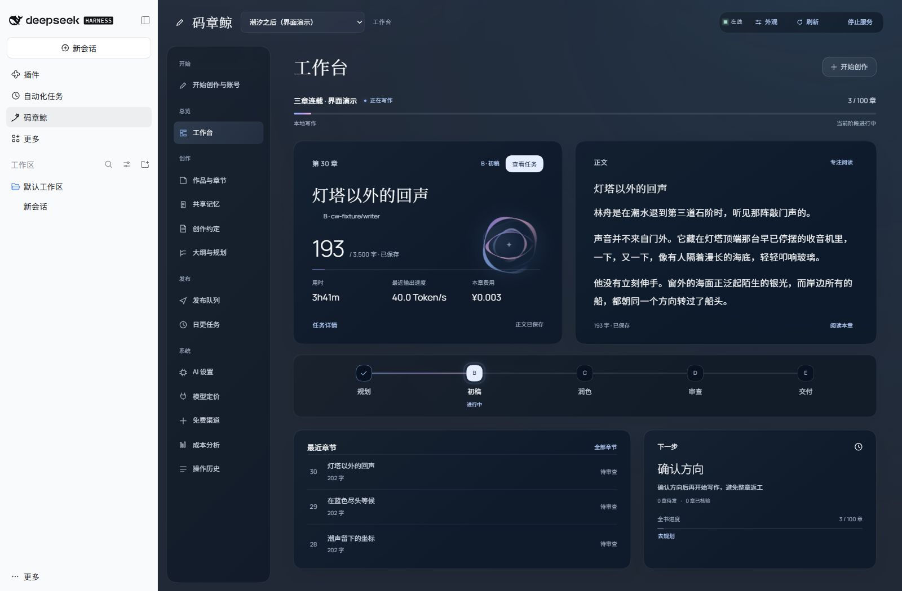
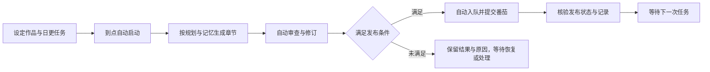
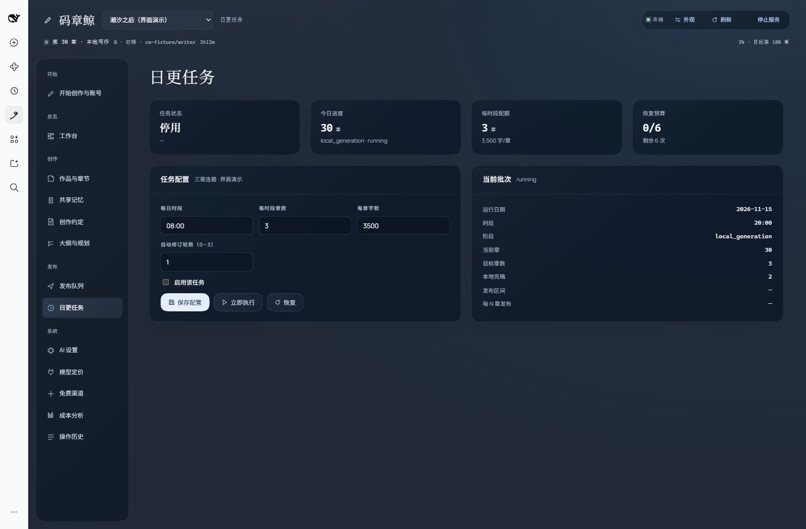
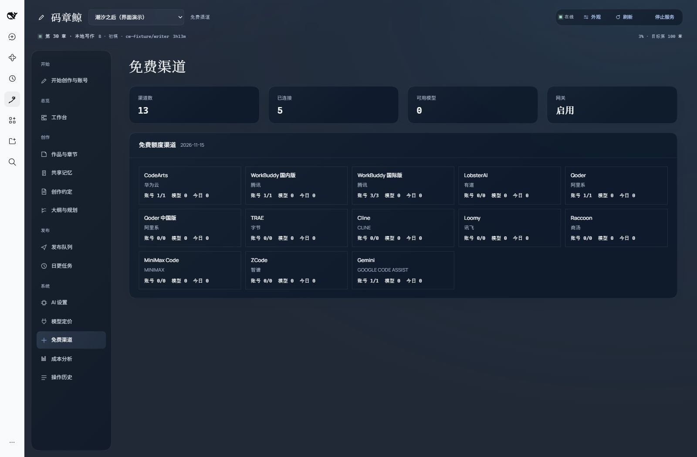
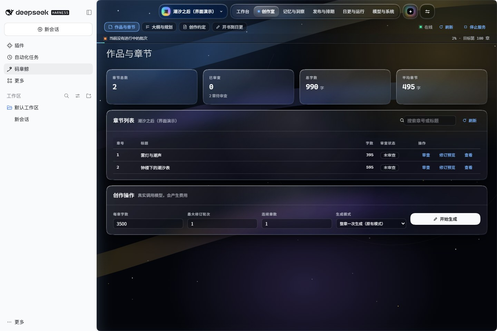
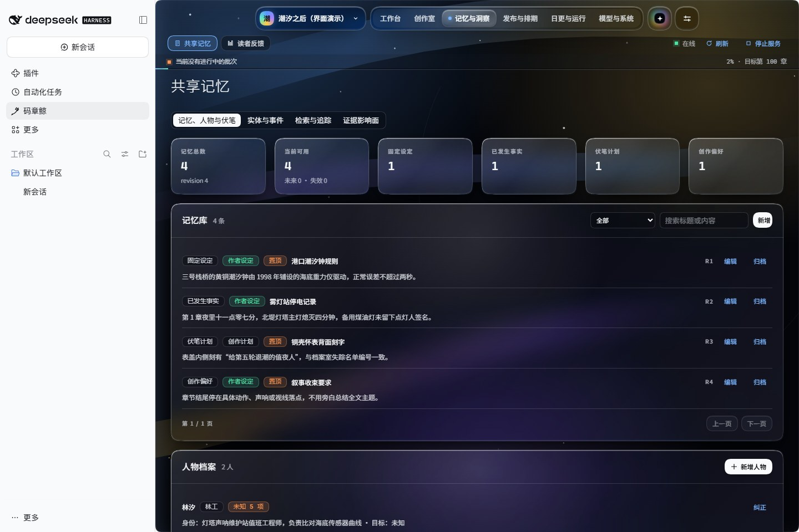
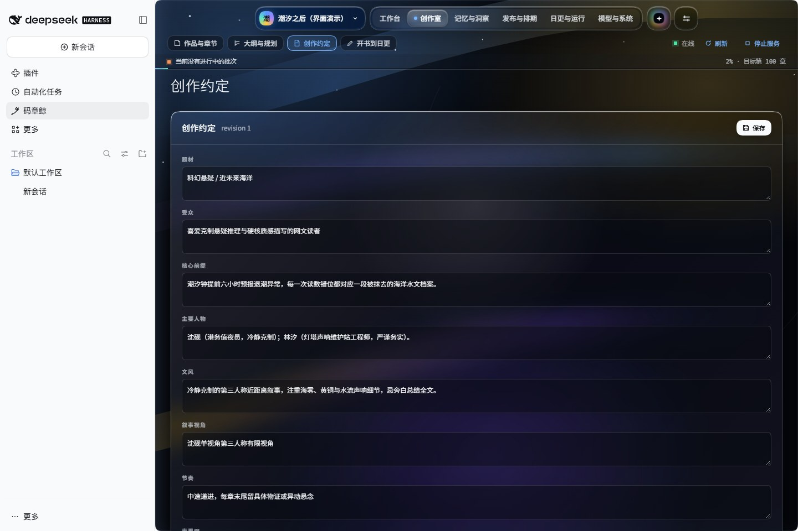

# 码章鲸 · 全自动小说写作与番茄发布

**0.7.5（GPL-3.0-only）：全方位用户体验优化——4 工作区顶栏与右上角任务中心、全任务进度条、多书日更去重、免费模型连接修复、首章死结破解与自动审查 2 次封顶转人工复核。**

码章鲸是运行在 DeepSeek Harness（DSH）里的无人值守小说工作台。连接模型、登录账号、设定任务后，由本机服务按计划完成章节写作、审查修订、发布与状态核验。你可以安排更新时间、每次章数和篇幅，在 Windows 上也可接入部分免费模型渠道。

**[npm 安装](https://www.npmjs.com/package/dsh-chapter-whale)** · **[下载完整安装包](https://github.com/thus-zhou/dsh-chapter-whale/releases/latest)** · **[从安装到自动连载](docs/quickstart.md)** · **[查看全部实机图](docs/screenshots.md)**

Windows 10/11 x64 · macOS（Apple Silicon / Intel）· Linux 常驻存稿归档 · DSH ≥ 0.2.2-rc.1 · GPL-3.0-only · 0.7.5

> Windows 上已使用独立 DSH 环境实装；macOS 插件首发安装与独立工作区 `.venv` 服务启动已在 GitHub Actions `macos-latest` 跑通，真实番茄及七猫页面、真实模型调用、物理机 Intel Mac 与外网 Webhook 仍待验。详见[验证记录](RELEASE_STATUS.md)。

**安装三步**：① 在 DSH 插件管理中添加 npm 包名 `dsh-chapter-whale`，或从[最新发布页](https://github.com/thus-zhou/dsh-chapter-whale/releases/latest)下载插件 `.tgz` → ② 安装后重启 DSH → ③ 侧栏打开「码章鲸」：创建作品，使用 DSH 已登录模型开始写作，需要发布时再登录番茄。

- **Windows x64**：首次启动在 `%LOCALAPPDATA%\ChapterWhale\workspace` 建独立工作区，自动下载并校验固定 Python 与 Chromium 运行环境。
- **macOS（arm64 / x64）**：需本机已安装 Python 3.11+（`brew install python@3.13` 或 Python 官网安装包），首次启动自动在 `~/Library/Application Support/ChapterWhale/workspace/.venv` 创建隔离环境并安装依赖；若需在 Mac 上启用浏览器发布，按[上手指南](docs/quickstart.md)安装 Chromium 一次即可。作品与账号数据留在独立工作区，卸载插件不会删除。



## 0.7.5 审计修复（开发分支）

- 修复 Windows 轻量包全新安装：运行时清单恢复为 v0.7.0 归档的原始字节哈希，`downloadRuntime` 不再因 182 项 CRLF 差异拒绝安装。
- 修复多书日更去重覆盖任务配置、handoff 章节候选污染共享记忆/人物档案、排期路径绕过人工复核门禁。
- 修复成本分析默认页崩溃、模型定价/自定义供应商/发布账号的 API 契约、批次恢复按钮与 13 个免费渠道兜底 ID。
- 补充 Node 代理版本校验、端口自愈的真实客户端更新、隐私授权显式化与网关密钥 owner 校验。

## 0.7.4 审计修复

- 实体提取恢复正常；存稿必须完成记忆、实体、RAG 与连续性同步后才算完成。补同步复用当前正文。
- 免费池等待、网络故障与配置问题分别记录；恢复继续原批次，保留 `max_revisions=0`。
- 场景模式读取手写 Markdown 细纲，缓存绑定创作约定、实际提示词、字数及场景划分。
- 修改正文后旧实体事件降为未知；修复流式响应提前结束、审查否定结论误判、并发指标导入覆盖、排期日期解析与不连续章号预检。
- 托管升级校验代码指纹与进程身份；活动任务保留，空闲实例安全重启并验证新版。

## 0.7.3 修复与改进

- **启停与重启恢复**：修复 Windows `.venv` 启动器包装进程导致的停止失败与残留进程树问题；同工作区过期 `run-description.json` 重启时自动刷新，不再误判为外来进程阻塞；`.install-lock` 支持死进程锁自动回收。
- **单模型与写作排期引擎**：解除 `provider_schema=1` 单模型配置在存稿中的误拦截；支持 `continuing` 周期恢复、`chapters_per_slot > 1` 排期展开与回环桥绕过系统代理；修复发布预检、记忆保存 422 与常驻服务退化空转。
- **前后端一致性**：补齐 `GET /api/jobs` 接口；修复 DSH 面板 GET 带请求体、状态覆盖、角色测试误报与独立 Web 端错误解包、修订上限和总览同步。
- **运行时基线**：Windows 轻量包复用经完整性校验的 `v0.7.0` 运行时，始终安装 `0.7.4` 包内后端代码；macOS 首启继续自动配置隔离 `.venv`。

## 0.7.2 修复与改进

- **多书隔离与版本校验**：修复新建和切换作品时串用旧书大纲、前提、章节或界面草稿的问题；大纲读取与更新按作品与版本校验，切书时自动清理上一作品表单状态并忽略过期请求。
- **新书上手引导**：DSH 原生面板与 Web 工作台均提供新书引导，按步骤提示配置模型、准备大纲并开始写作。
- **发布预检与排期恢复**：修复发布准备、预检与排队之间的目标一致性；重跑任务校验操作参数与作品，未过期的漏跑排期可在当日恢复。
- **跨平台运行时策略**：Windows 轻量包复用经完整性校验的 `v0.7.0` Python 与浏览器运行时，并始终安装 `0.7.2` 包内后端代码；macOS 首启继续基于 Python 3.11+ 自动创建隔离 `.venv`。

## 0.7.0 界面与核心更新

- **Liquid Glass v5 双端重构**：DSH 插件与独立本地控制台（`http://127.0.0.1:18765`）统一采用 3 岛悬浮胶囊顶栏（`工作台 / 创作室 / 记忆与洞察 / 发布与排期 / 日更与运行 / 模型与系统`）、全站内联 SVG 图标、星曜极光/墨玉暖金/冰霜极简三套主题，以及表面通透度、模糊度、折射色散和光带对比度 4 项实时光学滑块。
- **书卷正文直览与阅读设置**：工作台左主右辅，采用遮蔽磨砂护眼稿纸直览当前章节与 A–E 五阶段进度，支持衬线/无衬线字体切换、信息密度与减弱动画持久化。
- **排期缓冲与连续性能力**：集成番茄排期缓冲状态机（待实连确认前禁静默自动排期）、实体状态锁定、上下文检索追踪、风格预检与忽略词表、读者反馈观察卡（可采纳/撤销），以及七猫只读导出与 Linux/macOS 常驻存稿归档（均按契约标明待实机项）。
- **示例截图口径**：下方与[演示图集](docs/screenshots.md)全部图片均从 `0.7.0` 正式代码在 DSH `0.2.2-rc.3` 独立隔离环境中截取，不含任何真实账号或个人数据。

## 把每天要做的更新，交给一个任务

适合已经有故事想法，希望持续产出网文章节、维护连载的创作者。把题材、人物、文风和更新计划设好之后，码章鲸按同一套任务继续往下写，把生成、检查和提交发布接起来。

| 你想完成的事 | 码章鲸如何执行 |
| --- | --- |
| 每天按时更新 | 按任务设置的时间和时区触发，支持每天多个时段 |
| 自动完成一批章节 | 按每次章数、目标字数与已有规划推进写作 |
| 写完继续检查和修订 | 在任务流程中执行审查，并按设置尝试修订 |
| 合格章节自动提交番茄 | 校验作品、账号、来源与审查记录后，执行发布并核验状态 |
| 尽量利用已有模型资源 | 接入部分免费额度模型，以及支持的厂商账号渠道 |
| 随时知道任务做到哪里 | 查看当前章节、批次、进度、发布状态与操作历史 |

**首次配置完成并启用自动调度后，正常运行不需要逐章手动点击“生成”和“发布”。** 电脑与本地服务需要保持运行，模型可用、账号登录有效；验证码或授权失效时，由账号本人处理后继续。

## 一条自动执行的连载流程



工作台会保留执行状态、章节内容和发布记录。需要干预时，可以查看原因、调整设置、暂停任务或恢复符合条件的批次。

## 自己定时间、定章数、定篇幅

你可以为作品创建自己的日更计划。例如：每天 08:00 和 20:00 各执行一次，每次 1 章，目标每章 3,500 字，最多修订 2 轮。

| 任务设置 | 可以控制什么 |
| --- | --- |
| 作品、平台书名与账号 | 这项任务替哪部作品、哪个账号更新 |
| 每日时间与时区 | 何时启动；支持多个更新时间 |
| 每次章节数 | 每个时段推进多少章 |
| 每章目标字数 | 本次写作希望达到的篇幅 |
| 修订轮数 | 自动审查后允许继续修改的次数 |
| 启用、暂停、立即执行与恢复 | 自己控制自动任务的运行节奏 |



*0.7.0 独立测试环境，使用示例作品与停用的演示任务；自动调度关闭。*

## 直接使用 DSH 已登录的模型

打开码章鲸后，自动接入 DSH 中已登录或已配置的模型，并在尚未配置创作模型时使用 DSH 当前模型。无需重新填写账号密钥。在「AI 设置」中可切换通用模型、分别设置 A–E 分工；更换 DSH 登录后点击「使用 DSH 当前模型」刷新。

DSH 的登录凭据由宿主处理。写作时保持 DSH 运行，模型计费与额度沿用对应账号规则。已保存的独立接口和模型绑定会保留。

## 免费额度与其他厂商渠道

已有可用的厂商账号，可以通过支持的渠道授权，再把可用模型用于写作任务；已有 API 服务，也可以直接配置 OpenAI 兼容接口。

- **渠道集中查看**：在同一个页面查看账号渠道、模型与使用状态。
- **部分厂商登录**：按对应渠道提供的登录流程完成授权，扫码或验证码由本人操作。
- **免费额度模型**：选择已可用、已确认额度类型的模型，配置到写作流程或免费渠道池。
- **按需轮换**：免费渠道池支持选入模型和授权作品，按配置尝试可用连接。
- **付费备选自行决定**：需要时再配置自己的备选模型与费用策略。



画面展示可用渠道目录与未登录状态。实际支持的登录方式、可用模型、额度和授权要求，以对应渠道的当前返回为准。完整管理页的「AI 设置 → 免费额度接入」提供渠道服务与授权操作；侧栏「免费渠道」用于查看状态。

## 自动运行，也能看清每一步

### 工作台：看任务进度和发布结果

当前任务是否在运行、正在推进哪一章、批次是否结束、队列里还有多少内容，都能集中查看。已核验发布、未确认和归档待核会分别显示。


### 作品与章节：自动产出的内容仍然可以查看和调整

按章查看标题、字数与审查状态。需要时打开正文、重新审查或润色，把对内容的控制留在自己手里。



### 连载记忆：让后续写作带着已有设定往前走

共享记忆集中保存固定设定、已发生事实、伏笔与创作偏好。创作约定则保存题材、受众、人物和文风，作为自动写作的方向。

<table>
  <tr>
    <td width="50%"><br>随章节积累的长篇记忆</td>
    <td width="50%"><br>让自动写作遵循你的创作约定</td>
  </tr>
</table>

模型分工、审查策略、成本统计和操作历史也保留在工作台中，需要时再进一步调整。[查看新版完整界面 →](docs/screenshots.md)

> 图片来自 0.7.0 正式插件在 DSH `0.2.2-rc.3` 独立隔离环境中的界面，采用示例作品《潮汐之后（界面演示）》、停用演示任务与测试适配器。没有调用真实模型、登录发布账号或发布章节。

## 安装后，按这四步开始

### 1. 从 npm 安装，或使用完整发行包

**DSH 桌面版**：在应用内「插件」管理中添加包名 `dsh-chapter-whale`，安装完成后重启。桌面 profile 由应用管理，推荐直接使用应用内的安装入口。

**使用 `dsh web` 的用户**：在终端安装到自己的 web profile：

```powershell
dsh plugin --profile web add dsh-chapter-whale
```

安装后重启 `dsh web`，侧栏打开「码章鲸」。自定义 profile 请将 `web` 换成实际名称。npm 包提供插件与后端源码，Python 和浏览器会在首次启动时从 GitHub 自动下载，并核对固定大小与 SHA-256，不需要手动安装。

也可以先从 npm 下载压缩包：

```powershell
npm pack dsh-chapter-whale@latest
```

然后把生成的 `.tgz` 文件交给 DSH 插件管理安装。`npm pack` 只下载插件包，首次启动仍需要下载运行环境。

**通过 GitHub 安装**：在[发布页](https://github.com/thus-zhou/dsh-chapter-whale/releases/latest)选择轻量插件包或包含运行时的完整安装包。

在 DSH 插件管理中添加对应版本的下载包地址，安装完成后重启 DSH，从侧栏打开「码章鲸」，点击「开始使用码章鲸」。

```text
https://github.com/thus-zhou/dsh-chapter-whale/releases/download/v0.7.4/dsh-chapter-whale-0.7.4.tgz
```

`dsh-chapter-whale-0.7.4.tgz` 是跨平台轻量插件包（Windows 首次启动自动下载并校验 `v0.7.0` 固定运行时归档 `dsh-chapter-whale-runtime-win32-x64-0.7.0.tgz`，始终安装 `0.7.4` 包内后端代码；macOS 首次启动基于本机 Python 3.11+ 创建隔离 `.venv`）。已有相同运行时的工作区直接复用，不重复下载。

<details>
<summary>使用命令行安装</summary>

```powershell
dsh plugin --profile web add https://github.com/thus-zhou/dsh-chapter-whale/releases/download/v0.7.4/dsh-chapter-whale-0.7.4.tgz
```

这条命令面向 `dsh web`；桌面版请在应用内添加地址。也可以通过[自定义市场源](https://raw.githubusercontent.com/thus-zhou/dsh-chapter-whale/main/market/index.json)安装；首次启动按固定 buildId 和摘要核对运行时。插件版本与运行时版本分别记录。

</details>

#### 后续更新

桌面版请在插件管理中检查更新。使用命令行的 web profile：

```powershell
dsh plugin --profile web update dsh-chapter-whale
```

更新后重启对应的 DSH。若旧版宿主未完成升级，可显式安装 `dsh-chapter-whale@latest`。更新只替换插件及随版本提供的代码，作品、账号和任务保存在独立工作区；更新前建议备份该目录。首次环境已准备好且运行时版本未变时，不会重复下载。

### 2. 创建作品，连接模型和账号

在「开始创作与账号」填写书名与故事想法，再连接自己的模型（`0.7.2` 新书上手引导会依次提示配置模型、准备大纲并开始写作，切书时自动隔离各作品草稿与大纲）。需要使用厂商账号渠道时，按完整管理页的授权流程操作。准备发布时，登录自己的番茄作家账号，并在平台创建对应作品。

### 3. 建立日更任务

插件启动后，打开本机完整管理页：

```text
http://127.0.0.1:18765
```

进入「日更任务 → 创建日更任务」，选择作品与账号，设置时间、每次章数、目标字数和修订轮数。侧栏面板可以查看和调整已有任务；完整管理页提供新建任务与全局调度开关。

### 4. 开启自动调度，让任务按计划执行

启用这项任务，再打开「自动调度」。建议先用小章数跑通自己的模型与发布账号，再逐步调整更新量。此后保持本机服务运行，在工作台查看自动执行结果即可。

**[查看完整上手教程：从首次安装到无人值守连载 →](docs/quickstart.md)**

## 常见问题

**可以完全无人值守吗？**

可以在首次配置、模型连接和账号授权完成后，按已启用的任务自动写作、审查、修订并提交发布，正常执行不需要逐章点击。电脑或服务停止、额度耗尽、验证码、平台登录失效等情况需要恢复相应条件。

**免费模型在哪里登录？**

先启动码章鲸，打开本机完整管理页，进入「AI 设置 → 免费额度接入」，启动独立渠道服务，再按支持渠道的页面操作。各厂商的账号、授权和额度规则分别生效。

**为什么建好任务还没有自动运行？**

同时检查任务是否启用、全局「自动调度」是否开启、设定时区和时间是否正确，以及模型与发布账号是否可用。任务状态和操作历史会保留进一步的原因。

**一定要配置多个模型吗？**

不需要从复杂分工开始。先用自己的可用模型跑通流程，再按需要调整各阶段的模型与审查策略。

**作品和账号数据存在哪里？**

Windows 默认保存在 `%LOCALAPPDATA%\ChapterWhale\workspace`，macOS 默认保存在 `~/Library/Application Support/ChapterWhale/workspace`，均与插件安装目录分开。更新或卸载插件不会主动删除这些数据；请自行备份工作区。默认后端地址为 `127.0.0.1:18765`。

**支持什么系统和平台？**

当前 `0.7.4` 插件正式声明支持 Windows 10/11 x64 与 macOS（Apple Silicon `arm64` / Intel `x86_64`），要求 DSH ≥ 0.2.2-rc.1；发布适配番茄小说（审核与发布规则仍由平台决定）。macOS 上基于 Windows DPAPI 的免费额度独立服务通道暂不开放（建议直接复用 DSH 已登录模型或自配 API Key）。Linux / macOS 无头常驻存稿见 [deploy/linux](deploy/linux/README.md) 与 [deploy/macos](deploy/macos/README.md)。

## 许可证与第三方组件

- 插件自有代码采用 MIT（[LICENSE](LICENSE)）；内嵌的写作器 [webnovel-writer](https://github.com/981029l/webnovel-writer) 采用 **GPL-3.0-only**（上游只声明 GPL v3，无 “or later”）。
- 写作器由后端在同一进程内导入调用，因此**后端与写作器组成的整体按 GPLv3 组合分发**；插件外壳、字体与运行时依赖仍按各自许可证分发。完整许可证文本见 [LICENSES/](LICENSES/)。
- 对应源码、上游基线、构建脚本（`scripts/build-runtime.py`、`scripts/pack-bundle.py`）与可复制的重建命令见 [docs/license-decision.md](docs/license-decision.md)；逐组件版本、来源与证据见 [docs/license-inventory.md](docs/license-inventory.md) 和 [THIRD_PARTY_NOTICES.md](THIRD_PARTY_NOTICES.md)。

## 文档与项目状态

- [从安装到自动连载](docs/quickstart.md)：模型、厂商登录、番茄账号、任务和自动调度。
- [九张 0.7.0 实机截图](docs/screenshots.md)：各页面的用途及独立演示环境说明。
- [0.7.0 复测与验收记录](docs/retest-0.7.0.md) 与 [验证边界总览](RELEASE_STATUS.md)：单测、`check-release`、本机 DSH 实装与待实机项清单。
- [插件市场收录进度](market/SUBMISSION.md)：已提交的申请与已核对的自动收录记录。
- [反馈问题](https://github.com/thus-zhou/dsh-chapter-whale/issues)：附上版本、错误提示和脱敏截图，方便定位。

包名为 `dsh-chapter-whale`，当前分支版本为 `0.7.5`（尚未发布；公开下载仍为 `0.7.4`，许可证 `GPL-3.0-only`）。项目使用 AI 辅助开发，组件与归因声明见 [THIRD_PARTY_NOTICES.md](THIRD_PARTY_NOTICES.md) 与 [`LICENSES/`](LICENSES/)。

**[查看 0.7.4 发布状态与验证边界（0.7.5 待验收） →](RELEASE_STATUS.md)**
