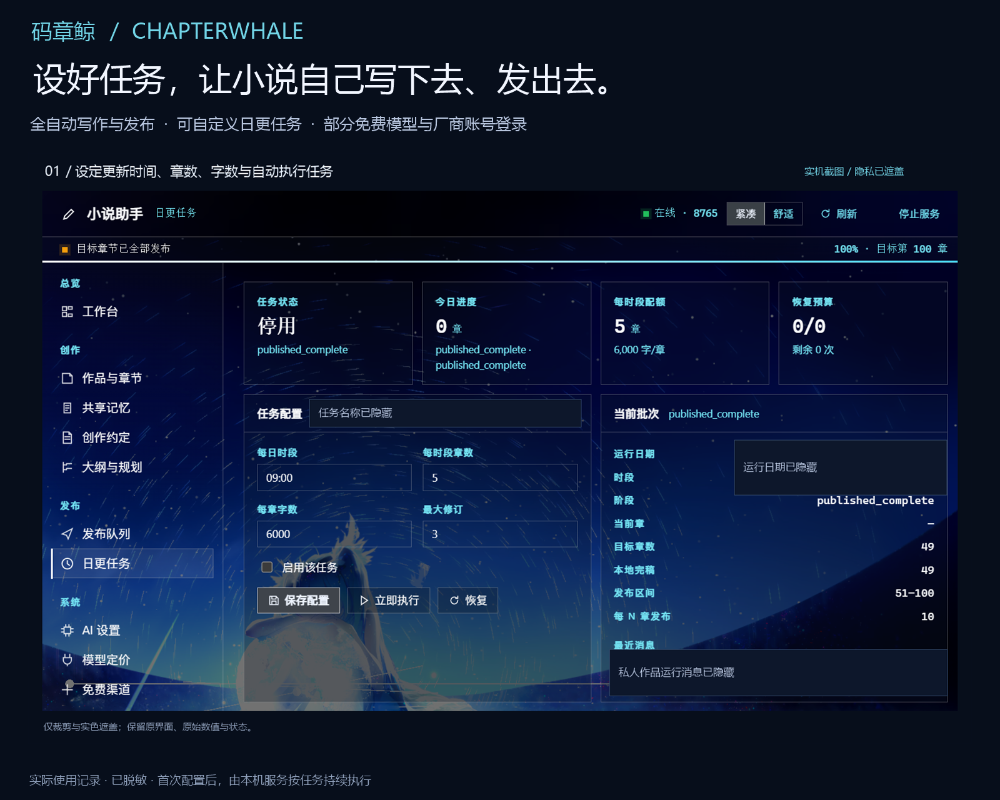
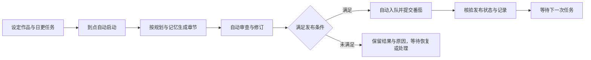
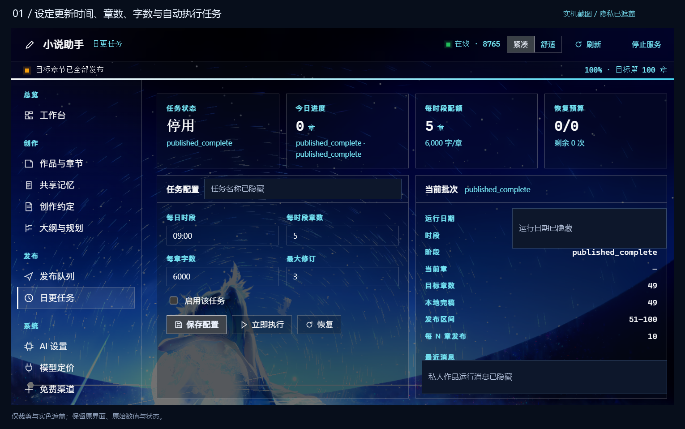
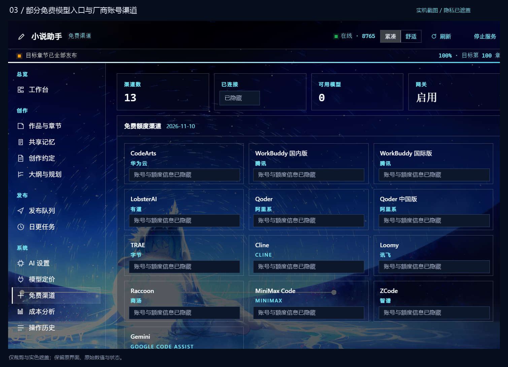
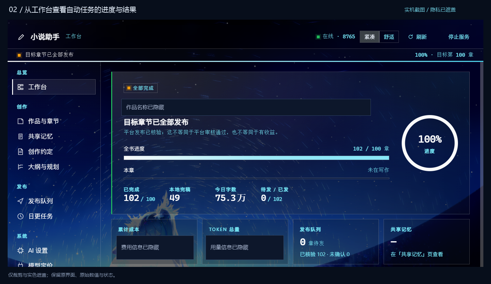
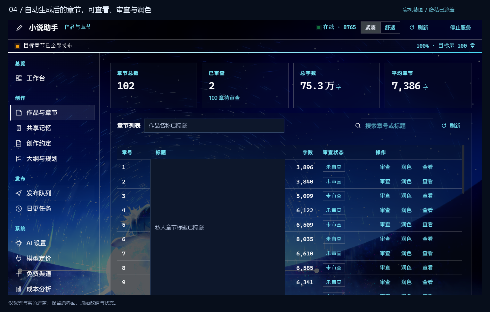
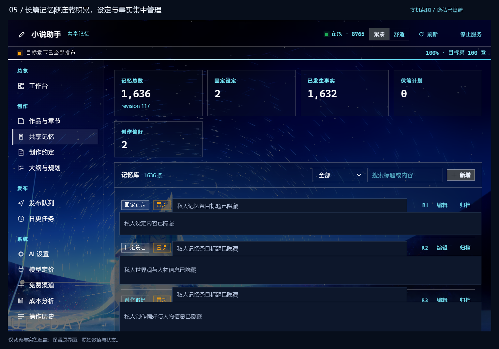
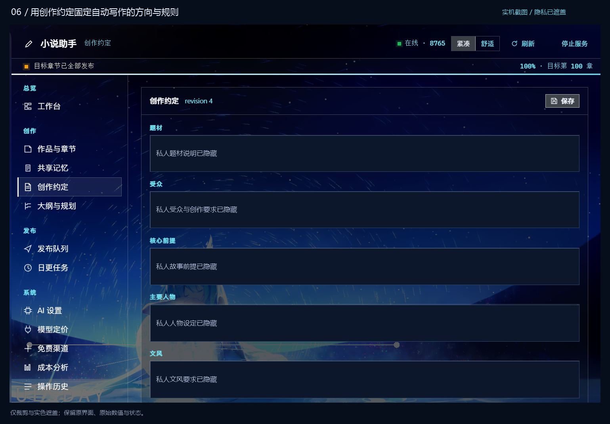

# 码章鲸 · 全自动小说写作与番茄发布

**设好任务，让小说自己写下去、发出去。**

码章鲸是运行在 DeepSeek Harness（DSH）里的无人值守小说工作台。连接模型、登录账号、设定任务后，由本机服务按计划完成章节写作、审查修订、发布与状态核验。你可以安排更新时间、每次章数和篇幅，也可以接入部分免费模型，通过支持的厂商账号渠道完成授权。

**[npm 安装](https://www.npmjs.com/package/dsh-chapter-whale)** · **[下载完整安装包](https://github.com/thus-zhou/dsh-chapter-whale/releases/latest)** · **[从安装到自动连载](docs/quickstart.md)** · **[查看全部实机图](docs/screenshots.md)**

Windows 10/11 x64 · DSH ≥ 0.2.2-rc.1 · 内置 Python 与浏览器 · 首个公开版本

**安装三步**：① 在 DSH 插件管理中添加 npm 包名 `dsh-chapter-whale`，或从[最新发布页](https://github.com/thus-zhou/dsh-chapter-whale/releases/latest)下载完整 `.tgz` → ② 安装后重启 DSH → ③ 侧栏打开「码章鲸」：建作品、配模型，需要发布时再登录番茄作家后台。

首次启动会在 `%LOCALAPPDATA%\ChapterWhale\workspace` 建独立工作区并准备运行时，约占 400MB 磁盘。npm 包首次启动自动下载并校验约 278 MB 的固定版本环境；GitHub 完整包已包含环境。作品与账号数据留在独立工作区，卸载插件不会删除。完整包摘要见发布页的 `SHA256SUMS.txt`。仅支持 Windows x64。



## 把每天要做的更新，交给一个任务

适合已经有故事想法，希望持续产出网文章节、维护连载的创作者。把题材、人物、文风和更新计划设好之后，码章鲸按同一套任务继续往下写，把生成、检查和提交发布接起来。

| 你想完成的事 | 码章鲸如何执行 |
| --- | --- |
| 每天按时更新 | 按任务设置的时间和时区触发，支持每天多个时段 |
| 自动完成一批章节 | 按每次章数、目标字数与已有规划推进写作 |
| 写完继续检查和修订 | 在任务流程中执行审查，并按设置尝试修订 |
| 合格章节自动提交番茄 | 校验作品、账号、来源与审查记录后，执行发布并核验状态 |
| 尽量利用已有模型资源 | 接入部分免费额度模型，以及支持的厂商账号渠道 |
| 随时知道任务做到哪里 | 查看当前章节、批次、进度、发布状态与操作历史 |

**首次配置完成并启用自动调度后，正常运行不需要逐章手动点击“生成”和“发布”。** 电脑与本地服务需要保持运行，模型可用、账号登录有效；验证码或授权失效时，由账号本人处理后继续。

## 一条自动执行的连载流程



工作台会保留执行状态、章节内容和发布记录。需要干预时，可以查看原因、调整设置、暂停任务或恢复符合条件的批次。

## 自己定时间、定章数、定篇幅

你可以为作品创建自己的日更计划。例如：每天 08:00 和 20:00 各执行一次，每次 1 章，目标每章 3,500 字，最多修订 2 轮。

| 任务设置 | 可以控制什么 |
| --- | --- |
| 作品、平台书名与账号 | 这项任务替哪部作品、哪个账号更新 |
| 每日时间与时区 | 何时启动；支持多个更新时间 |
| 每次章节数 | 每个时段推进多少章 |
| 每章目标字数 | 本次写作希望达到的篇幅 |
| 修订轮数 | 自动审查后允许继续修改的次数 |
| 启用、暂停、立即执行与恢复 | 自己控制自动任务的运行节奏 |



*实机记录：截图时任务已经结束并停用，保留当时的真实状态。新建任务和自动调度开关位于随包提供的完整管理页，具体步骤见[上手指南](docs/quickstart.md#4-创建自己的日更任务)。*

## 已接入部分免费模型，也支持部分厂商账号登录

已有可用的厂商账号，可以通过支持的渠道授权，再把可用模型用于写作任务；已有 API 服务，也可以直接配置 OpenAI 兼容接口。

- **渠道集中查看**：在同一个页面查看账号渠道、模型与使用状态。
- **部分厂商登录**：按对应渠道提供的登录流程完成授权，扫码或验证码由本人操作。
- **免费额度模型**：选择已可用、已确认额度类型的模型，配置到写作流程或免费渠道池。
- **按需轮换**：免费渠道池支持选入模型和授权作品，按配置尝试可用连接。
- **付费备选自行决定**：需要时再配置自己的备选模型与费用策略。



画面展示 CodeArts、WorkBuddy、Qoder、TRAE 等渠道入口。实际支持的登录方式、可用模型、额度和授权要求，以对应渠道的当前返回为准。完整管理页的「AI 设置 → 免费额度接入」提供渠道服务与授权操作；侧栏「免费渠道」用于查看状态。

## 自动运行，也能看清每一步

### 工作台：看任务进度和发布结果

当前任务是否在运行、正在推进哪一章、批次是否结束、队列里还有多少内容，都能集中查看。已核验发布、未确认和归档待核会分别显示。



### 作品与章节：自动产出的内容仍然可以查看和调整

按章查看标题、字数与审查状态。需要时打开正文、重新审查或润色，把对内容的控制留在自己手里。



### 连载记忆：让后续写作带着已有设定往前走

共享记忆集中保存固定设定、已发生事实、伏笔与创作偏好。创作约定则保存题材、受众、人物和文风，作为自动写作的方向。

<table>
  <tr>
    <td width="50%"><br>随章节积累的长篇记忆</td>
    <td width="50%"><br>让自动写作遵循你的创作约定</td>
  </tr>
</table>

模型分工、审查策略、成本统计和操作历史也保留在工作台中，需要时再进一步调整。[查看七张完整实机图 →](docs/screenshots.md)

> 图片来自作者提供的个人使用环境，已裁剪并以不透明区域遮盖作品信息、账号情况、本机路径及个人配置。未使用 AI 重绘界面或更改任务状态。部分画面沿用旧名称「小说助手」；背景是用户的个性化环境，公开版名称为「码章鲸」，界面随 DSH 主题显示。图中规模和数量是当时的项目记录。

## 安装后，按这四步开始

### 1. 从 npm 安装，或使用完整发行包

**DSH 桌面版**：在应用内「插件」管理中添加包名 `dsh-chapter-whale`，安装完成后重启。桌面 profile 由应用管理，推荐直接使用应用内的安装入口。

**使用 `dsh web` 的用户**：在终端安装到自己的 web profile：

```powershell
dsh plugin --profile web add dsh-chapter-whale
```

安装后重启 `dsh web`，侧栏打开「码章鲸」。自定义 profile 请将 `web` 换成实际名称。npm 包提供插件与后端源码，Python 和浏览器会在首次启动时从 GitHub 自动下载，并核对固定大小与 SHA-256，不需要手动安装。

也可以先从 npm 下载压缩包：

```powershell
npm pack dsh-chapter-whale@latest
```

然后把生成的 `.tgz` 文件交给 DSH 插件管理安装。`npm pack` 只下载插件包，首次启动仍需要下载运行环境。

**希望一次下载完整环境**：使用下方 GitHub 完整发行包。

在 DSH 插件管理中添加下方地址，安装完成后重启 DSH，从侧栏打开「码章鲸」，点击「开始使用码章鲸」。

```text
https://github.com/thus-zhou/dsh-chapter-whale/releases/download/v0.2.0-rc.1/dsh-chapter-whale-0.2.0-rc.1.tgz
```

完整包约 **278 MB（265 MiB）**，包含独立 Python、写作后端和 Chromium，无需自己安装 Python、下载后端或填写项目目录。

<details>
<summary>使用命令行安装</summary>

```powershell
dsh plugin --profile web add https://github.com/thus-zhou/dsh-chapter-whale/releases/download/v0.2.0-rc.1/dsh-chapter-whale-0.2.0-rc.1.tgz
```

这条命令面向 `dsh web`；桌面版请在应用内添加地址。也可以通过[自定义市场源](https://raw.githubusercontent.com/thus-zhou/dsh-chapter-whale/main/market/index.json)安装；源码安装的首次启动会自动下载并校验同版本环境。

</details>

#### 后续更新

桌面版请在插件管理中检查更新。使用命令行的 web profile：

```powershell
dsh plugin --profile web update dsh-chapter-whale
```

更新后重启对应的 DSH。若旧版宿主未完成升级，可显式安装 `dsh-chapter-whale@latest`。更新只替换插件及随版本提供的代码，作品、账号和任务保存在独立工作区；更新前建议备份该目录。首次环境已准备好且运行时版本未变时，不会重复下载。

### 2. 创建作品，连接模型和账号

在「开始创作与账号」填写书名与故事想法，再连接自己的模型。需要使用厂商账号渠道时，按完整管理页的授权流程操作。准备发布时，登录自己的番茄作家账号，并在平台创建对应作品。

### 3. 建立日更任务

插件启动后，打开本机完整管理页：

```text
http://127.0.0.1:18765
```

进入「日更任务 → 创建日更任务」，选择作品与账号，设置时间、每次章数、目标字数和修订轮数。侧栏面板可以查看和调整已有任务；完整管理页提供新建任务与全局调度开关。

### 4. 开启自动调度，让任务按计划执行

启用这项任务，再打开「自动调度」。建议先用小章数跑通自己的模型与发布账号，再逐步调整更新量。此后保持本机服务运行，在工作台查看自动执行结果即可。

**[查看完整上手教程：从首次安装到无人值守连载 →](docs/quickstart.md)**

## 常见问题

**可以完全无人值守吗？**

可以在首次配置、模型连接和账号授权完成后，按已启用的任务自动写作、审查、修订并提交发布，正常执行不需要逐章点击。电脑或服务停止、额度耗尽、验证码、平台登录失效等情况需要恢复相应条件。

**免费模型在哪里登录？**

先启动码章鲸，打开本机完整管理页，进入「AI 设置 → 免费额度接入」，启动独立渠道服务，再按支持渠道的页面操作。各厂商的账号、授权和额度规则分别生效。

**为什么建好任务还没有自动运行？**

同时检查任务是否启用、全局「自动调度」是否开启、设定时区和时间是否正确，以及模型与发布账号是否可用。任务状态和操作历史会保留进一步的原因。

**一定要配置多个模型吗？**

不需要从复杂分工开始。先用自己的可用模型跑通流程，再按需要调整各阶段的模型与审查策略。

**作品和账号数据存在哪里？**

默认保存在本机 `%LOCALAPPDATA%\ChapterWhale\workspace`，与插件安装目录分开。更新或卸载插件不会主动删除这些数据；请自行备份工作区。默认后端地址为 `127.0.0.1:18765`。

**支持什么系统和平台？**

当前公开版支持 Windows 10/11 x64、DSH ≥ 0.2.2-rc.1，发布适配番茄小说。平台审核与发布规则仍由平台决定。ARM64、macOS 和 Linux 尚未验收。

## 文档与项目状态

- [从安装到自动连载](docs/quickstart.md)：模型、厂商登录、番茄账号、任务和自动调度。
- [七张实机截图](docs/screenshots.md)：各页面的用途及脱敏说明。
- [当前版本验证记录](RELEASE_STATUS.md)：47 项插件测试、148 项后端测试、全新安装与独立 DSH 加载验证。
- [插件市场收录进度](market/SUBMISSION.md)：已提交的申请与已核对的自动收录记录。
- [反馈问题](https://github.com/thus-zhou/dsh-chapter-whale/issues)：附上版本、错误提示和脱敏截图，方便定位。

包名为 `dsh-chapter-whale`，当前发行版本为 `0.2.0-rc.1`（首个公开版本）。项目使用 AI 辅助开发，组件声明见 [THIRD_PARTY_NOTICES.md](THIRD_PARTY_NOTICES.md)。

**[下载码章鲸，设置你的第一项自动更新任务 →](https://github.com/thus-zhou/dsh-chapter-whale/releases/tag/v0.2.0-rc.1)**
