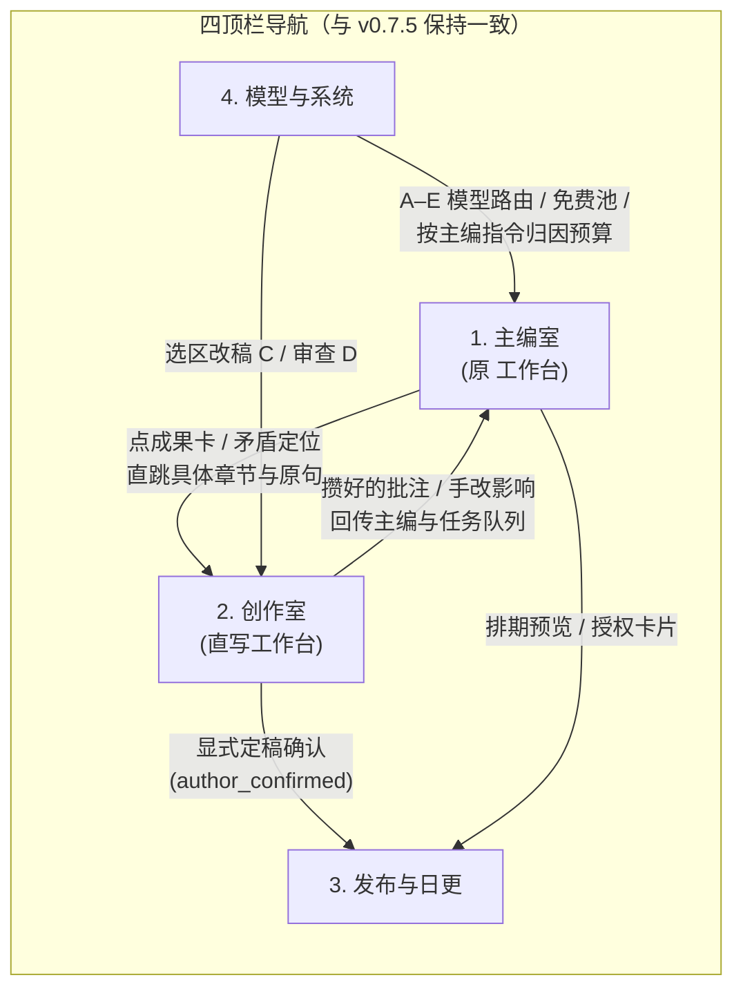

# 码章鲸（dsh-chapter-whale）v0.8 – v0.9 升级方案总纲与产品交互设计

- **基线版本**：`v0.7.5`（仓库 `O:\小说助手\release\chapter-whale`）
- **方案日期**：2026-11-26
- **适用范围**：DSH 桌面插件前端（`client.js` / `assets/atelier-native.css`）、DSH 宿主桥（`index.js`）、独立本地 Web 控制台（`backend/manager/static/`）及 Python 后端（`backend/manager/`、`backend/integration/`、`backend/fanqie_auto_publish/`）
- **文档套件索引（完整十卷本：`00`–`09`）**：
  1. **本文**：`00_总纲与产品交互设计.md` — 愿景、导航映射、双空间自适应交互规范、前端编辑器选型与双端共享策略
  2. `01_自由编辑_版本契约与多文件大纲设计.md` — 草稿世代（防 ABA）/独立版本身份/显式定稿、BOM-LF 规范化、多文件大纲墓碑与权威分界、受限删除与手改记忆同步
  3. `02_三层批注_选区锚点与三方合并设计.md` — 选区/单章/全书三层批注、XML 定界抗弱模型、Patch Ledger 中间基线合并、局部耦合合批与未写细纲/人物卡同步扫描
  4. `03_两层并发引擎_共享文件合并与主编室编排设计.md` — 无锁并行 + 分域短锁 RMW、`lease_id` 租约与唯一准入、`hold_amendment_id` 改令控制、三级优先级留交互槽、跨进程 SSE 与滑动窗口
  5. `04_四期施工路线_接口总表与端到端验收手册.md` — 全量 API / `WRITE_ROUTES` 变更总表、务实四期里程碑（`v0.8.0-alpha` → `v0.9.5`，止步 0.9 不好高骛远）与双轨端到端验收手册
  6. `05_统一数据事务_备份恢复与安全契约.md`（P0 · **跨文档单一权威契约源**）— `chapter_uid` / `version_id` / `version_fingerprint` / `idempotency_keys` 权威定义、`.webnovel/workbench.sqlite3` 统一本地库、跨文件事务日志（`transaction_journal.py`）、一致性备份/三档降级与四主体权限防注入
  7. `06_长篇小说世界状态_记忆与检索引擎.md`（P1）— 分期落地：三期交付确定性核心（Python 2-gram + FTS5 混合检索、手动核心卡、故事时间轴与上下文透明清单）；四期交付 AI 增量提取与防脏数据护栏
  8. `07_写作质量_作者风格与创作反馈设计.md`（P1）— 一期交付本地零成本「快速体检」，四期交付作品质量体检仪表盘与角色 D 6 维融合审查（`MAX_AUTO_REVIEWS=2`）；风格学习与剧情试验场明确延后至 v0.9 之后
  9. `08_模型资源调度_费用控制与Agent权限.md`（P0）— 统一 `ModelGateway`（2A 起接管全部调用）、模型能力矩阵与隐私标签隔离（`local_offline | private_api | free_pool_shared`）、三级主编路由、五态预算状态机与三级暂停控制
  10. `09_长篇压力测试_故障注入与产品验收.md`（P1）— `v0.8–v0.9.5` 验证体系：2A 起运行 Hypothesis 随机合并与模型畸形输出测试、10–1000 章压测与 8 类崩溃注入、核心长篇质量评测（外部 MCP 与 3000 章长测不纳入 0.9 范围）

---

## 1. 升级背景与核心目标

`v0.7.5` 完成了稳定性止血、免费池修复、4 顶栏收敛和 2 次自动审查封顶，但作者在实际写书时仍被四大结构性体验瓶颈卡住：

| 痛点编号 | v0.7.5 现状问题 | 源码级根因 | 升级后目标体验 |
| --- | --- | --- | --- |
| **P1 自由改原文** | 章节只能在弹窗 `<pre>` 里只读查看；AI 生成细纲后大纲目录变多文件而无法保存 | 无 `PUT /chapters/{ch}` 写接口；`ChapterModal` 为只读；`app.py:2084` 限制 `len(files) <= 1` | 点开章节光标直接落入稿纸，支持实时草稿、正式版本、一键回滚与多文件大纲自由编辑 |
| **P2 批注驱动改稿** | 只能盲跑固定提示词润色，不能划选句子/段落提要求，也不能跨章改设定 | `polish`/`revision` 无指令入参；`revision_plan.locate` 不支持重复句与跨段选区 | 支持**选区 / 单章 / 全书**三层批注、攒批注冲突检测、原处红绿逐条采纳与同段 A/B 对照 |
| **P3 伪串行卡死** | 审第 3 章和改第 8 章互相 409；AI 改稿时作者无法同时写；学样本和写章互相堵死 | `app.py` 9 类接口共用 `identity = project:{id}`；`studio.py` 跨 LLM 长 IO 持有全书 `writer.lock` | **计算层无锁并行 + 提交层分域短锁合并**；AI 改结尾时作者照常改开头；有依赖任务明确等待并自动续跑 |
| **P4 AI 参与感弱** | A–E 五角色藏在按钮背后，只能表单点点点，无法一句话统筹或随时改主意 | `creative/chat` 仅改表单且禁调工具；缺少主 Agent 编排器与实时事件流 | 升级工作台为**主编室**：一句话开书/规划/写章/改稿，展开群聊看各角色按成果汇报、随时 `@` 派活与中途改令 |

---

## 2. 顶层信息架构：导航零膨胀，两个相通的创作空间

沿用 v0.7.5 已确立的 **4 个顶栏工作区**（`HUBS`），不增加第 5 个顶栏入口，而是重构前两大工作区的职责定位，使两者共享同一套底层作品数据与实时事件总线：



### 2.1 顶栏路由兼容表
保留 `client.js` 中原有兼容跳转逻辑（`flow`、`setup`、`brief`、`free`、`providers`、`operations`），仅调整主视觉标签与默认落地页：
- `dashboard` → 展示标签升级为 **「主编室」**（兼容旧路由名 `dashboard`，无破坏性变更）；
- `chapters` → 升级为 **「创作室 · 直写工作台」**，将原 `outline`（大纲与规划）、`memory`（记忆与人物）、`readers`（读者观察）收拢为创作室子视图或右侧抽屉快捷入口，不再强迫作者频繁整页跳转。

---

## 3. 空间一：「主编室」产品与交互规范

### 3.1 页面布局（克制默认态 + 按需展开群聊 + 零作品开书态）
为避免一进页面就被复杂多列信息淹没，主编室默认遵循 **「三要素聚焦」**，且**在首装零作品状态下开箱即用**：

0. **零作品首屏态（尚未建书的第一句话入口）**：
   - 当用户本地尚无任何作品时，主编室不强制弹窗填表建书，直接开放主编输入框（后端创建临时开书会话 `prebook_{uuid}`）；
   - 作者直接输入第一句话（如“开一本县城悬疑小说……”），主编调用建书工具落盘新书后，服务端在单事务内将本次开书指令、原对话消息与任务无缝绑定至新书 `project_id`，前端静默切换上下文继续推进，**不丢任何开书对话**。
1. **主画布（左/中主区域，占 68% 宽）—— 与主编对话区**：
   - 顶部轻量作品态势条：当前书名、章节数/总字数、已启用模型模式（单模型/A–E 分工）、本次会话累计额度（单价未知明确显示「费用未知」）。
   - 消息流：作者自然语言指令 + 主编回复 + **结构化富卡片**（执行蓝图卡、成果卡、影响范围确认卡、费用预算提醒卡、发布授权卡）。
   - 底部统一输入区：
     - 支持直接自然语言对话；
     - 输入 `@` 呼出角色快捷补全：`@主编`、`@策划`、`@主笔`、`@精修`、`@审稿`、`@运营`；
     - 附带轻量上下文胶囊（如「附带当前章节」「附带第 1–3 章」「仅给提案 / 自动执行」）。
2. **右侧紧凑侧栏（占 32% 宽，可折叠）—— 「进行中 & 待你决定」双抽屉**：
   - **上半区「待你决定」**：集中挂起所有需要作者拍板的卡片（A/B 写法二选一、矛盾批注裁决、全书批注范围确认、中途改令影响确认、超预算续跑、对外发布授权）。清零时自动收折。
   - **下半区「当前工作」**：展示正在并行运行的任务及其清晰状态——**谁派的、依据哪份稿、正在等什么（如 `等待第 8 章结尾定稿`）、实时进度条、一键取消与可折叠「执行诊断详情」**（展开可查看当前角色/模型、重试次数、排队原因与脱敏错误，默认折叠不干扰视线），顶部提供**细粒度暂停控制**（单任务暂停 / 本书自动任务暂停 / 全局 AI 暂停）。
3. **可展开的「编辑部群聊」抽屉/分栏视图**：
   - 主编室右上角提供「展开编辑部群聊（N 条新汇报）」开关；展开后可浏览各角色协作时间线，并在群聊内直接回复某条汇报或 `@` 指定角色。
   - **反刷屏铁律**：
     - 普通心跳、百分比进度只更新任务卡，**绝不往群聊发水话**；
     - 角色只在三类时刻发群聊消息：**① 产出了可读成果（人物卡/大纲/正文/修订候选）② 发现了具体设定或逻辑矛盾（带原文引用与前文依据）③ 需要作者拍板**；
     - **每一条“已完成”消息都必须绑定真实成果链接**，点击即跳到创作室对应文档或原句。

### 3.2 主编自主度档位（由自然语言自动识别，也支持手动切换）

| 自主档位 | 触发话术示例 | 执行边界 |
| --- | --- | --- |
| **提案模式 (`propose`)** | “先给我三个方向 / 聊聊第二卷怎么转折” | 仅产出方案卡与对比，不写正文、不改大纲 |
| **步进确认 (`step_confirm`)** | “先出前十章细纲，我看了没问题再写” | 每完成一个里程碑（大纲/人物/单章）暂停呈递成果卡，作者点「继续」后接力 |
| **连跑模式 (`auto_chain`)** | “你挑一个最合适的，直接搭人物、前十章细纲并试写前三章” | 在既有预算上限内自动按依赖图连跑：建书 → 人物/细纲 → 写章 → 审稿体检；**仍受高风险动作强确认保护** |
| **批改试跑 (`dry_run_first`)** | “把全书前半段改成第一人称 / 从第六章起女主用化名” | 强制先扫描影响范围、展示预计调用量，默认提供**「先试改 1 章」**按钮，作者确认效果后再批量执行 |

### 3.3 高风险动作强确认红线
无论作者处于哪一档自主度，以下 4 类操作**必须**弹出确认卡片并经作者显式点击后才能落盘或提交：
1. **对外真实发布 / 平台定时排期提交**（同时沿用 `reconcile` 核对机制）；
2. **覆盖或批量改写超过 1 章的已有正式正文**；
3. **重置或大幅推翻已定稿的总纲/人物主设**；
4. **单次指令预估费用超过单次预警阈值，或命中已有预算上限后的续跑放行**。

---

## 4. 空间二：「创作室 · 直写工作台」产品与交互规范

### 4.1 自适应工作空间布局（桌面三栏 / 全屏稿纸 / 移动端底栏）
为兼容桌面大屏、DSH 窄侧栏以及平板/手机（`390×844`）访问，创作室支持三种自适应模式与手动拖拽栏宽：
- **桌面创作态（`>= 1100px`）**：左目录（可折叠）+ 中央弹性稿纸 + 右侧按需工具栏；
- **全屏沉浸稿纸态**：一键隐藏两侧栏专注码字，支持 `Ctrl+K` 快捷命令面板与全书搜索跳转；
- **窄屏 / 触屏态（`< 768px`）**：目录收入顶部抽屉、批注/Diff 收入底部滑出抽屉；**触屏长按划选默认把操作收至底部固定工具条**，彻底避开 iOS/Android 系统原生复制浮窗遮挡。

```text
+--------------------+------------------------------------------+---------------------------+
|  左侧导航栏 (240px) |             中央直写稿纸区 (弹性主区)      |   右侧按需工具栏 (340px)    |
|  [筛选: 全部/未定稿 |  [面包屑] 第 1 章 · 雨夜测绘图   [草稿已保存] |  Tab1: 批注 (选区/本章)    |
|   待采纳/冲突/待发] |  [状态胶囊] 3,240字 | 线上v3·本地v4未定稿  |  Tab2: AI 候选与合并       |
|  [本地全书搜索 🔍]  |  [主操作] 保存版本(Ctrl+S) | 快速体检 | 定稿 |  Tab3: 质量报告与预检      |
|  ▼ 大纲与规划       |  [编辑态批注跳转条] ●#1(第4段) ●#2(第9段)  |  Tab4: 版本历史与回滚      |
|    · 总纲.md        |  --------------------------------------  |  Tab5: 本章参考            |
|    · 卷一.md        |  第一章 雨夜测绘图   <-- 可直接编辑标题    |    (本章细纲 + 上章结尾    |
|    · AI规划-0001..  |                                          |     300字 + 人物与伏笔卡)  |
|  ▼ 设定与资料       |  雨点敲在老屋的铁皮檐上，像有人在数秒。    |  -----------------------  |
|    · 世界观.md      |  [高亮选区: "她很害怕，手一直在抖。"]      |  [批注 #1 · 选区]          |
|  ▼ 正文章节         |  ---> 审阅态展开原处红绿对比与 A/B 切换   |  "别直写害怕，通过开门动作  |
|    01 雨夜测绘图     |                                          |   表现紧张。"              |
|       v4未定稿·1待采 |  [底部栏] 上一章 | 字数/段数 | 下一章      |  [立即改] [两种写法] [删]  |
|    02 档案馆旧档     |  [撤销轻条] 已应用 2 处修改 · [撤销采纳]   |  [处理本章全部 4 条批注]   |
|  + 新建空白章节     |  (20步内存撤销栈 + 反向补丁安全回退)      |  [回收站恢复 | 导入旧稿]   |
+--------------------+------------------------------------------+---------------------------+
```

### 4.2 关键交互细节
1. **多维独立章节状态（不压缩为单一歧义圆点）**：
   - 后端分别维护 6 个正交状态维度：**编辑态**（干净/未保存/草稿已保存）、**审查态**（未审/通过/需修/两审交接）、**作者确认态**（未确认/已确认/已失效）、**后台任务态**（空闲/等待/运行/失败）、**发布态**（未发/已排期/已发布/需对账/线上本地分叉）、**批注态**（待处理/待采纳/有冲突）。
   - 左侧章节卡片采用「主状态徽标 + 紧凑副标签」（例如 `线上已发布 v3 · 本地 v4 未定稿 · 1 待采纳`），彻底消除单色圆点既表过审又表定稿的歧义；顶部提供「最近编辑 / 未定稿 / 待采纳 / 有冲突 / 待发布」快速筛选器，并内置零模型开销的**本地全书检索**（`GET /api/projects/{id}/search?q=...`，跨 `正文/*.md` 与 `大纲/*.md` 秒级定位关键词与伏笔）。
2. **「本章参考」整合常驻面板（右侧 Tab 5）与本地「快速体检」**：
   - 将写正文时最高频查阅的三项信息收拢在一处：**本章细纲 + 上一章结尾最后 300 字 + 本章关联人物/伏笔卡**（同时左栏提供独立「设定与资料」文件夹编辑 `设定/*.md`，与 `大纲/*.md` 隔离，绝不污染 AI 细纲索引）；
   - 顶栏提供**零模型费用、`< 100ms` 的本地「快速体检」按钮**（`POST /api/projects/{id}/chapters/{ch}/quick-check`）：基于本地词表与规则即时标出平台敏感词、常见错别字/标点连打、人称漂移与高频口癖词（如连用“突然/不禁/冷笑”），一期即可用、无需消耗任何额度。
3. **编辑态批注跳转、划选交互与「20 步内存撤销栈 + 反向补丁撤销」**：
   - **编辑态轻量批注锚点跳转条**：在直写编辑态顶部显示本章待处理批注的紧凑序号胶囊（`#1 第4段`、`#2 第9段`）；点击任意胶囊直接将 `<textarea>` 光标定位并选中对应锚点区间、滚动居中，让作者无需切进只读审阅态也能快速看见并直达批注段落；
   - 桌面端划选浮出玻璃胶囊（含「写批注让 AI 改」「两种写法 A/B」「常用快捷指令」），键盘选区与触屏端统一收至底部/顶部固定工具条防遮挡；
   - **彻底弥补 `<textarea>` 重新赋值清空浏览器原生撤销栈**：`workbench-core.js` 为当前章维护 **20 步内存撤销/重做栈**（统一记录手工编辑检查点与 AI 采纳事件）；采纳后弹出轻提示条「已应用 N 处修改 · [撤销刚才采纳]」，若作者采纳后又在别的段落继续打字，撤销采纳走**反向补丁合并**（仅撤回本次采纳的 Hunk 并恢复为 `pending`，**绝不抹掉作者后续手打的新字**）。
4. **原处 Diff、单块微调与冲突解决**：
   - 选区或单章候选就绪后，可在稿纸内切换「编辑态 / 行内对比 / 并排对比」视图；每张 Hunk 卡片支持「微调此块」原地小输入框修改后以 `custom_text` 提交，也支持对不满意候选一键**「换强模型重改此段」**（单步临时换模型，不改全局路由）；
   - 若作者在 AI 生成期间改了别的段落，顶部柔和提示「已自动保留你在第 2–4 段的修改」，仅在 AI 修改处展示红绿对比；若撞到同一句，原处并排显示「你的当前写法」与「AI 候选写法」供二选一。
5. **键盘与防丢体验**：
   - 快捷键：`Ctrl+S` 保存正式版本、`Ctrl+Z` / `Ctrl+Shift+Z` 撤销重做、`Ctrl+Shift+M` 划选加批注、`Ctrl+K` 快捷命令/全书搜索、`Alt+↑/↓` 切换上下章；
   - 窗口意外关闭、DSH 热重载或浏览器刷新后重新打开，自动恢复临时草稿与上次光标行偏移，并在顶栏提示「已恢复未提交草稿 · [保存为正式版本] / [丢弃草稿回退正式版]」；手改大幅变动后的记忆同步提醒以角落轻徽章呈现，绝不弹窗打断写作心流。

---

## 5. 前端编辑器内核选型、双端共享架构与工程约束

### 5.1 前端编辑器技术拍板（规避中文 IME 与双端重复开发深坑）
- **明确否决手写 `contenteditable`**：手写 `contenteditable` 在中文输入法（IME composition）、剪贴板粘贴去格式、跨段落选区、以及 `Ctrl+Z` 撤销栈上极易产生难以收口的缺陷。
- **拍板默认落地方案：「高稳双态融合模式 + 统一 `EditorAdapter` 抽象」**：
  1. **直写编辑态（默认态）**：采用受控原生 `<textarea>`（配合等宽/衬线无重排排版与自动高度），避免手写 `contenteditable` 的复杂坑点；严格约定在 **IME 组合输入（`compositionstart` → `compositionend`）期间绝不强制覆写 `.value`**，异步补丁仅在显式采纳时写入，并通过 20 步内存撤销栈 + 反向补丁合并保护（若采纳请求飞行中作者继续打字，前端对本地新增输入执行三方合并后再写入，绝不丢字）；在编辑态直接支持划选创建批注、顶部批注锚点胶囊一键跳段与快捷键 `Ctrl+S` / `Ctrl+Shift+M`。
     - **极简双层浮条定位策略（明确砍掉容易错位的隐藏镜像 `div`）**：因不同 DPI、滚动条宽度与中英混排自动折行极易让隐藏镜像 `div` 测算偏差且维护成本高，`workbench-core.js` **不再维护隐藏镜像 `div`**，改用极简可靠的双层策略：① 桌面鼠标划选直接取 `mouseup` 指针视口坐标并做编辑器可视边界防溢出钳位；② 触屏长按选区（避开 iOS/Android 系统复制浮窗）与键盘 `Shift+方向键` 选区统一收至底部/顶部**固定批注操作条**，100% 稳定零错位。
  2. **批注审阅与对比态（按需一键切换 / 有待采纳候选时自动切入）**：采用只读纯文本分层渲染视图（按段落与字符偏移精确切片），承载**原处批注高亮、行内红绿 Diff、并排 A/B 写法对照与双版本冲突裁决**；
     - **唯一锚点定位真相（附竞态校验）**：切入审阅态前前端先 flush 当前草稿，通过 `GET /chapters/{ch}/annotations?against=draft` 获取后端 Python `text_merge.py` 实时重定位后的区间与状态，响应强制携带 **`evaluated_draft_id`、`evaluated_draft_revision` 与 `evaluated_text_sha256`**，前端核对与当前本地视图一致后才渲染高亮，绝不在 JS 侧另写第二套定位逻辑；
     - **单块 Hunk 原地微调**：在只读 Diff 视图的每个 Hunk 卡片上提供**「微调此块」**按钮，点击后仅将该 Hunk 展开为一个紧凑 `<textarea>`，改两三个字后直接走现有 `apply-hunks` 的 `custom_text` 提交，无需为改几个字切回整章重新找位置；点击任意未冲突段落的「点此直接编辑」同样支持携带字符偏移与滚动位置无感切回整章编辑态。
  3. **面向未来的平滑演进接口**：将选区读写、光标定位、内容变更与 Diff 装饰收口在 `EditorAdapter` 接口后（**一期 `v0.8.0-alpha` 先做 1–2 天编辑器技术验证原型**，实测中文 IME 组合输入、1 万字章节滚动延迟、跨屏划选与 20 步撤销栈后再全量铺开）；后续若需要一体化视图可原地切换为离线打包的 CodeMirror 6 纯文本 bundle，**上层批注/三方合并/业务代码零改动**。
- **双端代码共享强制约定（避免手写两份复杂编辑器）**：
  - 抽取与宿主无关的核心逻辑为共享源码模块 `scripts/shared/workbench-core.js`（负责 Unicode 码点偏移换算、极简双层浮条定位、本地单调 `edit_seq` 与 `draft_id`/`draft_epoch`/`draft_revision` 串行队列、20 步内存撤销栈与反向补丁撤销、三方冲突状态渲染数据模型、**基于 `decoder = new TextDecoder('utf-8')` + `decoder.decode(chunk, { stream: true })` 防中文跨分片乱码的 `fetch + ReadableStream` SSE 帧解析与 `snapshot_seq` / `Last-Event-ID` 重连器**、批注与 Hunk 归约器）；
  - 扩展既有构建脚本 `scripts/build-client-ui.py`（当前仅生成 `// BEGIN GENERATED ATELIER CSS` 块），新增 **`// BEGIN GENERATED WORKBENCH CORE`** 标记块将 `workbench-core.js` 同步注入 DSH 插件 `client.js` 并复制至 `backend/manager/static/workbench-core.js`（无需改动 `package.json` `files` 清单），确保两端 100% 同源、零双写维护成本。

### 5.2 状态真相与安全约束
1. **后端是唯一状态真相**：草稿、批注、Hunk、补丁账本、幂等键、全文检索索引与世界状态统一收敛至单作品本地 **`.webnovel/workbench.sqlite3`（WAL）**，全局任务队列与主编室事件落盘于 `integration_data/manager.sqlite3`，正文与大纲仍为纯文本文件（详见 `05` §1–§2），**绝不把关键业务状态只存在浏览器 `localStorage`**（`localStorage` 仅作输入崩溃前的毫秒级本地缓存备份）。
2. **双端渲染与实时流对齐**：
   - DSH 插件侧（`client.js` + `assets/atelier-native.css`）经 `python -X utf8 scripts/build-client-ui.py` 编译；
   - 独立本地 Web 端（`backend/manager/static/liquid-glass.js` + `app.js` + `index.html`）复用同一套共享核心模块、API 契约与事件帧格式；
   - **实装代理约束（核对 [index.js:805-847,918,997-1001](../../../index.js#L805-L847)）**：① 因 DSH 代理强制校验 `x-novel-helper-token`，双端统一用带会话头的 `fetch() + ReadableStream` 读 SSE；② `index.js` 的 `forward()` 当前用 `upstream.arrayBuffer()` 整包缓冲且未透传 `last-event-id`，必须针对 `text/event-stream` 响应增加流式直写分支（透传 `last-event-id`、清除 `upstreamTimeoutMs` 定时器、设 `x-accel-buffering: no`、客户端断开即 abort 上游）；③ `index.js:998` 的 `hostModels.sync` 触发正则必须同步纳管新增的 LLM 写路由（`annotations/run`、`chief/messages`、`book-directives/*`、`sync-memory`、`tasks/*/retry`）。
3. **严格守住安全、运行时零膨胀与发布护栏**：
   - 所有新增写路由必须同步登记在 [index.js](../../../index.js#L214) 的 `WRITE_ROUTES` 并通过 `test/gate.test.mjs` 防漂移校验；
   - **零新增第三方 Python 运行时依赖**：已实测本机自带打包运行时 `runtime/python/python.exe` 为 **Python 3.13.17 + SQLite 3.50.4（`ENABLE_FTS5=True`）**，`v0.8–v0.9.5` 全量基于标准库与现有 `requirements-runtime.lock`（`fastapi`/`pydantic`/`httpx`/`filelock`），**不新增任何运行时 pip 包**，继续复用轻量 `runtimeAssetBuildId` 归档；
   - 不修改受 `ofm-source-lock.json` 保护的 `backend/vendor/our-free-model-source/`；
   - 所有文本文件保持纯 LF，每期收尾同步更新 `runtime-manifest.json` 并通过 `node scripts/check-release.mjs --local`。

---

## 6. 明确的非目标边界（防止范围蔓延）

为保证四期按质按量交付，本升级计划**明确不做**：
- 不做多用户实时协同编辑（CRDT / OT 网络多人协同）；人机协作采用轻量可靠的「草稿快照 + 段落/区间三方合并」；
- 不做富文本排版器（Word 样式/字体颜色/插图混排）；网文写作以纯文本 + 极简 Markdown 标题/分段为准，避免格式污染平台投稿；
- **不做“中间插章导致后续全部章号顺移重排”**（该操作会引发既有 `effective_from_chapter`、发布回执与历史版本全局重映射，复杂度极高；仅支持末尾新建空白章与受限删除未发布的尾章/空章）；
- 不让多个 Agent 自由无上限相互闲聊；所有角色协作必须通过结构化任务单与事件流受控推进；
- **明确止步于 `v0.9.5`（不做过度扩张的 `v1.0+` 远期功能）**：本方案聚焦把“直写编辑 + 三层批注合并 + 并发主编室 + 长篇基础记忆与体检”做到极稳好用；**明确不纳入 `v0.8–v0.9.5` 施工范围**：外部 MCP Server 接入、多维作者文风自动机器学习、分支剧情试验场（Story Sandbox）、多设备云同步、封面生成/有声配音、可视化自定义工作流拖拽器、以及 3000 章 72 小时超长压测。
- 不打破七猫平台的只读导出与本地绑定契约，不绕过番茄平台的显式发布授权与对账核验。
