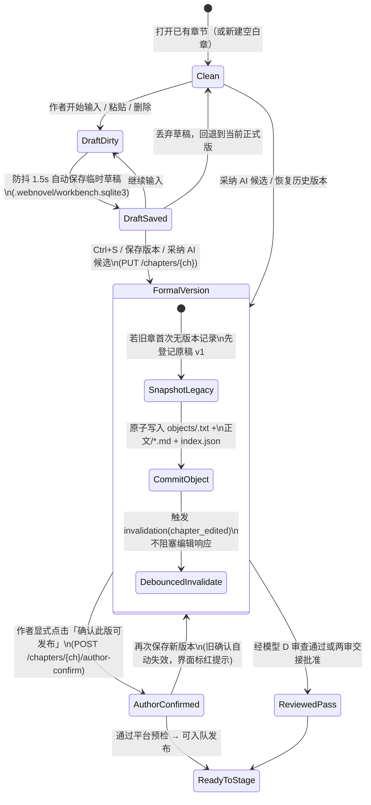

# 01 · 自由编辑、版本定稿契约与多文件大纲双轨同步设计

> 对应需求：**痛点 1（自由改动原文与大纲）** 及 **版本/失效/发布安全闭环**  
> 落地阶段：**一期（v0.8.0）同步交付核心直写、草稿、正式版本、独立「作者显式定稿确认（`author_confirmed`）」与多文件大纲权威自愈（避免手改错别字后被迫重跑 AI 审查）；四期（v0.9.5）补齐按章生效合同指纹与已发布版本本地对比隔离**

---

## 1. 现状源码诊断与必修缺陷

逐行核查 `v0.7.5` 源码，发现实现自由编辑必须跨越以下 **5 个具体代码卡点**：

1. **缺少章节写回接口**：[app.py](../../../backend/manager/app.py#L1979-L2066) 只有只读 `GET /chapters/{chapter}`、`restore` 与 `revision/accept`，没有 `PUT /chapters/{chapter}`，且 [index.js](../../../index.js#L214-L300) `WRITE_ROUTES` 未放行。
2. **`chapter_versions.write_chapter()` 存在现存失效钩子 Bug**：
   - 在 [chapter_versions.py:466](../../../backend/integration/chapter_versions.py#L466)，`commit_candidate()` 返回的字段是 `record["state"] = "committed"`；
   - 但在 [chapter_versions.py:484](../../../backend/integration/chapter_versions.py#L484)，`write_chapter()` 判断的是 `if str(result.get("status") or "") == "committed":`（键名错写为 `status` 而非 `state`），导致 `invalidation.invalidate()` 从未通过 `write_chapter()` 触发！**一期必须顺手修复并补单测。**
3. **`approve_chapter_review` 不可直接用于手改定稿**：
   - [writer_runner.py:265-289](../../../backend/integration/writer_runner.py#L265-L289) 硬性校验三件事：`review_decision == "needs_human_review"`、`human_review_required is True`、`bound_body == current_body_digest` 且 `auto_review_count >= required`。
   - 作者手改正文后，正文指纹必然改变，调用原接口会被直接拒绝；因此**必须新增独立的「作者显式定稿确认」机制**，绝不混入 `PUT` 保存开关。
4. **多文件大纲被强制锁死只读**：
   - [app.py:2084](../../../backend/manager/app.py#L2084) 计算 `"editable": len(files) <= 1`。一旦 `studio.plan()` 生成 `AI规划-0001-0005.md` 与原 `卷一.md` 并存，整个大纲页立即不可保存。
5. **AI 规划文件的“文字 vs 恢复注释”双轨分裂与中断不一致风险**：
   - [studio.py:225](../../../backend/integration/studio.py#L225) 生成的 `AI规划-*.md` 首行嵌有 `<!-- novel-plan:{JSON} -->`，而 [studio.py:234-266](../../../backend/integration/studio.py#L234-L266) 的 `recover_plan()` **仅在 `key not in doc["chapters"]` 时才回填缺失章**，已有旧章会被保留！如果仅先写 `.md` 再写 `story_plan.json` 并在两次写盘间发生中断，重启后 `recover_plan()` 仍会返回旧结局。
6. **老稿恢复丢失 UTF-8 BOM 导致原始指纹漂移**：
   - [chapter_versions.py:650-656](../../../backend/integration/chapter_versions.py#L650-L656) 的 `restore_version()` 先用 `utf-8-sig` 解码剥除 BOM，再用纯 `utf-8` 写回磁盘，导致恢复后的文件虽内容可读，但**原始字节 SHA-256 已改变**（而版本与回执校验严格依赖原始字节哈希）。
7. **一期新旧写入口若锁契约不统一会引发并发覆写**：
   - 旧版非预览 `polish`（[studio.py:477](../../../backend/integration/studio.py#L477)）、`generate`/`batch` 与回执更新仍走整书 `writer.lock`，若一期仅让新编辑器拿单章锁而放任旧路径继续裸写正文，新旧两套锁仍会同时改写同一章。

---

## 2. 正文三层生命周期模型（草稿 / 正式版本 / 作者定稿）



### 2.1 第一层：实时临时草稿（存 `workbench.sqlite3`，含 `draft_id` / `draft_epoch` 防 ABA 与前端 `edit_seq`）
- **定位**：防崩溃/切章恢复缓冲，**绝不触碰 `正文/*.md`、`chapter_versions/`、`writer_receipts.json` 和 `invalidation_log.json`**。
- **存储位置（遵循 `05` §2 减负收口）**：落地于项目级 **`.webnovel/workbench.sqlite3`** 的 `chapter_drafts` 与 `chapter_meta` 表（不再散落小 JSON 文件，亦不读写 `chapter_versions/index.json`）。
- **数据结构（引入 `draft_id` + 跨删除单调递增 `draft_epoch` 杜绝 ABA 问题）**：
  > **防 ABA 说明**：若仅校验 `draft_revision`，当桌面端保存正式版删掉旧草稿再新建草稿使 `revision` 回到 `1` 时，平板端拿着旧 `revision=1` 会误通过校验并静默覆写桌面新草稿！因此每次新建草稿生成全新 UUID `draft_id` 并在 `workbench.sqlite3` 的 `chapter_meta` 中递增跨删除不回零的 `draft_epoch`。
  ```json
  {
    "schema_version": 2,
    "chapter_uid": "chuid_7a91f0",
    "chapter_number": 1,
    "draft_id": "drf_8f21b9c0",
    "draft_epoch": 12,
    "draft_revision": 7,
    "base_version_id": "ver_0004_91ab",
    "base_content_sha256": "a1b2c3...（发起草稿时的正式稿原始字节 SHA-256）",
    "title": "雨夜测绘图",
    "content": "当前未正式提交的全文...",
    "cursor": { "start": 412, "end": 412, "scroll_top": 680 },
    "dirty": true,
    "updated_at": "2026-11-26T11:30:00+00:00",
    "client_session_id": "sess-9f31"
  }
  ```
- **双端（桌面 + 平板）草稿并发写保护 + 前端 `edit_seq` 防丢键入**：
  - `PUT /api/projects/{id}/chapters/{ch}/draft` **必须携带 `expected_draft_id`、`expected_draft_epoch` 与 `expected_draft_revision`**（尚无草稿时传 `draft_id=null, expected_draft_revision=0` + 当前 `expected_version_id`）；任一失配立即返回 **HTTP `409`（`code: "draft_conflict"`）**，附带服务端最新草稿与双端差异，**绝不静默覆盖另一端输入**；
  - 前端同时维护本地单调递增的 **`edit_seq`**（每次按键 +1）：当 `Ctrl+S` 或 `apply-hunks` 飞行期间用户继续键入使 `local_edit_seq > submitted_edit_seq` 时，前端绝不用旧回包覆盖输入框（`apply-hunks` 返回时通过三方合并保留双方改动，详见 `02` §3.2）；
  - 键入停止 300ms 先写 `localStorage`（按 `project_id + client_session_id` 隔离），防浏览器进程瞬间闪退；停顿 1500ms 或切章/失焦串行发送 `PUT .../draft`。
- **外部编辑器修改正文感知**：打开章节或保存前，若检测到磁盘 `正文/*.md` 的 `content_sha256` 与最新已登记版本及草稿均不一致（如作者曾用 Typora/Obsidian 改过文件），顶部弹出提示「检测到外部编辑器改动，是否登记为新版本并加载：[登记并加载] / [查看对比]」，绝不静默覆盖外部手改。

### 2.2 第二层：正式版本提交（统一 `05` 权威版本身份 + 跨文件事务 + BOM/LF 规范化）
- **正式版本身份与内容哈希分离（严格遵循 `05` §1.1 权威定义）**：
  - 每次正式提交分配全局唯一且单调递增的 **`version_id`**（`ver_{seq:04d}_{uuid8}`）与 **`version_seq`**，并记录永久 **`chapter_uid`**、**`content_sha256`**（兼容旧版 `sha256`）、**`body_digest`**、**`title_digest`** 与统一综合指纹 **`version_fingerprint = sha256((content_sha256 + "\x00" + title_digest).encode("utf-8"))`**；
  - 即使作者**仅修改章节标题、正文一字未改**，也会产生独立可识别的新 `version_id`；
  - 所有正式变更动作（`PUT /chapters/{ch}`、`restore`、`DELETE`、`author-confirm`、`apply-hunks(target="version")`）统一强制传入 `expected_version_id` 与 `expected_content_sha256`（仅新建空白章 `allow_new=true` 时可为空），绝不基于旧页面盲覆他端结果。
- **跨文件提交走统一事务日志（`transaction_journal.py`，一期 `v0.8.0-alpha` 上线，详见 `05` §3）**：
  - 凡同时改动 `.md` 正文/文件名、兼容旧 JSON（`index.json` / `writer_receipts.json`）与 `workbench.sqlite3`（草稿、批注、失效）的操作，一律先登记 `.webnovel/transactions/tx_{id}.json` 再按序落盘，中途崩溃由启动自愈完整重放。
- **BOM / CRLF 编码规范化闭环拍板**：
  - **老稿原样归档（v1）**：老书旧章首次编辑前先逐字节快照归档为 `v1`，100% 保留原始 UTF-8 BOM 与 `\r\n`；点「恢复至 v1 原稿」走 `restore_version_raw` 逐字节写回，原始 `content_sha256` 分毫不差；
  - **新版本统一规范化**：经编辑器新提交或三方合并产生的新正式版本，**统一规范落盘为 UTF-8 无 BOM + LF（`\n`）**；所有 Diff 对比层均按 LF 规范化比较，彻底消除换行符切换造成的全篇假红绿 Diff。
- **新增接口**：`PUT /api/projects/{identity}/chapters/{chapter}`
- **请求体（Pydantic `ChapterSaveInput`，内置正文 ≤ 200KB / 禁止 `\x00` 体积与字符护栏）**：
  ```json
  {
    "title": "雨夜测绘图",
    "content": "完整正文内容...",
    "expected_version_id": "ver_0003_a1b2（覆盖已有章节时强制必填）",
    "expected_content_sha256": "a1b2c3...（覆盖已有章节时强制必填；仅 allow_new=true 新建章可为 null）",
    "op_id": "edit-8c2f...（强制幂等键，受 05 §1.3 idempotency_keys 保护）",
    "source": "author_edit",
    "note": "收紧开场节奏",
    "submitted_draft_id": "drf_8f21b9c0",
    "submitted_draft_epoch": 12,
    "submitted_draft_revision": 7,
    "allow_new": false
  }
  ```
- **防“`Ctrl+S` 后立刻继续打字被晚到清理抹掉”协议**：
  - 取消粗暴的布尔清草稿开关，改为传入 **`submitted_draft_id` + `submitted_draft_epoch` + `submitted_draft_revision`**；
  - 后端提交正式版后，在事务内核对草稿表：**仅当草稿当前的 `(draft_id, draft_epoch, draft_revision)` 与提交值三者全相等时才清理草稿**；
  - 若作者按 `Ctrl+S` 后继续打字导致草稿已推进至 `draft_revision = 8`（或前端 `edit_seq` 已超前），后端**绝不清掉新草稿**，响应返回 `"draft_preserved": true, "current_draft_revision": 8`，保留作者刚敲下的新内容！
- **后端核心执行步骤（新增封装 `backend/integration/chapter_editor.py`）**：
  1. **参数、Windows 文件名边界与路径安全校验**：
     - 校验 `chapter > 0`；
     - **Windows 文件名强校验**（同时应用于章节标题与大纲文件名）：除过滤 `chapter_versions._WINDOWS_BAD` 非法字符外，**必须拦截 Windows 保留设备名**（忽略大小写及后缀名：`CON`、`PRN`、`AUX`、`NUL`、`COM1`–`COM9`、`LPT1`–`LPT9`）以及**末尾空格与末尾点号（`.`）**（Windows 落盘会静默裁掉尾随点号导致后续路径比对失配）；
     - 若目标章已存在且 `expected_version_id` 或 `expected_content_sha256` 为空，**直接返回 HTTP `400`（`expected_version_required`）**；禁止符号链接/Windows Junction 逃逸 `正文/` 目录；
     - **统一落盘原语**：所有磁盘文件（正文、JSON 索引、检查点、大纲）一律走 `transaction_journal` +「同目录临时文件 → `flush` + `os.fsync` → `replace_with_retry`」原子落盘，绝不直接覆盖写。
  2. **一期新旧写入口统一锁与提交契约（杜绝“不同锁同时写同章”）**：
     - 规定所有会修改 `正文/第N章*.md` 的入口——包括新 `PUT /chapters/{ch}`、旧版直接润色 `studio.polish_existing(preview=False)`、`writer_runner` 写新章、`revision_plan.accept()` 与 `version_history.restore()`——**全部必须获取单章锁 `locks/chapter-{ch:04d}.lock` 并统一经由 `chapter_versions` 带 `expected_version_id + expected_content_sha256` 校验的原子提交路径写盘**，严禁旧入口绕过版本核对直接裸写 `正文/*.md`！
     - 一期阶段旧版整书串行任务仍可继续顺序运行，但写入单章时遵守同一套单章锁与版本校验契约，确保“手改 + 旧版直接润色”绝不会互相静默覆写。
  3. **老书/旧章首次编辑原稿保护**：
     - 检查 `chapter_versions.current_version(project, chapter)`；
     - 若磁盘已有 `正文/第N章*.md` 但版本库尚无对应当前磁盘原始字节哈希的记录，先调用 `chapter_versions.snapshot(project, chapter, source="legacy-adopted", note="首次编辑前自动归档原稿")`，逐字节归档原稿（保留 BOM 与 `\r\n`）。
  4. **乐观并发校验（防多窗口/后台/外部编辑器静默覆盖）**：
     - 校验 `expected_version_id == current_meta["version_id"]` 且 `expected_content_sha256 == file_sha256(current_path)`；任一不一致立即返回 **HTTP `409`（`code: "concurrent_modification"`）**，附带当前磁盘版本、标题与差异：
       ```json
       {
         "code": "concurrent_modification",
         "message": "正文已在其他窗口、任务或外部编辑器中更新，请比对后保存",
         "current_version_id": "ver_0006_a1b2c3d4",
         "current_content_sha256": "f9e8d7...",
         "current_title": "...",
         "current_content": "...",
         "diff": { "changes": 2, "hunks": [...] }
       }
       ```
     - 前端收到 409 后自动打开「双版本并排合并」对话框，绝不丢失作者正在写的内容。
  5. **标题改名安全处理与 Windows 句柄冲突防护（覆盖“仅改标题不改正文”场景）**：
     - **严禁跨阶段缓存磁盘文件路径**：由于章节标题编码在文件名里（`正文/第N章-旧标题.md`），硬性规定所有并发任务、队列参数、草稿及检查点**同时传递 `chapter_id` 与永久 `chapter_uid`，绝不把旧路径 `destination` 跨 Stage A → Stage C 复用**；无论读正文还是写回/重命名，都必须在持有单章短锁 `locks/chapter-{ch:04d}.lock` 期间核验 `chapter_uid` 并通过 `chapter_versions.chapter_path(project, chapter)` **动态解析当前真实路径**，彻底消除改标题导致的“找不到旧文件”路径漂移；
     - **Windows `WinError 32` 重命名退避重试**：仅改标题或改文连带改标题时，先在单章锁内校验目标路径无同名冲突，再使用复用 [publication_safety.replace_with_retry](../../../backend/fanqie_auto_publish/publication_safety.py#L30-L36) 同等退避策略的 `rename_with_retry`（针对 Windows `WinError 5/32/33` 杀毒/短句柄占用执行指数退避重试，最多 6 次）；若重试仍遇外部进程长占句柄，返回明确的 `409 file_in_use_retry` 提示且不破坏原文；
     - 改名成功后同步更新 `chapter_versions/index.json` 与 `writer_receipts.json` 的 `destination`；若该章此前已有 `author_confirmed` 定稿确认，改标题后旧确认立即自动失效，界面提示重新确认标题。
  6. **唯一失效触发方（防重复失效 + 大书异步防卡 `Ctrl+S`）**：
     - 修复 [chapter_versions.py:484-491](../../../backend/integration/chapter_versions.py#L484-L491) 中 `result.get("status")` → `result.get("state") == "committed"` 并透传调用方 `op_id`（替代硬编码的 `write-{chapter}-{digest}`），同时移除 [version_history.py:209](../../../backend/integration/version_history.py#L209) 的重复 `invalidation.invalidate()` 调用；
     - **架构约定**：`chapter_versions` 提交层（`write_chapter` / `commit_candidate` 的统一收尾钩子）是**唯一的 `invalidation.invalidate()` 触发方**，上层 `chapter_editor`、`revision_plan.accept`、`version_history.restore` 只传入 `invalidation_reason` 和幂等 `op_id`，**严禁各层重复调用**；同时将 [invalidation.py:134](../../../backend/integration/invalidation.py#L134) 当前同步全书执行的 `continuity.rebuild(project)` 改造为按章增量或后台异步刷新，确保 500–1000 章大书按 `Ctrl+S` 仍满足 `P95 ≤ 500ms`；
     - 为保障 `v0.7.5` 回滚兼容，`chapter_versions/index.json` 保留 `entry["current"] = sha256`（64 位），同级新增 `entry["current_version_id"]` 与 `meta["version_id"]`（详见 `05` §1.1）；
     - 若正文规范化摘要（`body_digest`）未变化（且未改标题），幂等返回 `unchanged: true`，不造冗余版本、不触发失效；
     - 若本章已有线上已发布记录（在 `manifest` 中 `status == "published"`），仍允许本地保存新版本，但响应携带 `"published_diverged": true` 与 `"published_sha256"`，绝不静默改动平台发布记录。

- **原始字节一键恢复（修复 BOM / CRLF 指纹漂移）**：
  - 升级 `chapter_versions.restore_version(project, chapter, version_id, *, restore_title: bool = True, op_id=None, note="")`：
    - 直接读取不可变归档对象原始字节 `raw_bytes = read_object(project, version_id)`，通过新内部原语 `commit_raw_bytes(...)` **逐字节写回磁盘**，**绝不经过 `utf-8-sig` 剥离 BOM 或改写 `\r\n` 换行符**，保证恢复后磁盘文件的原始 SHA-256 与目标历史版本逐字节完全一致！
    - `POST /api/projects/{id}/chapters/{ch}/restore` 请求体新增可选参数 `restore_title: bool = True`（默认连同该历史版本的标题一并恢复，也支持勾选“仅恢复正文，保留现标题”）。

- **新建空白章节、受限删除/回收站还原与尾章拆分合并（一期同步交付）**：
  - `POST /api/projects/{identity}/chapters`（新建空白章，自动签发永久 `chapter_uid`）；
  - `DELETE /api/projects/{identity}/chapters/{chapter}`（**受限删除**）：仅允许删除**未发布且未入队**的**尾部最大章号章节或 0 字空章**（必须携带 `expected_version_id`）；走事务日志存档后将正文、草稿、批注、候选、回执打包移入 `<project>/.webnovel/trash/{timestamp}-ch{ch:04d}/`；
  - `POST /api/projects/{identity}/trash/{entry}/restore`（**一期同步交付一键还原**）：从回收站无损恢复误删尾章（恢复原 `chapter_uid`、正文与批注，遇章号冲突时自动顺延为新尾章并提示）；
  - `POST /api/projects/{identity}/chapters/{chapter}/split` & `POST /api/projects/{identity}/chapters/merge-tail`（**未发布尾章拆分/合并**）：严格限定于未发布/未入队的尾部章节（如 6000 字尾章按光标拆成两章，或最后两短章合并为一章），不扰动前面任何既有章号与回执；
  - **基础老书 TXT/MD 批量导入（一期支持）**：`POST /api/projects/{identity}/import-chapters` 支持按章标题正则自动切分导入老书存稿并逐章签发 `chapter_uid` 与基线版本 v1，方便已有存稿的作者立即用上直写、检索与全书改稿。
- **跨标签页/多端实时提醒（配合三期 SSE `workspace_signal`）**：
  - 每次 `PUT /chapters/{ch}`、`PUT /chapters/{ch}/draft` 或大纲保存成功后，向事件流发布一条轻量 `workspace_signal`（仅含 `kind`、`chapter_id` / `filename`、`new_sha256` / `draft_revision` 与触发 `client_session_id`），同一本书的其他已开窗口（如平板或独立 Web 端）收到后立即弹出柔和横幅「本章已在其他窗口更新，[加载最新]」，事前规避绝大多数 409 冲突。

### 2.3 第三层：独立的「作者显式定稿确认」契约（一期随自由编辑同步交付，四期衔接按章合同指纹）

> **为什么必须在一期就交付？** 一期放开自由手改正文后，作者只要手改一个错别字，旧审查回执就会因正文指纹变化而立即失效。如果等到四期才提供「确认此版可发布」按钮，整个 v0.8.0–v0.9.0 周期作者改错字都被迫重跑 AI 审查才能入队发布，体验严重割裂。该接口高度独立，前移至一期可一步闭环“手改 → 确认 → 发布”。

#### 为什么不能复用 `approve-review`？
- `writer_runner.approve_chapter_review`（`review_decision = "human_approved"`）语义严格限定为「**AI 跑满两次自动审查未通过后交由人工复核放行**」，绑定当时的 AI 审查报告与 `auto_review_count`。
- 作者自由手改一篇自己满意的正文时，可能根本没跑 AI 审查，或者改完后旧审查指纹已经过期。强行混用既破坏审计语义，又会被原接口校验直接挡回。

#### 新契约设计：`author_confirmed` 与手改后记忆/人物同步闭环
1. **新增独立接口**：
   - `POST /api/projects/{identity}/chapters/{chapter}/author-confirm`
   - 请求体：
     ```json
     {
       "expected_version_id": "ver_0005_3e10（必须传当前正式版独立 version_id）",
       "expected_content_sha256": "当前正式版原始字节 SHA-256",
       "note": "作者精修定稿（可选）",
       "commit_pending_memory": false
     }
     ```
     - **`commit_pending_memory` 明确定义（严格绑版本防写入过期事实）**：默认为 `false`；设为 `true` 时**仅把基于当前同一个 `expected_version_id` 提取好、尚处 `pending` 状态的记忆/人物候选零模型调用直接提交入库**；若待审候选源自旧版本，直接跳过并提示重新同步，**绝不把旧稿过期事实写回记忆库**。
   - `DELETE /api/projects/{identity}/chapters/{chapter}/author-confirm`（撤销定稿确认，回到未定稿态）。
   - **手改后增量失效与记忆/人物同步（不单靠 100 字字数阈值！）**：
     - **精准触发判定**：改一个字（如“已死→未死”“三年前→三十年前”）同样颠覆全书。保存正式版时，先由本地确定性比对受变更段落是否命中既有事实证据区间或核心实体/数字/否定词变更——命中即标为高优待核验并点亮角落轻徽章；净变动 ≥ 100 字作为补充提醒条件；
     - 异步提取接口 **`POST /api/projects/{identity}/chapters/{chapter}/sync-memory`**（参数 `{ "preview": true, "op_id": "...", "expected_version_id": "..." }`）产出的候选强制绑定提取时的 `version_id`，支持预览增量事实、人物变更及可选反写「修正本章细纲摘要」，确认后经事务日志落库。
   - **权限铁律与不可变发布快照（详见 `05` §4）**：
     - 严格区分 **作者定稿（`author_confirmed`）、质量审查通过（`pass`）、允许自动续写（`chapter_settled`）、同意对外发布（`publish_authorized`）** 四种独立状态；**主编 Agent 严禁自行调用 `author-confirm` 或对外发布授权**；
     - 每次入队/排期授权绑定**不可变发布快照**；到达定时发布前若正式 `version_id` 已变动，自动暂停排期提示作者重新确认。
2. **数据落盘格式（写入 `writer_receipts.json` 对应章键，统一对齐 `05` §1.1 版本身份）**：
   ```json
   "1": {
     "chapter_uid": "chuid_7a91f0",
     "destination": "O:/.../正文/第1章-雨夜测绘图.md",
     "sha256": "原始字节 content_sha256",
     "version_id": "ver_0005_3e10",
     "creative_contract_hash": "按本章生效范围计算的合同指纹 creative_contract_hash_for_chapter(project, 1)",
     "reviewed_at": "2026-11-26T12:00:00+00:00",
     "review": {
       "success": true,
       "review_decision": "author_confirmed",
       "needs_revision": false,
       "author_confirmed": true,
       "confirmed_by": "author",
       "confirmed_at": "2026-11-26T12:00:00+00:00",
       "confirmed_version_id": "ver_0005_3e10",
       "confirmed_content_sha256": "原始字节 content_sha256",
       "confirmed_title": "雨夜测绘图",
       "confirmed_title_digest": "title_digest",
       "confirmed_version_fingerprint": "version_fingerprint",
       "body_sha256": "规范化文本 body_digest",
       "note": "作者精修定稿"
     }
   }
   ```
3. **对接 `publication_safety.review_eligible()` 与按章合同指纹（与 `v0.7.5` 既有 `human_approved` 正交并存）**：
   - **语义边界明晰（核对 [publication_safety.py:215-219](../../../backend/fanqie_auto_publish/publication_safety.py#L215-L219)）**：`v0.7.5` 已存在 `review_decision == "human_approved"`（用于自动审查达 2 次封顶后的 `POST .../approve-review` 人工放行）；本方案新增第 5 条并存分支 `review_decision == "author_confirmed"`（用于作者自由手改后的 `POST .../author-confirm` 显式定稿，无需先跑 2 轮 AI 审查），两条分支严格独立、互不覆盖。
   - **严格 5 项服务端联合校验**：
     ```python
     if review.get("review_decision") == "author_confirmed":
         if review.get("author_confirmed") is not True:
             return False
         if review.get("body_sha256") != body_sha256:
             return False
         version_id = review.get("confirmed_version_id")
         content_sha = review.get("confirmed_content_sha256")
         if not (isinstance(version_id, str) and version_id.startswith("ver_") and isinstance(content_sha, str) and len(content_sha) == 64):
             return False
         if project is None or chapter is None:
             return False
         from integration import chapter_versions
         disk_path = chapter_versions.chapter_path(project, chapter)
         disk_sha = chapter_versions.file_sha256(disk_path)
         if not disk_sha or disk_sha != content_sha:
             return False
         cur_meta = chapter_versions.current_version(project, chapter)
         if not cur_meta or cur_meta.get("version_id") != version_id or cur_meta.get("content_sha256") != disk_sha:
             return False
         current_title = chapter_versions.parse_chapter_name(disk_path.name)[1] if disk_path else ""
         if str(review.get("confirmed_title") or "") != str(current_title or ""):
             return False
         return True
     ```
   - **按章计算生效合同指纹 `creative_contract_hash_for_chapter(project, chapter: int)`（含零命中章节豁免）**：
     - 现有 `creative_contract_hash(project)` 把全书约定和所有作者记忆打成一个全局哈希，会导致“从第 6 章起女主用化名”一写入，**第 1–5 章以及第 6 章后本未提及名字的合规章原有审核/发布资格全部作废**；
     - 改造为两重精准控制：
       1. 规则条目支持 `effective_from_chapter: int | null`（`null` 表示全书生效，整数 `K` 表示仅约束 `chapter >= K`），`creative_contract_hash_for_chapter(project, chapter)` 只纳入 `effective_from_chapter is None or effective_from_chapter <= chapter` 的规则；
       2. **零命中无辜章节豁免（`verified_clean_directives`）**：当全书批注扫描确认第 `N` 章（`N >= K`）无任何违规命中、无需改写且作者确认保留其既有资格时，在 `.webnovel/workbench.sqlite3` 的 `directive_exemptions` 表中记录 `{ "chapter_id": N, "chapter_uid": "chuid_9f2a1c3d", "version_id": "ver_...", "content_sha256": 当前章指纹, "rule_id": "bdir_...", "rule_content_sha256": "...", "scan_method": "...", "confirmed_by": "author" }`（与 `05` §2 及 `06` §3.1 完全统一）；计算第 `N` 章合同指纹时，只要该章正文及规则文本未再变动且存在有效豁免记录，跳过该 `rule_id` 对合同指纹的扰动，**彻底避免未命中的无辜合规章节被迫重审或重定稿**！
   - **硬性防错特性**：只要作者定稿后再改了一个字**或修改了章节标题**，`disk_sha` / `body_digest` / `confirmed_title` 任一失配，`review_eligible()` 立即返回 `False`，`stage`/发布队列自动拒绝该章并提示「正文或标题已修改，请重新确认此版可发布」。
   - **继续执行平台预检**：定稿确认只替代“AI 质量审查门槛”，**绝不跳过**字数底线、违禁/风格预检告警提示、重复章校验、账号绑定校验与平台发布授权。
   - **本地修订 vs 线上已发布版本隔离**：
     - `GET /api/projects/{id}/chapters/{ch}` 返回增强字段：`publication_status`（`unpublished` | `staged` | `published`）、`published_sha256`、`local_diverged_from_published`（bool）。
     - 若某章已在番茄发布，作者本地修改后可点击「对比线上已发版本」，不会触发自动重复发布；若确实需要更新线上章节，需走独立的显式平台编辑/导出流程。

---

## 3. 多文件大纲编辑与 AI 规划双轨同步设计

### 3.1 问题本质
`大纲/` 目录下通常同时存在：
- 作者手动维护文件：`总纲.md`、`卷一.md`、`人物设定.md`；
- AI 自动生成文件：`AI规划-0001-0005.md`、`AI规划-0006-0010.md`（首行含 `<!-- novel-plan:{JSON} -->`，后接 `## 第N章 标题\n细纲正文`）。

同时 `.webnovel/story_plan.json` 维护了全书的结构化规划索引（`master_outline`、`volumes`、`character_arcs`、`foreshadowing`、`chapters: {"1": {...}}`），供 `studio.plan_async()`、`studio.is_key_scene()` 和写作执行器读取。

### 3.2 新增多文件大纲 API
保留原 `GET/PUT /api/projects/{id}/outline` 向后兼容（单文件继续可用），新增多文件与书级规划元数据接口：
1. `GET /api/projects/{identity}/outline/files`
   - 返回 `大纲/*.md` 全部文件列表：`[{ name, kind("ai_plan"|"manual"), revision, size, updated_at, chapter_range, editable: true }]`，以及单一权威源 `.webnovel/story_plan_meta.json` 中的书级字段（`master_outline` / `volumes` / `character_arcs` / `foreshadowing` 与 `meta_revision`）。
2. `GET /api/projects/{identity}/outline/files/{filename}`
   - 返回单个文件正文（如果是 `AI规划-*.md`，**向前端返回剥离顶部隐藏 JSON 注释后的干净可读 Markdown**，同时返回该文件覆盖章号的 `chapter_revs` 与文件 `revision` 哈希，避免作者误删 HTML 注释弄坏文件！）。
3. `PUT /api/projects/{identity}/outline/files/{filename}`
   - 请求体：`{ "content": "...", "revision": "sha256..." }`（**只负责保存该文件自身对应的章节细纲或手动卷纲，绝不通过多个 `AI规划-*.md` 交叉覆盖书级总纲/人物弧线/伏笔**）。
   - 安全校验：校验 `filename` 仅含单层 `.md` 文件名，禁止路径穿越和符号链接。
4. `PUT /api/projects/{identity}/outline/meta`
   - 独立保存书级结构化字段（`master_outline`、`volumes`、`character_arcs`、`foreshadowing`）至唯一权威源 `.webnovel/story_plan_meta.json`（携带 `expected_meta_revision` 防并发覆盖），并同步派生更新 `story_plan.json` 顶层字段。
5. `POST /api/projects/{identity}/outline/files`
   - 新建大纲卷文件（如 `卷二.md`）。

### 3.3 多文件大纲的「分界单一权威源 + 单调修订号 + 中断自愈」机制（杜绝多头覆盖！）
实测发现两个必须同时解决的隐患：① `v0.7.5` 的 `studio.recover_plan()`（[studio.py:234-266](../../../backend/integration/studio.py#L234-L266)）仅补缺失章，写盘中断后旧索引会盖掉新结局；② 若把书级字段冗余存在多份 `AI规划-0001-0005.md` 与 `AI规划-0006-0010.md` 头部，交替编辑两份文件会导致旧副本覆盖新的人物弧线或伏笔。

因此严格拆分两类数据的**唯一权威边界**（新增 `backend/integration/outline_editor.py` 并升级 `studio.recover_plan`）：

1. **严格的权威边界划分**：
   - **章节细纲（`chapters[ch]`）的唯一权威源**：对应章号区间所在的 `大纲/AI规划-*.md` 文件（按每章独立的单调递增 `chapter_rev` 与 `outline_sha256` 判新旧）；
   - **书级结构化字段（`master_outline / volumes / character_arcs / foreshadowing`）的唯一权威源**：独立的 `.webnovel/story_plan_meta.json`（带单调 `meta_revision`）；新建的 `AI规划-*.md` 顶部注释仅写入 `chapters` 列表（每章含 `id / title / outline / key_scene / chapter_rev`），**不再冗余写入或以旧副本覆盖书级字段**（兼容读取老版 `v0.7.5` `AI规划-*.md` 仅在 `story_plan_meta.json` 尚未存在时做一次性初始化回填）；
   - **`story_plan.json` 定位**：降级为由 `story_plan_meta.json` + 全部 `AI规划-*.md` 派生合并而成的**可随时自愈重建索引缓存**。
2. **原子保存步骤（持有短锁 `locks/outline.lock`）**：
   - **保存单份 `AI规划-*.md`**：
     - Step 1 备份旧文件至 `DATA/backups/` 与 `.webnovel/outline-backups/`；
     - Step 2 使用与 `writer_runner` 统一的标题解析器提取该文件内各章新的 `title` 与 `outline`；**防误删章节标题保护**：若原文件包含第 `M` 章细纲但本次提交中 `## 第M章` 标题缺失，默认返回 **HTTP `409`（`code: "missing_chapter_headings"`, `missing_chapters: [M]`）** 弹窗请作者确认是“格式写偏（回去补标题）”还是“确实要删该章细纲（带 `confirm_removed_chapters: [M]` 重提）”，杜绝手滑误删导致细纲索引丢失；
     - Step 3 为发生变化的章节递增 `chapter_rev = max(md_ch_rev, index_ch_rev) + 1`，更新首行 `<!-- novel-plan:{JSON} -->`（保留向后兼容 `v0.7.5` 读解析的 `chapters` 数组结构，附加 `chapter_rev` 与 `author_edited: true`），**先原子写盘 `AI规划-*.md`**（权威提交点）；
     - Step 4 将各章新条目与 `chapter_rev` 合并写入派生索引 `.webnovel/story_plan.json`。
   - **保存书级字段（`PUT /outline/meta`）**：先原子写盘 `.webnovel/story_plan_meta.json`（递增 `meta_revision`），再同步更新 `story_plan.json` 顶层字段。
   - **手动大纲文件与独立资料库（`设定/*.md`）的语义与注入边界**：
     - 手动大纲文件（`总纲.md`、`卷一.md`）按文件名安全校验后原子落盘并留备份，**不改动 `story_plan.json` 中的 AI 结构化章表**，也不自动触发既有章节 `invalidation`；
     - **新增独立「设定集 / 资料库」目录（`<project>/设定/*.md`）**：存放测绘流程、年代物价、法医常识、境界表等非大纲背景资料，在创作室独立展示与编辑，**不混入 `大纲/*.md` 干扰规划解析**，并直接接入本地 FTS5 检索与 `06` L5 按需召回。
3. **升级 `studio.recover_plan(project)` 为防“删除复活”的墓碑感知与冲突显性化自愈器**：
   - **消除删除复活风险**：当作者确认删除某章细纲（带 `confirm_removed_chapters: [M]`）时，在对应 `.md` 顶部元数据及索引中写入显式**删除墓碑 `{"chapter_id": M, "chapter_rev": next_rev, "deleted": true}`**；同时 `recover_plan()` 执行**以全部现存 `AI规划-*.md` + `story_plan_meta.json` 为准的完整重建**（结合墓碑比对 `chapter_rev`），确保已删章节绝不会从旧缓存复活；
   - **五类多文件冲突显性提示（绝不静默覆盖）**：扫描时自动检测并向前端返回结构化 `conflicts` 告警——① 两份 `AI规划-*.md` 同时包含同一章号；② 外部 Markdown 编辑器修改了可见细纲正文但未更新首行隐藏 JSON（比对 `outline_sha256` 立即识别并按可见正文提示作者一键同步或保留）；③ 整份大纲文件被外部删除或重命名；④ 同修订号内容冲突；⑤ 人工总纲与 `story_plan_meta.json` 显著分歧；
   - **体积与字符安全**：所有大纲写入接口统一施加单文件 **≤ 500KB**、禁止 `\x00` 与 Windows 保留名/尾随点号校验。

---

## 4. `GET /chapters/{chapter}` 增强响应契约（支撑直写工作台）

为减少前端首屏请求风暴，将 `GET /api/projects/{identity}/chapters/{chapter}` 扩展为向后兼容的富结构：
```json
{
  "id": 1,
  "title": "雨夜测绘图",
  "content": "正式版全文...",
  "words": 3240,
  "sha256": "原始字节 sha256（用于 PUT 并发校验）",
  "body_digest": "规范化文本 sha256",
  "version_seq": 4,
  "version_source": "author_edit",
  "draft": {
    "exists": true,
    "draft_revision": 7,
    "base_sha256": "...",
    "stale": false,
    "title": "...",
    "content": "...",
    "cursor": { "start": 412, "end": 412, "scroll_top": 680 },
    "updated_at": "..."
  },
  "review_state": {
    "reviewed": false,
    "human_review_required": false,
    "author_confirmed": true,
    "confirmed_version_id": "...",
    "confirmed_title": "雨夜测绘图",
    "review_status": "author_confirmed",
    "auto_review_count": 0,
    "publish_eligible": true
  },
  "publication": {
    "status": "unpublished",
    "published_sha256": null,
    "local_diverged": false
  },
  "annotations_summary": {
    "open_count": 3,
    "proposed_count": 1,
    "pending_previews": 2
  }
}
```
*(保留原有的 `reviewed`、`human_review_required`、`review_status`、`auto_review_count` 顶层兼容字段，防止旧测试或独立 Web 端旧逻辑报错。)*
