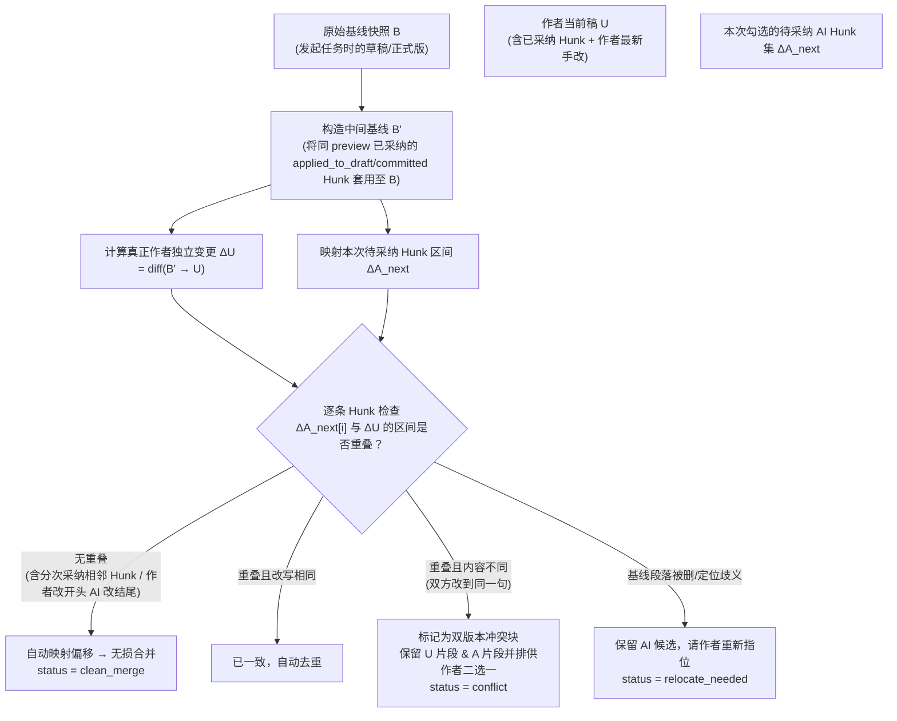

# 02 · 三层批注、升级版选区锚点与三方合并引擎设计

> 对应需求：**痛点 2（全文批注 & 选段批注让 AI 改）** 及 **同章人机并发编辑不冲突**  
> 落地阶段：**一期解耦单章候选保存；二期交付选区/单章批注、三方合并与同段 A/B；四期交付全书/跨章批注与规则生效范围**

---

## 1. 现状局限与改造目标

核对 `v0.7.5` 的 [revision_plan.py](../../../backend/integration/revision_plan.py#L82-L175) 与 [studio.py](../../../backend/integration/studio.py#L477-L542)，现有修订机制有 4 个根本短板：

1. **无用户指令入口**：`POST /chapters/{ch}/polish` 和 `/revision` 不收用户要求，只能被动按模型 D 的评审问题改稿。
2. **锚点定位过窄**：`revision_plan.locate(text, original)` 依赖 `text.count(piece) == 1` 且要求 `piece` 落在单一段内——**重复台词（如全章出现 3 句“我知道”）报 `anchor_ambiguous`，跨两段划选报 `anchor_not_in_paragraph`**。
3. **正文一变动直接丢弃候选**：[studio.py:501](../../../backend/integration/studio.py#L501) 硬判断 `if source.read_bytes() != old: raise ValueError("润色期间正文或要求已改变，候选未保存")`，导致 AI 跑完 40 秒后因为作者顺手改了个错别字而前功尽弃。
4. **只能整章“全接受/全拒绝”**：`revision_plan.accept()` 不支持逐条 Hunk 采纳、不支持从眼前未保存草稿发起、不支持同选区并排生成 A/B 两份候选。

---

## 2. 三层批注统一数据模型

新建模块：`backend/integration/annotations.py`（批注与选区锚点管理）与 `backend/integration/text_merge.py`（三方合并与重定位引擎）。

### 2.1 存储收敛（`workbench.sqlite3`）与本地产物定期 GC 治理
- **结构化工作台状态统一收敛至 `<project>/.webnovel/workbench.sqlite3`（WAL 模式，详见 `05` §2）**：
  - 单章/选区批注（`annotations`）、Hunk 状态（`hunk_states`）、章节补丁账本（`patch_ledger`）、全书/跨章指令（`book_directives`）与规则豁免（`directive_exemptions`）全部落于单作品 `workbench.sqlite3`，依托单库事务消除多 JSON 散落并发更新竞态与小文件碎片；
- **大文本不可变产物保留独立文件（内容寻址去重）**：
  - **发起任务的基线快照（含未保存草稿）**：`<project>/.webnovel/snapshots/{snapshot_id}.txt`（按 LF 规范化内容 SHA-256 去重，保证即使草稿后续变了也能精确还原发起时刻的基线原文）；
  - **修订候选正文载荷（支持多候选/A-B 对照）**：复用并扩展 `<project>/.webnovel/revision_previews/{ch:04d}-{preview_id}.json`（索引元数据同步登记于 `workbench.sqlite3`）。
- **基于引用计数的历史产物自动 GC 策略（防长篇小文件无限膨胀）**：
  - 定期（Manager 启动空闲期或每日一次）基于 `workbench.sqlite3` 实时引用关系执行安全清理，**严禁触碰正式 `chapter_versions/objects/`、活跃草稿及任意非终态 `pending`/`applied_to_draft` 候选**：
    - 已 `accepted` / `rejected` / `superseded` 超过 **30 天**的 `revision_previews/` 记录（及 `workbench.sqlite3` 中零引用的孤儿 `snapshots/*.txt`）；
    - 已终结指令超 **7 天**的 `staged_artifact_path` 暂存文件；
    - `outline-backups/` 按每文件保留最近 **30 份**滚动裁剪；`trash/` 回收站默认保留 **30 天**后可手动清空或按配额清理。

### 2.2 选区锚点 Schema（统一字符偏移单位 + 解决重复句与跨段划选）
- **跨端偏移单位硬约定（解决浏览器 UTF-16 与 Python Unicode 码点差异及换行符差异）**：
  - 锚点协议统一使用 **`offset_unit = "unicode_codepoint_lf"`**：即先把文本换行统一规范化为 `\n`（`\r\n`/`\r` → `\n`），再按 Unicode 码点索引计算 `char_start` / `char_end`；
  - 前端（JS）提交选区时，先将编辑器文本 `\r\n` 规范化为 `\n`，再用码点计数（如 `Array.from(norm.slice(0, utf16Pos)).length`）换算为 `char_start`/`char_end`（覆盖 emoji、汉字扩展区代理对与跨段换行）；后端入库前必做一次确定性校验 `norm_text[char_start:char_end] == norm_quote`，不相等直接报 `400 anchor_slice_mismatch`。

```json
{
  "offset_unit": "unicode_codepoint_lf",
  "chapter_uid": "chuid_9f2a1c3d",
  "base_snapshot_id": "sha256_of_exact_lf_normalized_text_when_created",
  "base_origin": "draft | version",
  "base_version_id": "ver_0004_9f2a1c3d",
  "base_content_sha256": "正式版本正文内容哈希（如基于草稿则记草稿的 base_content_sha256）",
  "char_start": 1024,
  "char_end": 1168,
  "para_start": 12,
  "para_end": 13,
  "quote": "被划选的精确原文（LF 规范化，可含 emoji 与跨段换行符）",
  "quote_sha256": "sha256(quote)",
  "prefix_ctx": "选区前 64 个码点的相邻上下文（含说话人与相邻行，不丢换行）",
  "suffix_ctx": "选区后 64 个码点的相邻上下文（含相邻行，不丢换行）",
  "occurrence_hint": 2
}
```

### 2.3 单章 / 选区批注条目与 Hunk 两层状态 Schema
- **批注状态（派生聚合，不因部分采纳而过早完结，与 `05` §1.2 严格对齐）**：`open | conflicted | running | proposed | partially_applied | accepted | rejected | relocated_needed`
- **Hunk 独立状态（每个修改块各自维护，与 `05` §1.2 严格对齐）**：`pending | applied_to_draft | committed | committed_modified | superseded | rejected`
  - 例：1 条批注生成 3 个 Hunk，作者仅采纳其中 1 个时，另 2 个保持 `pending` 可继续操作，整条批注状态为 `partially_applied`；若 A/B 方案中采纳了 A 的某块，仅 B 中与该区间重叠的 Hunk 标为 `superseded`；若采纳进草稿后又被作者大改才按 `Ctrl+S` 提交，最终标为 `committed_modified`（诚实归因，不伪称原样采纳 AI 建议）；仅当全部 Hunk 均已进入终态（`committed` / `committed_modified` / `superseded` / `rejected`，且至少 1 个落地）时，批注才进入 `accepted`。

```json
{
  "id": "ann_8f3a1c2b",
  "annotation_revision": 2,
  "chapter_id": 1,
  "chapter_uid": "chuid_9f2a1c3d",
  "scope": "selection | chapter",
  "anchor": { "...如上；scope=chapter 时为 null..." },
  "instruction": "只改这几句对白。让读者意识到姐姐在撒谎，别让主角当场拆穿。",
  "edit_policy": "strict_selection | allow_neighbors | chapter_scoped",
  "variants_requested": 1,
  "status": "partially_applied",
  "conflict_with": [],
  "candidate_ids": ["prev_a1", "prev_b2"],
  "hunk_states": {
    "hk_01": { "status": "applied_to_draft", "draft_id": "drf_8f21b9c0", "draft_revision": 7, "applied_range": [1024, 1140], "applied_text_sha256": "..." },
    "hk_02": { "status": "pending" },
    "hk_03": { "status": "pending" }
  },
  "thread": [
    { "role": "author", "text": "只改这几句对白...", "at": "..." },
    { "role": "editor", "text": "已给出两版写法（A 偏冷淡试探，B 偏细节露馅）", "preview_ids": ["prev_a1", "prev_b2"], "at": "..." },
    { "role": "author", "text": "A 版不错，但再克制一点", "at": "..." }
  ],
  "created_at": "2026-11-26T12:00:00+00:00",
  "updated_at": "2026-11-26T12:05:00+00:00"
}
```

### 2.4 全书 / 跨章批注 Schema（严分“改旧稿”与“立新规”）
```json
{
  "id": "bdir_4e91a0",
  "instruction": "从第六章起，女主对外用化名「林溪」，独处或面对姐姐时仍用真名「沈知微」。",
  "effective_from_chapter": 6,
  "exceptions": ["独处时仍用真名", "面对姐姐时仍用真名"],
  "apply_to_existing": true,
  "apply_as_future_rule": true,
  "future_rule_memory_id": "mem_71c2（作者确认后写入 shared_memory / creative_brief 的规则 ID）",
  "scan_state": "scanning | ready_for_review | trial_running | batch_running | partially_accepted | completed | paused_budget",
  "affected_chapters": [
    {
      "chapter_id": 6,
      "hits": [
        { "para_index": 8, "quote": "“我叫沈知微，”她把工作证推过去。", "reason": "对外自我介绍，应改为化名" }
      ],
      "excluded_hits": [
        { "para_index": 21, "quote": "姐姐压低声音：“知微，别碰那张图。”", "reason": "命中例外：面对姐姐，保持真名" }
      ],
      "trial": true,
      "preview_id": "prev_c601",
      "state": "proposed | accepted | skipped | rejected"
    }
  ],
  "estimated_calls": 5,
  "directive_id": "dir_90a1"
}
```

---

## 3. 锚点重定位与同章三方合并算法（核心工程保证）

### 3.1 四级渐进式锚点定位（`relocate_anchor(base_text, current_text, anchor)`）
> **唯一真相原则 + 竞态核对**：审阅态所有 `open` 批注的高亮区间**一律由后端 Python `text_merge.py` 统一计算**（前端切入审阅态前先 flush 草稿，调 `GET /chapters/{ch}/annotations?against=draft` 取回实时定位区间与状态，响应强制返回 **`evaluated_draft_id`、`evaluated_draft_revision` 与 `evaluated_text_sha256`** 供前端核对，若本地草稿已在弱网回包期间变动则丢弃旧回包重算），绝不在前端另写第二套定位算法。
> **反例防呆（已实测）**：若原文甲、乙、丙各说一句“我知道”，选中乙后删除甲那一行，旧偏移 `char_start` 恰好滑落到丙的“我知道”上！因此**绝不允许在稿件已变时直接裸查旧偏移**。
> *(注：下述相似度 `0.78` 与次高分差 `0.15` 为初始实验阈值，须在 **二期 2A（`v0.8.2`）上线前** 通过 1000 组 Hypothesis 随机性质测试与真实中文网文重复台词语料完成校准确认。)*

所有定位均在 LF 规范化的 Unicode 码点文本上执行，严格按以下四级判定：

1. **Level 1 · 零变更精确直命（严苛前置条件）**：**仅当 `sha256(norm_current_text) == anchor.base_snapshot_id`（整篇文档一字未变）**，且 `norm_current_text[char_start:char_end] == anchor.quote` 时，直接采用原偏移 `[char_start, char_end]`。
2. **Level 2 · Diff 区间映射 + 说话人/邻域上下文强制复核**：当稿件有任何变动时，先计算 `diff(base_text → current_text)`，将基线区间 `[char_start, char_end]` 映射至新区间 `[mapped_start, mapped_end]`：
   - 若该区间位于某段未改动的 `equal` 块内部，且 `current_text[mapped_start:mapped_end] == anchor.quote`，**再复核其前后 64 码点邻域（含说话人、标点与换行）与 `prefix_ctx`/`suffix_ctx` 的综合相似度**；
   - 若原段落发生整段搬移导致不在 `equal` 块中，则在全篇搜寻所有等于 `anchor.quote` 的候选位置，逐一计算其前后 64 码点与 `prefix_ctx`/`suffix_ctx` 的相似度，**仅当存在唯一高分胜出者（`score >= 0.78` 且高于次高候选 `>= 0.15`）时才认定重定位成功**；
   - 例：甲、乙、丙各说“我知道”，删掉甲后，Diff 映射将乙准确前移并经“乙说：”前文核验命中乙，绝不误改丙；若删除连带破坏了乙的说话人语境致乙丙无法唯一区分，直接降级至 Level 4！
3. **Level 3 · 区间重叠冲突判定**：Diff 映射显示 `[char_start, char_end]` 落入了 `replace` 变更块（作者小幅改了选区内部），或前后文夹逼出对应片段 `current_slice != anchor.quote` → 判定为 **`overlap_conflict`（双方改动了同一选区）**，保留双方写法并排选择。
4. **Level 4 · 无法唯一归位（保守兜底，绝不猜改）**：选区被删除、或存在多个相同引文且上下文无法唯一确认 → 返回 **`relocated_needed`**，**完整保留 AI 候选稿**，前端提示作者“原选区已移动、删除或存在歧义，请在正文中重新指一下位置，或复制该候选”。

### 3.2 同章三方合并与分次采纳中间基线 `B'` 算法

> **防误冲突修正（针对同一批注分次采纳相邻 Hunk）**：假设 1 条批注基于基线 `B` 产出相邻的 `hk_01` 与 `hk_02`。若作者先采纳 `hk_01` 到草稿（得到 `U1`），接着再采纳 `hk_02` 时如果仍直接算 `diff(B → U1)`，刚才已采纳的 `hk_01` 会被误判为“作者独立手改 `ΔU`”，进而与紧邻的 `hk_02` 误报 `overlap_conflict`！
> **正确做法**：在 `apply-hunks` 每次计算真正的“作者独立改动 `ΔU`”之前，先将同一 `preview_id` 下所有已处于 `applied_to_draft`（且对应当前草稿链）或 `committed` 状态的 Hunk 确定性套用到原始基线 `B` 上，构造**中间基线 `B'`**，再基于 `B'` 执行三方合并：
> - 真正作者独立改动：`ΔU = diff(B' → U)`；
> - 本次待采纳 AI 改动：`ΔA_next = remapped_hunks(B' → B' + selected_pending_hunks)`。



- **Patch Ledger（完整补丁应用账本）与边界全覆盖**：
  - 在章节级维护轻量 `patch_ledger`（跨候选记录每次采纳的 `preview_id`、`hunk_id`、实际应用的文本——含作者 `custom_text`、实际落点区间 `applied_range`、对应 `draft_id` 与 `draft_revision`），系统性解决 7 类高阶边界：
    1. **使用 `custom_text` 原地微调采纳**：构造中间基线 `B'` 时套用实际落盘的 `custom_text` 而非原 AI 候选，防后续 Hunk 误报冲突；
    2. **点击「撤销刚才采纳」或人工回退（反向补丁撤销，绝不抹掉后续打字）**：在 `workbench-core.js` 的 20 步内存撤销栈与后端 `POST /revision/undo-apply` 双端协同支持：若采纳后作者尚未继续编辑，直接弹出栈顶恢复；若采纳后作者已在其他段落新增打字，系统基于 `patch_ledger` 记录的 `(applied_range, before_quote, applied_text)` 执行**反向三方补丁撤销**（仅撤回本次采纳块、保留后续手改），同步回滚 `patch_ledger` 并将对应 Hunk 恢复为 `pending`，绝不留下虚假 `applied_to_draft`；
    3. **跨候选修改相邻/重叠段落**：合并另一份候选前自动参考同一草稿链上的 `patch_ledger`；
    4. **A/B 仅采纳 A 中某 1 个 Hunk**：只把 B 中与该区间重叠的 Hunk 标为 `superseded`，**不急于废弃 B 的全部其余非重叠修改**（非重叠 Hunk 仍保留为 `pending` 供按需采纳或整份收起）；
    5. **同字符边界纯插入冲突**：若两个 Hunk（或作者与 AI）在同一字符位置做非空纯插入且内容不同，明确判为 `insert_conflict` 交作者决定先后顺序，不随机拼接；
    6. **执行期间修改批注指令**：批注带单调 **`annotation_revision`**，候选绑定发起时的 `annotation_revision`，返回时若批注已被改写，自动标记该候选为 `stale_instruction` 提醒作者而非盲用；
    7. **活跃草稿存在时 `apply-hunks(target="version")` 防状态撕裂**：硬约束——只要当前章存在 `dirty` 草稿，`apply-hunks` 默认且强制落盘 `target="draft"`；仅当作者显式选择并确认「连同当前草稿一并保存为正式版本」（同时携带 `expected_draft_id + expected_draft_epoch + expected_draft_revision + expected_version_id + expected_content_sha256`）时才允许直存正式版。
- **逐条采纳（Per-Hunk Apply）、飞行中继续打字不丢字与窗口化真实归因**：
  - 新增 `POST /api/projects/{id}/chapters/{ch}/revision/apply-hunks`（携带 `op_id` 走 `idempotency_keys`）：
    - **当 `target == "draft"` 时（防单窗口防抖自撞 409 且兼容飞行中继续打字）**：
      - 请求**强制要求传入 `expected_draft_id`、`expected_draft_epoch`、`expected_draft_revision`**；
      - 前端 `workbench-core.js` 在调用前暂停防抖并等待当前飞行中 `PUT /draft` 返回（记录发起前基线 `B_pre_apply` 与本地 `edit_seq`）；
      - **若 `apply-hunks` 网络请求飞行期间作者又继续在 `<textarea>` 里敲字（本地最新文本为 `U_local`）**：绝不粗暴覆盖 `U_local` 丢字，也绝不直接抛弃 AI 采纳结果；客户端对 `(B_pre_apply, A_server_result, U_local)` 做无重叠自动三方合并（若恰巧撞同一句则保留 `U_local` 并弹原处冲突块），并将结果压入 20 步内存撤销栈同时触发一次增量 `PUT /draft` 同步服务端；
    - **丢弃草稿时的状态联动回退**：点击「丢弃草稿」（`DELETE .../draft`）时，后端在单章锁与 `workbench.sqlite3` 事务中按 `draft_id` 将对应 `applied_to_draft` Hunk 回退为 `pending`、清空该 `draft_id` 关联的 `patch_ledger` 并重算批注聚合状态；
    - **正式提交时的窗口化真实归因校验（杜绝“他点点头。”短句误判）**：按 `Ctrl+S` 提交正式版时，对 `applied_to_draft` Hunk **禁止用全章子串包含（`after in full_text`）**，而是将 `patch_ledger` 中记录的 `applied_range` 映射到最终提交正文，仅在**映射区间及其前后 ±120 码点窗口**内核对 `applied_text_sha256` / 文本一致性——匹配则记 `committed`，已被作者大幅改写则如实记 `committed_modified`。

---

## 4. 四类关键批注工作流详解

### 4.1 选区批注与“两种写法（A/B）”并行生成
1. **输入构造（精简上下文 + XML 定界标签输出协议扛弱模型）**：
   - 给精修编辑（Role C）的上下文仅包含：**本书核心风格与本章相关记忆摘要（≤ 1500 字）+ 选区前 2 段（只读参考）+ `<TARGET_START>选区原文<TARGET_END>` + 选区后 2 段（只读参考）+ 作者批注指令**。
   - **采用 XML 定界标签替代纯 JSON 扛弱模型翻车**：由于网文正文含大量中英文双引号、对话与换行，弱模型/免费池极易在 JSON 字符串转义上报错。精修输出协议改为**优先解析定界标签**：
     ```xml
     <replacement>
     仅选区替换后的纯文本（无需任何 JSON 引号转义）
     </replacement>
     <explanation>改动思路简述</explanation>
     ```
     仅当未命中定界标签时降级兼容解析 JSON；同时做**防畸形校验**（禁止空替换、重复 `<patch id>`、非法段落越界或正文包含闭合标签截断——采用唯一随机 nonce 定界属性或最外层首尾匹配防正文中恰好出现字面 `</replacement>`）；若解析失败，经统一 `ModelGateway` 附明确错误原因执行 **1 次轻量格式修复重试**（计入同一 `op_id` 预算上限）。
   - **程序侧确定性校验**：只把 `<replacement>` 拼回原 `[char_start:char_end]` 区间生成候选，**从机制上 100% 保证选区之外一字未动**（当 `edit_policy == "allow_neighbors"` 时，把 `<TARGET>` 范围显式扩大到前后各 1 段，并在 Hunk 中完整展示给作者审核）。
   - *(注：实际耗时与 Token 节省幅度以同模型、同章节对照实测为准，不在方案中预估夸大倍数。)*
2. **A/B 双候选并行**：
   - 当作者点击「两种写法」或说“给我两种改法”时，后端同时派发两条独立的无互斥预览任务（共享同一个 `group_id`，由客户端传入统一 `op_id` 经 `idempotency_keys` 幂等防双击双扣费）：
     - 方案 A 附加轻微差异化指导（例如：`侧重克制留白/动作细节`）；
     - 方案 B 附加另一方向指导（例如：`侧重情绪张力/节奏推进`），或按作者指令中明确指定的两种方向。
   - 两条候选各自落盘为独立 `preview_id`，互不阻塞，前端在选区原处以「方案 A | 方案 B | 原文」并排卡片展示（每张 Hunk 卡片均支持「微调此块」原地小输入框修改后以 `custom_text` 提交）；**严格遵循 §3.2 局部替换原则**：采纳 A 中某 Hunk 后，仅将 B 中与该区间重叠的 Hunk 自动置为 `superseded`（若两方案仅针对同一单选区，则另一方案整份自然进入 `superseded`），B 中其余非重叠 Hunk 仍保留 `pending` 供作者按需采纳或一键整份收起。

### 4.2 攒批注批量处理：矛盾预筛查 + 相邻/语义耦合局部合批
1. 作者在通读整章时，可反复划选添加多条 `open` 状态批注（支持混含 1 条单章批注 + N 条选区批注），此时不调模型、零费用。
2. 点击「处理本章全部批注」后，后端先执行一次**轻量前置分诊（Triage，Role E/C 单次短调用）**，将批注划为三组：
   - **冲突组（`conflicted`）**：区间重叠且要求相反，或语义矛盾（如批注 #2 要求“删掉姐姐出场”，批注 #7 要求“给姐姐加心理戏”）→ 并排标出请作者二选一，**绝不阻塞其余批注**；
   - **耦合合批组（`coupled_batch`）**：同一章内**段落间距 `≤ 3` 段**，或分诊判定存在道具/细节/人设语义关联的无冲突批注（如第 2 段“把手电筒改成打火机” + 第 4 段“加强光影氛围”）→ **合并为同一次上下文调用，按编号定界标签 `<patch id="ann_1">...</patch><patch id="ann_2">...</patch>` 一次性协同改写并拆回各自 Hunk**，杜绝第 4 段仍写出“手电筒光柱”，同时节省上下文 Token；
   - **独立并行组（`independent`）**：段落间距较远且无语义耦合的批注 → 直接并行派发精修执行。

### 4.3 单章批注改稿
- 对 `scope="chapter"` 的批注（如“前半章太慢，合并两场问话，保留结尾那句”），精修模型同样优先采用带段落定位的 XML 定界块协议（`<patch start_para="2" end_para="5" reason="...">...</patch>`，兼容 JSON 降级 + 1 次格式重试），经程序校验并拆成按位置排序的多个 Hunk。
- 作者可点击每条 Hunk 自动滚动到稿纸对应位置，逐条打钩采纳、点击「微调此块」原地修改两三个字、或全选应用；对局部不满意的 Hunk 还能直接点「追问重改」开启该条目的多轮精修。

### 4.4 全书 / 跨章批注（两阶段安全闭环）
防止“一句话把 50 章写乱或烧光额度”，全书批注强制走**「扫描确认 → 试改一章 → 批量执行」**三步走：
1. **阶段 1 · 只读影响扫描（零写盘，同时覆盖正文 + 尚未起草的未来细纲 + 人物卡别名）**：
   - 先用本地关键词/实体索引（结合 `06` 世界状态引擎的事实与实体关系，不局限于死板字面匹配）初筛**三类资产**：① 已有正文段落、② **已生成但尚未起草正文章节的 `AI规划-*.md` 细纲**（防第 6–10 章细纲仍叫真名而记忆要求叫化名导致提示词打架）、③ **人物卡主名/别名字段**；再由审稿/策划角色对命中段落做语义甄别（严格识别作者提出的例外条件，如“独处/面对姐姐时保留真名”）。
   - 向作者呈现**「全书影响清单卡」**：列出四类明确分组——① 已有正文命中章与原句、② 命中的例外保留句、③ **处于生效区间（`>= K`）但扫描 0 命中的合规已有章节**（同时注明本次扫描范围与规则版本哈希，供核对）、④ **需同步修订的未起草未来细纲与人物卡条目**，以及预计模型调用次数与预估费用（单价未知标「费用未知」）。
   - 卡片上提供四个独立勾选开关：
     - `[✓] 修订已有命中章节正文（第 6、7 章，共 11 处）`
     - `[✓] 同步更新人物卡别名与未起草未来细纲（AI规划 第 8–10 章）`
     - `[✓] 沉淀为今后写作规则（从第 6 章起生效，例外：独处/面对姐姐）`
     - `[✓] 无命中已有章节（如第 8 章）保留既有审查/发布资格`（豁免记录绑定规则版本哈希、正文 `version_id` 与扫描范围，规则更新后自动重验）
2. **阶段 2 · 试改样本章 & “仅立新规”防误伤已有章节保护**：
   - 作者先点「试改第 6 章」查看实际改稿效果；满意后再点「批量生成其余章节候选」。
   - 若勾选了「沉淀为今后写作规则」：规则写入 `shared_memory.json` 时显式携带 **`effective_from_chapter: K`** 与 `exceptions`。写作检索仅对 `chapter >= K` 注入该规则；发布资格校验调用 `creative_contract_hash_for_chapter(project, ch)`（含 `verified_clean_directives` 豁免机制，详见 `01` §2.3）。
   - **关键防误伤保护（“仅立新规、不改旧稿”场景）**：
     - 假设本书目前已写到第 8 章，作者原本提了“从第 6 章起用化名”，但在确认卡上**取消勾选「修订已有第 6–8 章」**、只勾选了「仅沉淀为今后写作规则」；
     - 此时系统**绝不默默按 `effective_from_chapter = 6` 落库**（否则第 6–8 章合同指纹立刻漂移，导致其既有过审/发布资格在作者毫不知情下全部作废！）；
     - 默认自动将生效起始章推演为 **`effective_from_chapter = max_existing_chapter + 1`（即第 9 章）** 并在界面醒目标明“仅对第 9 章及之后新章生效，不改动第 1–8 章现有资格”；
     - 若作者手动坚持把生效起始章调回第 6 章，前端必须弹出二次确认明示：“**将导致已有第 6–8 章的审查/定稿资格失效（未勾选豁免的章节需重新审查或重新定稿），确认继续？**”。
3. **阶段 3 · 逐章采纳与预算断点**：
   - 批量生成的每章结果均以独立 `preview_id` 存为候选，**绝不静默直接覆写正式正文**；
   - 支持作者逐章核对采纳或勾选多章批量采纳；若途中触发预算上限，已完成扫描/生成的章节候选完整保留，补充预算后从断点章续跑，不重复消耗。

---

## 5. 批注与改稿核心 API 清单

| 方法与路径 | 用途 | 备注 |
| --- | --- | --- |
| `GET /api/projects/{id}/chapters/{ch}/annotations?against=draft\|version` | 获取本章全部批注与后端 `text_merge.py` 实时重定位后的高亮区间及关联候选摘要 | 只读（审阅态唯一偏移真相） |
| `POST /api/projects/{id}/chapters/{ch}/annotations` | 创建选区/单章批注（自动保存发起快照） | 写白名单 |
| `PATCH /api/projects/{id}/chapters/{ch}/annotations/{aid}` | 修改批注指令/状态/解决冲突 | 写白名单 |
| `DELETE /api/projects/{id}/chapters/{ch}/annotations/{aid}` | 删除未执行的批注 | 写白名单 |
| `POST /api/projects/{id}/chapters/{ch}/annotations/run` | 执行单条、多条或全部批注（**必传 `op_id` 幂等防双击扣费**；支持 `variants: 1\|2`、`triage: true` 与局部耦合合批） | 异步任务，无同章手改互斥 |
| `POST /api/projects/{id}/chapters/{ch}/annotations/{aid}/followup` | 对已有候选继续追问重改（**必传 `op_id` 幂等**） | 保留上轮候选历史 |
| `GET /api/projects/{id}/chapters/{ch}/previews` | 列出本章全部待处理/历史候选（含 A/B 组）与三方合并状态 | 只读，实时计算与当前草稿的冲突状态 |
| `POST /api/projects/{id}/chapters/{ch}/revision/apply-hunks` | 逐条/多条采纳 Hunk（含中间基线 `B'`、冲突裁决、`custom_text` 原地微调；`target="draft"` 必传 `expected_draft_id + expected_draft_epoch + expected_draft_revision`，直存正式版额外必传 `expected_version_id + expected_content_sha256`） | 写白名单 + `op_id` 幂等 |
| `POST /api/projects/{id}/chapters/{ch}/revision/undo-apply` | 反向补丁撤销最近一次或指定 `patch_ledger` 条目的采纳（保留作者在其他段落的后续手改），并回退对应 Hunk 为 `pending` | 写白名单 + `op_id` 幂等 |
| `POST /api/projects/{id}/book-directives/scan` | 发起全书/跨章批注只读扫描（**必传 `op_id` 幂等**），产出命中/例外/零命中及未来细纲四组清单与预估开销 | 异步只读任务 |
| `POST /api/projects/{id}/book-directives/{did}/execute` | 按作者确认的开关执行试改一章、批量生候选、零命中章节豁免或写入后续规则（**必传 `op_id` 幂等**） | 写白名单 + 预算校验 |
