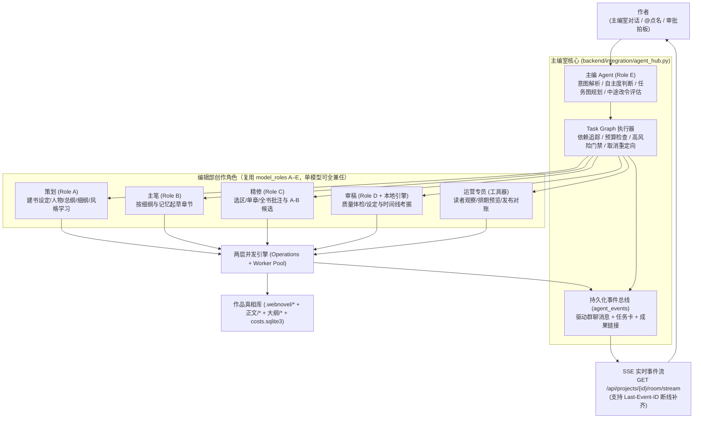

# 03 · 两层并发引擎、共享文件合并与主编室多 Agent 编排设计

> 对应需求：**痛点 3（可并行任务不互卡 + 依赖清晰自动接力）** 与 **痛点 4（一句话主编派活 + 编辑部群聊协作 + 中途改令）**  
> 落地阶段：**一期开启 SQLite WAL 并解耦单章候选写回；二期落地 `operation_scheduling` 扩展表、放开批注/A-B 并发并交付最小主编室（含弱模型工作流模板兜底）；三期铺开全链路并发槽位、父子任务共享、跨进程 SSE 实时唤醒与中途改令；四期补齐长任务指令级预算暂停续跑**

---

## 1. 两层并发引擎：计算无锁并行 + 提交分域合并

### 1.1 彻底拆除 v0.7.5 的两把“大铁锁”与路径防漂移铁律
1. **拆除任务入口一刀切（二期先松绑批注/A-B，三期全量切换）**：[app.py:254](../../../backend/manager/app.py#L254) 原靠单一 `identity = f"project:{id}"` 拦截所有同书任务。二期率先引入独立扩展表 `operation_scheduling`，为批注/预览/A-B 候选任务分配独立 `dedup_key` 放开同书并行；三期全面接管全部入口并上线槽位调度器、父子共享与依赖唤醒。
2. **拆除跨 LLM 长 IO 的文件锁**：严禁在持有任何 OS 文件锁（`file_lock`）期间发起 HTTP / 模型调用。所有长任务统一重构为三阶段协议：
   - **Stage A · 快照读（短锁 ≤ 50ms）**：在对应分域短锁内动态解析当前文件路径，读取所需正文/大纲/记忆并记录精确指纹（`base_sha256`、`brief_revision`、`plan_revision`），立即释锁；
   - **Stage B · 无锁计算（受槽位队列调度）**：在 `worker.py` 子进程内执行 LLM 调用，支持多任务真正并行；同时维护心跳与 `cancelled` 检查点；
   - **Stage C · 分域短锁提交（短锁 ≤ 100ms，Read-Modify-Write）**：只锁实际要写入的共享状态文件，重新动态解析路径并重读磁盘最新状态，按条目键合并写入；若目标基线已被其他操作改动，**绝不覆盖，安全降级为独立候选供用户合并**。
3. **跨阶段严禁缓存磁盘路径 + 永久 `chapter_uid` 绑定 + Windows 重命名退避（防 `WinError 32`）**：
   - 因章节标题编在文件名里（`正文/第N章-标题.md`），且一期支持受限删尾章与尾章拆合，所有并发任务、队列与子检查点**一律同时传递 `chapter_id` 与永久不可变的 `chapter_uid`（详见 `05` §1.1），严禁把 Stage A 读到的文件路径 `destination` 传给 Stage C 复用**；
   - Stage A 读、Stage C 写与标题改名全部在持有 `locks/chapter-{ch:04d}.lock` 期间先核验 `chapter_uid` 匹配（防止旧章被删后重号误写到新章），再调用 `chapter_versions.chapter_path(project, ch)` 动态定位当前文件，且改名统一走带 `WinError 5/32/33` 指数退避重试的 `rename_with_retry`。

### 1.2 全局锁目录、严格锁序与“跨层绝不嵌套”铁律（杜绝死锁）
将原单一的 `.webnovel/writer.lock` 细化为 `<project>/.webnovel/locks/` 下的分域锁，必须遵守两条死锁免疫铁律：

- **铁律 A · OS 文件锁与 SQLite 写事务严禁嵌套**：任何代码路径**绝对不允许**“持有 OS 文件锁期间开启 SQLite `BEGIN IMMEDIATE` 写事务”，也**绝对不允许**“持有 SQLite 写事务期间获取任何 OS 文件锁”。两者严格串行分步执行，彻底消灭 `busy_timeout (15s) > file_lock_timeout (10s)` 超时失配与 OS/SQLite 跨层 AB-BA 不可检测死锁！
- **铁律 B · 同层多把 OS 文件锁按编号升序获取（多章节按章号升序）**：若单次文件提交需同时持有多把文件锁，严格按以下编号 1 → 8 升序获取；**同一级内需锁定多个章节（如锁第 8 章与第 3 章）时，必须按整数 `chapter_id` 升序（先 3 后 8）获取**，杜绝跨章互锁（默认 `blocking=True, timeout=10`）：

| 锁序 | 锁文件路径 | 保护的磁盘对象 | 典型持有时长 | 冲突处理原则 |
| --- | --- | --- | --- | --- |
| 1 | `locks/write_head.lock` | 新章连续生成游标、`batches/*.json` | 仅在分配新章号、写入批次状态切换时持有 | 同书同时只允许一个新章生产游标，重复入口自动复用同一任务 |
| 2 | `locks/chapter-{ch:04d}.lock` | `正文/第{ch}章*.md`（草稿/批注/账本行落于 `workbench.sqlite3`，与 OS 锁严禁嵌套） | 毫秒级写正文与重命名 | 按 `chapter_uid + expected_version_id + expected_content_sha256` 校验；不匹配返回 409/降级合并 |
| 3 | `chapter_versions/.lock` | `chapter_versions/index.json`、`objects/`、`commits/` | 毫秒级版本登记 | 幂等 `op_id`，按章键独立追加版本 |
| 4 | `locks/outline.lock` | `大纲/*.md`、`story_plan.json` | 毫秒级大纲写回与双轨同步 | 校验 `revision`，不同章号区间可合并 |
| 5 | `locks/creative.lock` | `creative_brief.json`、`style_profile.json` | 毫秒级设定/学习合并 | 校验 `revision`；两样本同时学完时，后者若遇 `revision` 变化则落盘为「待合并学习建议」不覆盖前者 |
| 6 | `locks/receipts.lock` | `writer_receipts.json`、`review_attempts/` | 毫秒级回执写回 | **强制读最新文件，仅更新 `receipts[str(chapter)]` 单键**，绝不拿旧整表覆写 |
| 7 | `locks/memory.lock` | `shared_memory.json`、`character_state`、`continuity` | 百毫秒级记忆与索引更新 | 追加/按条目 ID 合并，不覆盖无关章节记忆 |
| 8 | `.publication/queue.lock` & `account.lock` | 发布队列 `manifest.json`、平台账号浏览器 | 队列写回毫秒级 / 账号浏览器按账号串行 | 同账号浏览器操作串行，不同账号可并行 |

### 1.3 任务准入、父子任务共享、依赖唤醒与取消/提交原子定序

> **严禁 `ALTER TABLE operations`（向后回滚铁律）**：核对 `v0.7.5` [app.py:134](../../../backend/manager/app.py#L134)，旧版执行的是无列名的 `INSERT INTO operations VALUES (?, ?)`。若直接给 `operations` 表加列，回滚至 `v0.7.5` 会立刻报 `table operations has 8 columns but 2 values were supplied` 导致任务写入完全瘫痪！因此**原有 `projects`、`operations`、`settings` 三张表保持列定义 100% 不变**，新增全部并发调度元数据落于按 `operation_id` 关联的独立扩展表。
>
> **Windows 多子进程 SQLite 并发硬配置（一期落地）**：核对 `v0.7.5` [app.py:99-106](../../../backend/manager/app.py#L99-L106)，`Store.connect()` 当前未开启 WAL 模式与 `busy_timeout`。多 `worker.py` 子进程与 Manager 主进程高频并发执行 `BEGIN IMMEDIATE`（`commit_state` CAS、事件写入、预算预留）时极易触发 `SQLITE_BUSY`。强制规定 `manager.sqlite3` 与 `costs.sqlite3` 的所有连接初始化统一执行：
> ```sql
> PRAGMA journal_mode=WAL;
> PRAGMA busy_timeout=15000;
> PRAGMA synchronous=NORMAL;
> PRAGMA foreign_keys=ON;
> ```
> 且所有 `BEGIN IMMEDIATE` 写事务外层包裹应用级退避重试（捕获 `sqlite3.OperationalError: database is locked / busy`，抖动退避 `50ms → 100ms → 200ms → 400ms → 800ms` 最多 5 次）；**Manager 优雅退出时强制执行一次 `PRAGMA wal_checkpoint(TRUNCATE)`**，防止用户直接复制备份作品/数据目录时漏拷 `-wal` 文件丢数据。

```sql
-- 在 manager.sqlite3 中新增独立扩展表，绝不修改原有 operations(id, payload) 表结构
CREATE TABLE IF NOT EXISTS operation_scheduling (
    operation_id TEXT PRIMARY KEY,          -- 关联 operations.id
    dedup_key TEXT,                         -- 子任务去重键（如 write_chapter:{pid}:{ch}）
    lane TEXT NOT NULL DEFAULT 'llm_general',
    directive_id TEXT,                      -- 关联主编指令
    parent_refs_json TEXT NOT NULL DEFAULT '[]', -- 挂载的父任务列表，如 [{"kind":"daily_job","id":"..."},{"kind":"directive","id":"..."}]
    params_fingerprint TEXT,                -- 写章参数与大纲修订号指纹（检测共享时的参数分歧）
    blocked_by_json TEXT NOT NULL DEFAULT '[]',  -- 前置依赖条件数组（含绑定的上游 settled_version_id）
    wait_reason TEXT NOT NULL DEFAULT '',   -- 清晰可读的等待原因，如「等待第 8 章结尾定稿确认」
    priority INTEGER NOT NULL DEFAULT 50,   -- 任务优先级（100→20，含老化防饿死，详见 08 §2）
    lease_id TEXT,                          -- Fencing Token：单调递增租约令牌，旧/失联 Worker 严禁写盘
    heartbeat_at TEXT,                      -- Worker 存活心跳（不单靠 PID 判定存亡）
    hold_amendment_id TEXT,                 -- 中途改令评估期写入最新 amendment_id（非布尔值，防连续两次改令误释放）
    staged_artifact_path TEXT,              -- 命中 hold_amendment_id 非空时暂存 Stage B 产物的检查点路径
    commit_op_id TEXT,                      -- 进入 committing 前落盘的确定性幂等提交 ID（供崩溃对账）
    commit_target_json TEXT,                -- 目标落盘对象标识，如 {"kind":"chapter","project_id":"...","chapter":1,"chapter_uid":"chuid_9f2a1c3d"}
    commit_state TEXT NOT NULL DEFAULT 'running', -- running | held | committing | committed | aborted | interrupted | cancelled | recovery_required
    updated_at TEXT NOT NULL
);
-- 事务级唯一准入索引：杜绝两个并发请求同时查不到活动子任务而分别双建
CREATE UNIQUE INDEX IF NOT EXISTS idx_op_sched_active_dedup
    ON operation_scheduling(dedup_key)
    WHERE dedup_key IS NOT NULL AND commit_state IN ('running', 'held', 'committing', 'recovery_required');
CREATE INDEX IF NOT EXISTS idx_op_sched_state ON operation_scheduling(commit_state, lane, priority DESC);
```

1. **父任务独立 + 写章子任务事务级唯一共享（日更与主编不打架、不互相丢后续）**：
   - 日更任务（含写第 10 章 → 入队 → 定时排期）与主编任务（如“试写第 10 章并审稿”）**保留各自独立的父任务记录**，仅在“生成第 10 章正文”这一步共享同一个 `chapter_write` 子任务（`dedup_key = "write_chapter:{project_id}:10"`）：
     - **事务级唯一准入**：插入 `operation_scheduling` 受部分唯一索引 `idx_op_sched_active_dedup` 约束，高并发下不会双建；
     - **参数一致性与后续分歧处理**：挂载前比对 `params_fingerprint`（目标字数、指令约束摘要、依据的 `plan_revision`）；一致则直接共享挂载；若挂载时或运行中途两个父任务提出不同新要求，**冻结共享关系、拆分为独立候选或交作者裁决**；
     - **独立取消互不误伤**：取消其中一个父任务时，仅将其从共享子任务的 `parent_refs_json` 移除；只要还有其他存活父任务依赖该子任务，写章子任务继续运行并把成果交付给存活父任务；仅当 `parent_refs_json` 变空时才真正取消该子任务。
2. **并发槽位调度器（三级优先级 + 前台交互专属保底槽 + 三级细粒度暂停，详见 `08` §2）**：
   - `Operations` 内置轻量调度器，按 `lane` 控制最大活跃子进程数（可配置）：
     - `llm_general`：默认活跃上限 `4`（同时按供应商/免费池软限流，遇到 429 冷却自动让出槽位）；
     - `browser_account:{name}`：每账号固定 `1`；`local_io`：默认 `4`。
   - **三级优先级与前景交互专属保底槽位（修复 P1 自动日更 + P2 批量联手占满槽位饿死前台的漏洞）**：
     - **P0 前台即时交互级（90–100）**：作者选区即时改稿 / A-B（100）、主编直接对话（90）；
     - **P1 主动创作与自动日更级（60–80）**：作者主动点击单章写作（80）、作者主动触发审稿（70）、**后台自动日更（60，归入后台配额池）**；
     - **P2 后台批量级（20–40）**：后台记忆提取（40）、全书批量扫描（30）、示范样本学习（20）；
     - **硬性留槽规则**：**所有非交互后台任务（`P1 自动日更` + 全部 `P2 批量任务`）合计最多占用 `max_slots - 1` 个槽位（默认最多 3 槽）**，确保始终为 P0 前台即时交互（及作者主动点击的 P1 创作）预留至少 **1 条专属快速通道**；同时引入时间老化（每排队 60 秒有效优先级 `+5`，但不突破交互保底槽红线），防止低优先级任务永远饿死。
   - **三级细粒度暂停控制**：提供 **单任务暂停/取消**、**单作品自动任务暂停**（暂停该书日更与后台批量，不影响其他书或手工交互）、**全局 AI 急停**（一键冻结全部新派发，正在 `committing` 的安全落盘，等待/运行中任务优雅中止）。
   - **同时受理 vs 同时运行**：同时发起 5 个 `llm_general` 任务时，**5 个全部受理返回成功（0 个 409）**，至多 4 个运行，第 5 个进入 `queued` 并明确展示 `wait_reason`（如 `模型并发槽位已满（4/4），排队第 1 位`），任一槽位释放即按有效优先级自动接力启动。
3. **依赖等待与明确作者决定唤醒（含提交前上游版本复核）**：
   - 当第 9 章依赖第 8 章结尾定稿时，第 9 章状态为 `waiting`，`blocked_by = [{"kind": "chapter_settled", "project_id": pid, "chapter": 8, "chapter_uid": "chuid_9f2a1c3d", "require_explicit": true}]`，`wait_reason = "等待第 8 章结尾定稿确认"`；
   - **明确触发条件**：只有作者对第 8 章执行了显式确认动作（采纳结尾候选并勾选可续写 / 确认可供下章承接 / 显式定稿 / 审查通过），记录绑定的 `settled_version_id` 并发出 `chapter_settled` 事件后，才自动唤醒第 9 章；**普通 `Ctrl+S` 绝不误唤醒**，等待期间 0 模型调用；
   - **上游变动复核**：若第 9 章被唤醒开始写作后，作者又回头修改了第 8 章（产生新 `version_id`），第 9 章在 Stage C 提交前复核发现依赖的第 8 章已变，自动降级为候选并标明「所依赖的第 8 章已有新改动，请确认后采纳」。
4. **租约 Fencing、`committing` 禁续租与取消/改令/提交线性化定序（严禁锁嵌套 + 崩溃对账）**：
   - 严格遵守「**先校 `lease_id` + 写 `commit_op_id` + SQLite CAS → 释放 DB 事务 → 再拿 OS 分域文件锁落盘 → 释放文件锁 → 更新终态**」，OS 锁与 DB 锁零嵌套：
     - **Worker 租约 Fencing 与 `committing` 禁续租红线（防双写）**：
       - 每次启动/恢复 Worker 签发全新单调递增 `lease_id` 并定期刷新 `heartbeat_at`；旧 Worker 重连或失联后醒来，其 `lease_id` 已不匹配 DB 当前值，Stage C CAS 必然失败（0 字节写盘）；
       - **严禁在 `commit_state = 'committing'` 后继续续租**：一旦进入 `committing`，租约不再延长；若在此窗口内超时/失联，Manager **绝不自动重发新 `lease_id` 或拉起第二个 Worker**，而是将其置为 **`recovery_required`**，必须先确认旧 Worker 进程树已退出，再执行 `transaction_journal` / `commit_op_id` 盘面对账后方可解锁或重试！
     - **取消路径（先优雅结算、超时再强杀进程树）**：
       1. SQLite `BEGIN IMMEDIATE` 执行 `UPDATE operation_scheduling SET commit_state='cancelled', updated_at=? WHERE operation_id=? AND commit_state IN ('running', 'held')`；若影响 `1` 行，取消成立；若影响 `0` 行且当前已是 `committing`/`committed`，诚实告知用户“结果已进入最终落盘，可在版本历史一键撤销”；
       2. 优先向 Worker 发送取消信号并等待 **2–3 秒优雅窗口**（让子进程关闭 HTTP 流并结算实耗）；超时再复用既有 [app.py:170](../../../backend/manager/app.py#L170) 的 `stop_process_tree()`（Windows `taskkill /PID <pid> /T /F`、POSIX `os.killpg`）强杀完整进程树，并按 `03` §3 **五态预算状态机**处理未结算请求。
     - **中途改令暂挂路径（支持连续多次改令不误释放）**：收到改令瞬间、调用 Role E 评估之前，递增该指令的 **`directive_revision`** 并生成唯一 `amendment_id`，在 SQLite 短事务内将受波及 `running` 子任务的 **`hold_amendment_id = amendment_id`**（覆盖旧改令 ID 并自动作废前一条未决确认卡）；仅匹配当前最新 `hold_amendment_id` 的裁决才能释放挂起！
     - **Worker 提交前门禁（Stage C 入口，获取任何 OS 锁前执行 SQLite `BEGIN IMMEDIATE`）**：
       1. 生成确定性 `commit_op_id` 并执行原子 CAS：
          `UPDATE operation_scheduling SET commit_state='committing', commit_op_id=?, commit_target_json=?, updated_at=? WHERE operation_id=? AND lease_id=? AND commit_state='running' AND hold_amendment_id IS NULL`；
       2. 若影响 `1` 行 → 立即提交关闭 SQLite 事务，再获取 OS 分域文件锁、走 `transaction_journal`（`05` §3）携带 `commit_op_id` 幂等落盘；落盘成功再开独立短事务置 `commit_state='committed'`；失败则回落 `aborted`；
       3. 若影响 `0` 行 → 查询当前行：
          - `lease_id` 过期或 `commit_state == 'cancelled'`：立即丢弃结果，0 字节写盘；
          - `hold_amendment_id IS NOT NULL`：将 Stage B 产物写入独立临时检查点 `staged_artifact_path`（不碰正文/大纲/回执），更新 `commit_state='held'` 挂起等待最新改令裁决！
       - *(注：此机制保证在**提交线性化点之前**收到的改令 100% 冻结旧结果；对改令到达前已跨过线性化点进入 `committing` 的产物，明示无法拦截、完整保留版本历史并在改令影响表中标出供作者回滚或修订。)*
5. **启动与运行期崩溃对账（`committing` / `recovery_required` 闭环）与外部发布恢复**：
   - Manager 启动时（以及运行期检测到 `recovery_required` 时）扫描 `operation_scheduling` 中**对应 Worker 进程已死亡但仍处于 `committing` 或 `recovery_required`** 的记录（同时延续既有 `app.py:205,251` 的 `upgrade-admission.lock`、`maintenance.json` 与 `operations_operation_key` 去重契约）：
     - 先按 `05` §3 执行未决 `tx.json` 恢复，再根据 `commit_op_id` 与 `commit_target_json` 查验目标存储（如 `chapter_versions/commits/{commit_op_id}.json`、候选预览文件或大纲修订号）：
       - **盘上已落盘（含经 `transaction_journal` / `chapter_versions.recover_pending()` 补齐）**：直接将 `commit_state` 推进为 `committed` 并向 `agent_events` 补发成果事件；
       - **盘上未落盘**：安全回落为 `interrupted` 并按五态预算规则释放仅处于 `reserved` 的悬空预留（已 `dispatched` 的标为 `unknown_charge`），供用户一键续跑。
   - 其余已完成步骤直接恢复成果引用；被中断的 `running` 子进程标为 `interrupted` 保留断点；
   - 涉及外部平台发布且网络/浏览器中断导致结果不明时，状态标为 `needs_reconcile`，**强制先跑平台状态对账（`reconcile`）确认线上是否已成功发布**，绝不盲目重试导致重复发章。

---

## 2. 主编室多 Agent 编排引擎（`agent_hub` + `agent_room`）

### 2.1 架构分层：确定性编排器 + 结构化工具总线



### 2.2 SQLite 持久化表设计（支持零作品开书会话 + 建书后原子绑定）

> **零作品首屏闭环设计**：允许 `project_id TEXT NULL` 并引入 **`session_id TEXT NOT NULL`**。当首装用户尚无作品时，前端向 `POST /api/chief/messages` 发起对话（自动分配 `session_id = "prebook_<uuid>"`）；主编调用 `create_book` 成功创建新书拿到 `project_id` 后，后端在单个 SQLite 事务内执行 `bind_session_to_project(session_id, project_id)`，将四张表中该 `session_id` 关联的原指令、任务节点、对话消息与拍板事项全部回填 `project_id` 并推送 `project_bound` 事件，前端无缝切至新书工作区，开书第一句话与后续汇报全程连贯不丢。

```sql
-- 1. 主编指令单（一次作者宏观要求对应一条 directive，用于聚合进度、串行改令与总费用）
CREATE TABLE IF NOT EXISTS agent_directives (
    id TEXT PRIMARY KEY,                  -- 例如 dir_9f2a1c
    session_id TEXT NOT NULL,             -- 未建书时为 prebook_<uuid>，建书后仍保留便于追溯
    project_id TEXT,                      -- 尚未建书时为 NULL，建书成功单事务绑定
    directive_revision INTEGER NOT NULL DEFAULT 1, -- 每次中途改令递增，用于丢弃过期评估与作废旧审批卡
    title TEXT NOT NULL,                  -- 主编提炼的简短目标，如「县城悬疑：搭人物+十章细纲+前三章」
    raw_instruction TEXT NOT NULL,        -- 作者原始话术
    autonomy TEXT NOT NULL,               -- propose | step_confirm | auto_chain | dry_run_first
    constraints_json TEXT NOT NULL,       -- 本次提取的硬约束，如 ["前三章不揭晓改图者"]
    status TEXT NOT NULL,                 -- planning | running | awaiting_approval | paused_budget | amended | completed | cancelled
    budget_cap_cny TEXT,                  -- 可选：本次指令自定义费用上限
    max_calls INTEGER NOT NULL DEFAULT 20,-- 二期 2B 即生效的最低调用次数护栏
    created_at TEXT NOT NULL,
    updated_at TEXT NOT NULL
);

-- 2. 任务图节点（每步具体派活，绑定真实后台 operation_id、子检查点与成果引用）
CREATE TABLE IF NOT EXISTS agent_tasks (
    id TEXT PRIMARY KEY,                  -- 例如 tsk_01
    directive_id TEXT NOT NULL,
    session_id TEXT NOT NULL,
    project_id TEXT,
    role TEXT NOT NULL,                   -- chief | planner | writer | editor | reviewer | publisher
    title TEXT NOT NULL,                  -- 如「编写第 1–10 章细纲」
    tool_name TEXT NOT NULL,              -- 对应的内部工具原语，如 create_book / plan_chapters / write_chapter / run_annotation
    params_json TEXT NOT NULL,            -- 完整工具参数与依据的 base_snapshot
    depends_on_json TEXT NOT NULL,        -- 前置任务 ID 或外部条件列表
    status TEXT NOT NULL,                 -- pending | waiting | running | awaiting_approval | completed | superseded | failed | cancelled | paused_budget
    wait_reason TEXT DEFAULT '',
    operation_id TEXT,                    -- 关联 operations.id
    checkpoint_json TEXT,                 -- 节点内部多步调用的子检查点（用于单节点中途超预算续跑不重做）
    artifact_ref_json TEXT,               -- 成果卡片引用：{"kind":"chapter","chapter_id":1,"version_id":"...","anchor":...}
    error TEXT DEFAULT '',
    created_at TEXT NOT NULL,
    updated_at TEXT NOT NULL
);

-- 3. 持久化事件流与群聊消息（同时服务主编主对话、编辑部群聊、任务进度与跨窗口工作区同步）
CREATE TABLE IF NOT EXISTS agent_events (
    seq INTEGER PRIMARY KEY AUTOINCREMENT, -- 单调递增游标，直接用作 SSE id / Last-Event-ID
    event_id TEXT UNIQUE NOT NULL,
    session_id TEXT NOT NULL,
    topic_id TEXT NOT NULL DEFAULT 'default', -- 话题归档 ID（支持「开启新话题」隔断长会话旧上下文）
    project_id TEXT,
    directive_id TEXT,
    task_id TEXT,
    channel TEXT NOT NULL,                 -- chief_chat | team_room | task_signal | workspace_signal（正文/草稿/大纲跨端变更广播）
    sender_role TEXT NOT NULL,             -- author | chief | planner | writer | editor | reviewer | publisher | system
    mentions_json TEXT DEFAULT '[]',       -- 如 ["editor"]
    kind TEXT NOT NULL,                    -- text | plan_card | artifact_card | conflict_card | approval_card | amendment_card | budget_card | project_bound | progress_signal | chapter_committed | draft_updated | outline_updated
    summary TEXT NOT NULL,                 -- 简练汇报正文
    payload_json TEXT NOT NULL,            -- 富卡片或轻量变更版本号数据
    created_at TEXT NOT NULL
);
CREATE INDEX IF NOT EXISTS idx_agent_events_proj_seq ON agent_events(project_id, seq);
CREATE INDEX IF NOT EXISTS idx_agent_events_sess_seq ON agent_events(session_id, seq);
CREATE INDEX IF NOT EXISTS idx_agent_events_topic ON agent_events(project_id, topic_id, seq);
```

#### 主编室长会话上下文窗口管理（防长篇几百轮撑爆弱模型）
- 每次向 Role E 发送主编对话时，**绝不把全量 `agent_events` 历史塞进 Prompt**，而是按固定预算组装四层上下文：
  1. **作品当前态势卡**（书名、章数、当前大纲/约束摘要、记忆库检索片段）；
  2. **当前活跃指令摘要**（进行中 / 待拍板 / `held` 的指令与任务状态）；
  3. **当前 `topic_id` 下最近 `K` 轮（默认 `K = 8`，且字符上限 ≤ 12,000）的滑动窗口对话**；
  4. **作者可一键点击「开启新话题」**（`POST /api/projects/{id}/chief/topics`）切出新 `topic_id`，立即清空旧对话上下文干扰，同时旧话题全部消息完整保留在历史中可随时翻阅。

-- 4. 待作者拍板事项（含版本绑定与防重放过期机制，详见 08 §5）
CREATE TABLE IF NOT EXISTS agent_approvals (
    id TEXT PRIMARY KEY,
    session_id TEXT NOT NULL,
    project_id TEXT,
    directive_id TEXT,
    directive_revision INTEGER NOT NULL DEFAULT 1, -- 改令递增后旧审批卡自动失效
    task_id TEXT,
    kind TEXT NOT NULL,                    -- plan_confirm | variant_pick | annotation_conflict | book_scope_confirm | amendment_confirm | amendment_fallback | budget_resume | publish_authorize
    title TEXT NOT NULL,
    artifact_fingerprint TEXT,             -- 绑定的正文/大纲/范围指纹，执行前二次复验防重放
    approved_scope_hash TEXT,              -- 确认执行范围的哈希
    expires_at TEXT,                       -- 审批有效期，过期自动失效需重生成
    detail_json TEXT NOT NULL,
    status TEXT NOT NULL,                  -- pending | approved | rejected | expired | superseded
    resolved_by TEXT,                      -- 强校验：仅允许 author 解决高风险审批，禁止 Agent 自批
    decision_json TEXT,
    created_at TEXT NOT NULL,
    resolved_at TEXT
);
```

### 2.3 主编三级编排路由（零调用快问 + 弱模型模板兜底 + 自由 DAG）与受控工具集

> 详见 `08_模型资源调度_费用控制与Agent权限.md`（含 9 维模型能力矩阵、安全降级、四主体权限隔离与提示词注入防护）。

1. **Level 0 · 本地确定性路由与只读快问（零主编编排消耗）**：
   - 查看进度、打开某章、停止任务、保存草稿、执行已有批注直接本地执行（0 模型调用）；
   - 明确的 `@精修`/`@审稿` 且参数充足无歧义时直接派往对应角色，不额外多耗一次主编调用；
   - 作者提出考据快问（如“第 3 章那张地图最后谁拿走了？”）识别为 **`qa_lookup`**，直查世界状态引擎/本地检索后秒回，**不建 `agent_directive` 和 DAG、不污染右侧任务栏**。
2. **Level 1 · 高频标准意图走「轻量槽位提取 + Python 确定性工作流模板」**（覆盖约 85% 常见创作指令）：
   - Role E 只输出极简平面 JSON：`{"intent": "...", "autonomy": "...", "slots": {...}, "constraints": [...]}`；
   - 由确定性 Python 模板工厂装配绝对无环、参数经 Pydantic 强校验的 **6 大标准模板**（`template_bootstrap_book`、`template_plan_and_write`、`template_selection_ab`、`template_chapter_annotations`、`template_book_directive`、`template_schedule_preview`）。
3. **Level 2 · 开放式复合指令走「受限自由 DAG 规划 + 硬校验兜底」**：
   - 通过四道程序防线：① 受控工具白名单 + Pydantic 强校验；② 拓扑排序环检测；③ 节点数上限 `MAX_DAG_NODES = 12` 与递归派活深度 `≤ 2`；④ 最多 2 次格式纠偏，仍失败则优雅降级为「提案/步进确认模式」。

*(注：支持在精修/A-B/失败卡片上对**当前单步临时换模型重试**，且支持主笔**实时流式生成预览、随时停止保留已写内容并追加指令续写**，详见 `08` §3。)*

主编和各角色不发明新写盘黑盒，只调用经过测试的受控原语（所有正文/样本/读者评论一律作为不可信创作资料隔离，防提示词注入诱骗调写/删工具）：

| 归属角色 | 工具原语 | 底层复用模块 | 是否需要高风险确认 |
| --- | --- | --- | --- |
| **主编 (E)** | `create_book`、`set_directive_constraints`、`create_task_graph`、`amend_directive`、`ask_author_decision` | `app.py` 建书 + `agent_hub.py` | 推翻已定稿大纲/高耗批改需确认 |
| **策划 (A)** | `draft_proposals`、`update_creative_brief`、`generate_characters`、`plan_chapters`、`learn_sample` | `studio.py` + `character_state.py` + `outline_editor.py` | 重置已有总纲需确认；新建/扩充自动落盘并留备份 |
| **主笔 (B)** | `write_chapters` | `studio.batch` / `writer_runner`（按章任务拆分） | 自动落盘为新章草稿/初稿（不覆盖已有正文） |
| **精修 (C)** | `rewrite_selection`、`generate_ab_variants`、`revise_chapter_by_annotations`、`scan_book_directive`、`execute_book_directive` | `annotations.py` + `text_merge.py` + `revision_plan.py` | 仅生成独立候选预览（零覆盖风险）；全书批量生候选前需确认范围与费用 |
| **审稿 (D)** | `review_chapter`、`audit_continuity_and_facts`、`check_style_precheck` | `writer_runner.review` + `continuity.py` + `style_rules.py` | 纯读与写报告，零覆盖风险；发现矛盾直接发带原文锚点的考据卡 |
| **运营 (Tool)** | `analyze_reader_metrics`、`preview_publish_schedule`、`request_publish_authorization` | `reader_metrics.py` + `schedule_buffer.py` + `publishing.py` | **真实发布/排期写入强制走确认卡片 + 既有发布授权流程** |

### 2.4 中途改令算法（Directive Amendment，配合 `hold_amendment_id` 与 `directive_revision` 串行控制）
当某条主编指令正在运行中，作者发来改令（如 *“第二章别进山，把冲突放在档案馆”* 或 *“保留人物关系，把凶手换掉”*）：
1. **同一 `directive_id` 改令严格串行 + 写入 `hold_amendment_id`**：在调用 Role E 评估之前，先在单事务内递增 `directive_revision`、生成新 `amendment_id`、作废任何未决旧改令确认卡，并将受波及 `running` 子任务置 **`hold_amendment_id = amendment_id`**；若连续发来第二条改令，第一条旧评估结束时因 `directive_revision` / `amendment_id` 已过期自动丢弃，绝不误释放第二次改令想拦住的 Worker！
2. **依赖与内容影响面评估（Role E）**：传入当前任务图状态 + 已落盘（含刚跨过线性化点进入 `committing` 的产物）与已 `held` 暂存的摘要 + 作者新改令，让主编输出结构化影响单：
   - `keep`（保留不受影响的任务与成稿；若对应任务正处于 `held` 且匹配当前 `hold_amendment_id`，立即放行提交）；
   - `update`（需要改写或局部修订的对象）；
   - `wait_and_redo`（需取消/等待新上游完成后重跑的下游；已 `held` 的旧方向产物安全归档，已提交的旧方向产物保留版本历史并标出待审）；
   - `preserve_versions`（所有已写旧方案与旧草稿自动归档入版本历史，标注来源 `superseded_by_amendment`）。
3. **快速确认与异常/超时降级兜底（防止 `held` 永远悬空）**：
   - 若仅涉及尚未动笔的细纲或单章未写稿，主编直接在群聊发「已按新方向调整计划」并附变更卡片即刻续跑；若影响已写多章正文，弹出「变更影响确认卡」由作者勾选重做范围；
   - **评估失败 / 超时 / 超预算兜底**：若 Step 2 调用 Role E 发生网络超时、解析失败或触发 `BudgetExceeded`，编排器**严禁让 `hold_amendment_id IS NOT NULL` 的任务沉默卡死**，必须立即在「待你决定」弹出**降级人工裁决卡**（`kind = "amendment_fallback"`），提供三个清晰按钮：**[放行已暂停结果] / [作废暂存并按新方向重试评估] / [取消本次改令恢复原计划]**；
   - **`staged_artifact_path` 生命周期清理**：一旦对应 `held` 任务被放行或作废、或所属指令已完结/取消超过 7 天，定期 GC 自动清理暂存文件；若作者长期未点击确认，任务卡持续置顶在「待你决定」并在诊断面板支持一键处置。

### 2.5 实时事件流、多子进程跨进程唤醒与双端同步协议
- **流式接口（同时覆盖有书态与零作品开书态）**：
  - 作品流：`GET /api/projects/{identity}/room/stream?after_seq=120`
  - 未建书会话流：`GET /api/chief/room/stream?session_id=prebook_xxx&after_seq=0`
  - 两者均输出标准 `Content-Type: text/event-stream; charset=utf-8`，支持 `Last-Event-ID` HTTP 请求头与 `after_seq` 参数。
- **持久事件与瞬态信号分离（防止 `agent_events` 无限膨胀）**：
  - 业务成果、对话、审批、改令等持久化写入 `agent_events`；
  - 高频瞬态信号（`progress_signal` 进度心跳、`draft_updated` 草稿保存提醒、实时生成预览片段 `live_preview_delta`）**仅走内存广播（并在内存/临时缓存保留最近已生成文本快照）**，绝不永久塞进 `agent_events` 拖慢 `room/state`。
  - **实时生成预览断线恢复**：若 SSE 断线重连期间主笔正在流式写章，前端自动拉取 `GET /api/projects/{id}/operations/{op_id}/live-preview` 拿回最新累计预览文本快照，再继续拼接后续增量片段，绝不丢前文或重复拼接。
- **多子进程 → Manager 主进程 SSE 跨进程实时唤醒机制（零污染且 100% 兼容既有日志采集）**：
  - 核对 [app.py:410-480](../../../backend/manager/app.py#L410-L480)，现有 `Operations._execute()` 采用 `stderr=subprocess.STDOUT` 统一采集 `log_tail` 与 `NOVEL_HELPER_PROGRESS:`。为彻底免疫第三方库 `print()` 污染且**零改动破坏既有日志采集与 `test_app.py`**，采用**回环内部接口唯一主通道 + 短读兜底**：
    1. **唯一主通道（本地回环认证端点）**：Manager 启动时生成进程级随机 `internal_wakeup_token` 通过环境变量注入子进程；`worker.py` 写完 `agent_events` 拿到自增 `seq` 后，直接调用本地 `POST http://127.0.0.1:{port}/internal/events/notify`（携带内部令牌，仅传极小信封 `{"seq": seq, "project_id": pid, "session_id": sid}`；因 `index.js` `allowsRead` 与 `WRITE_ROUTES` 仅代理 `/api/*`，`/internal/*` 天然与外部完全隔离）；
    2. **保留既有 `stdout/stderr` 采集不变**：`Operations._execute()` 保持 `stderr=subprocess.STDOUT` 专职采集 `NOVEL_HELPER_PROGRESS:` 与 `log_tail`，不让 SSE 业务事件与日志争抢同一管道；
    3. **兜底保险（短读防 WAL 膨胀）**：活跃 SSE 连接的 `asyncio.Event` 等待设 **500ms 超时**，超时执行**即开即关的短读连接**（查完立即 `close()`），严禁跨 `wait()` 持游标阻塞 WAL checkpoint。
- **为什么不使用原生 `EventSource` & 标准 SSE 协议完整实现**：
  - 因 DSH 代理强制校验自定义请求头 `x-novel-helper-token`（[index.js:918](../../../index.js#L918)），双端通过 `workbench-core.js` 统一用 `fetch() + ReadableStream` 解析标准 SSE，并**严格修正 `TextDecoder` 用法（`{ stream: true }` 传给 `decode()` 而非构造函数）**：
    ```js
    const decoder = new TextDecoder('utf-8');
    while (true) {
      const { value, done } = await reader.read();
      if (done) break;
      buffer += decoder.decode(value, { stream: true });
      // 解析完整 SSE 帧：支持多行 data: 拼接、单分片多事件、空行/心跳忽略
    }
    buffer += decoder.decode(); // 冲刷尾部字节
    ```
  - **快照/订阅精确对齐与慢客户端背压保护**：
    - `GET /room/state` 快照响应**强制返回 `snapshot_seq`**（本次快照覆盖的精确最大 `agent_events.seq`）；前端遵循「先建 SSE 订阅并缓冲 → 拉取 `room/state` 拿到 `snapshot_seq` → 丢弃缓冲中 `seq <= snapshot_seq` 的帧、按序回放 `seq > snapshot_seq` → 按 `event_id` 去重」彻底消除快照竞态；
    - **慢客户端有界队列背压**：Manager 为每条 SSE 连接维护有界发送队列（默认 `maxsize = 256`）；队列满时先丢弃瞬态 `progress_signal` / `live_preview_delta` 帧，若持久事件仍堆积溢出，则下发单条 `resync_required` 帧并安全断开该慢连接，防止单页卡死拖爆 Manager 内存；
    - 切书或切会话时先 `AbortController.abort()` 旧流防跨书串消息。
- **DSH 代理透传要点（核对 [index.js:351,805-847](../../../index.js#L805-L847)）**：
  - `allowsRead` 已放行 `/api/*`（除 `_service`），故 `/api/projects/:identity/room/stream`、`/api/chief/room/stream`、`/api/chief/room/state`、`/api/projects/:identity/operations/:opId/live-preview` 自动通过读门禁；
  - **`forward()` 必改两处**：① 显式转发 `request.headers['last-event-id']` 给上游；② 当上游响应 `content-type` 包含 `text/event-stream` 时，**严禁走 `await upstream.arrayBuffer()` 整包缓冲**，改为立刻 `clearTimeout(timer)` 关闭 `upstreamTimeoutMs`、写头（含 `'x-accel-buffering': 'no'`）并逐块流式 `response.write()` 透传 `upstream.body`，后端每 15 秒发送 `: ping\n\n` 心跳保活。

---

## 3. 指令级成本归因、五态预算状态机与子检查点续跑（复用 `costs.py`，详见 `08` §4）

> **节奏前移**：基础 `ModelGateway`（演进自既有 `provider_client.py`）与预算预留从 **2A（`v0.8.2`）** 起即接管全部模型调用；`directive_budget_links` 与最低限度指令级护栏（单条指令最大调用次数默认 20、最大自动生章数默认 3、单条指令 Token/人民币上限、节点上限 12、递归深度 ≤ 2）在 **2B（`v0.8.5`）** 主编室上线前即同步启用，绝不等到四期！

1. **指令上下文透传与 `costs.py` 实装修正**：统一经 `ModelGateway` + `costs.scope()` 携带 `directive_id`、`op_id` 与 `agent_role`，新增独立表 `directive_budget_links`（不改原 `request_budget` 表列）；修补 [costs.py:195-198](../../../backend/integration/costs.py#L195-L198) 无全局上限时提前 `return None` 的问题，确保传入指令级护栏时强制进入预留校验。
2. **五态预算状态机（与 `05` §1.2 及 `08` §4 严格统一）**：
   - 完整五态演进：**`reserved`（已本地占位、尚未发出网络请求）→ `dispatched`（已真正向供应商发出 HTTP 请求）→ `settled`（已结算实耗）| `unknown_charge`（已发出但进程强杀/断网未收到回执，计入未结算风险额度，不假装零消耗）| `released`（确认为 `reserved` 尚未发包时安全释放，且同步将 `tokens=0, cost_cny='0'` 清零以兼容 `v0.7.5` 回滚读取）**；
   - 两角色并发抢最后一笔余额仍由 SQLite `BEGIN IMMEDIATE` 原子裁决；未定价模型除醒目标注「费用未知」外，**必须支持按请求次数/Token 硬上限管控**，避免人民币上限对未定价模型形同虚设。
3. **节点级 + 节点内子检查点精确续跑**：多步节点每次子调用落盘 `checkpoint_json`；超预算精确停在当前步，补充额度后直接从断点续跑，0 重复消耗前序已完成调用。
