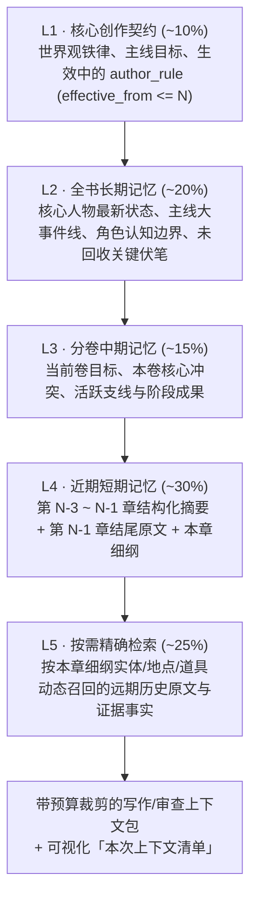

# 06 · 长篇小说世界状态、五级分层记忆与混合检索引擎（P1 核心壁垒）

- **优先级与务实分期（拆解三期复杂度，止步 `v0.9.5`）**：
  - **三期（`v0.9.0`）确定性核心**：落地统一存储（收敛于 `.webnovel/workbench.sqlite3`，不另建第二套 SQLite 库）、**Python 2-gram + 单字切分 FTS5 `unicode61` 检索**、作者手动锁定核心人物/道具/规则卡（带 `entity_id` / `pinned` / `story_time`）以及每次写章/审稿的透明 **`context_manifest` 上下文清单**；
  - **四期（`v0.9.5`）AI 增强与因果分析**：落地 AI 增量状态提取（带置信度 + 高危变更待确认防脏数据护栏 +「故意为之/回忆杀，忽略此冲突」按钮）与全书改设定五类剧情因果影响分析。
- **核心原则**：**不另起一套相互打架的记忆系统**，而是将 `v0.7.5` 既有的 `shared_memory.json`、`character_state`、`entity_state` 与 `continuity` 统一收口升级为 **「小说世界状态引擎（Story State Engine）」**，解决百万字长篇写到第 300 章依然不吃书、不泄密、不丢伏笔的核心创作质量问题。

---

## 1. 小说世界状态引擎（Story State Engine）

### 1.1 八大结构化事实域
统一由新门面模块 `backend/integration/world_state.py` 封装演进自既有 `memory_library.py`、`character_state.py`、`entity_state.py`、`continuity.py` 与 `retrieval_plan.py` 对外提供读写、校验与快照检索，底层存储兼容迁移自 `.webnovel/shared_memory.json` 并统一落入单作品 **`.webnovel/workbench.sqlite3`（WAL 模式，详见 `05` §2，已实测打包运行时 Python 3.13.17 + SQLite 3.50.4 原生开启 `ENABLE_FTS5`，零新增第三方依赖、零回滚破坏）**：

| 事实域 | 追踪核心要素 | 典型防吃书防线 |
| --- | --- | --- |
| **1. 人物状态 (`character`)** | 所在位置、对外化名/真名、生死伤势、能力等级、关键秘密、人物关系边 | 防止已死配角复活、人物瞬移、化名与真名混用 |
| **2. 角色认知边界 (`knowledge`)** | `who` 知道 / 不知道 `what`（何时获知、消息来源、误解状态） | **悬疑/权谋命门**：防止不知道凶手是谁的姐姐在第 3 章提前说漏嘴 |
| **3. 道具与资源 (`item`)** | 归属者、数量、物理状态（完好/损坏/销毁/遗失）、有效章区间 | 第 30 章获得、第 45 章送人、第 60 章销毁的青铜令牌，第 80 章绝不会凭空再从女主兜里掏出 |
| **4. 剧情时间线 (`timeline`)** | 故事内日期/时段、关键事件先后顺序、因果链与耗时 | 防止前一天下雨的案发日期在十章后写成晴天或顺序倒置 |
| **5. 世界观与地图 (`world_rule`)** | 地点拓扑距离、势力格局、超自然/行业硬规则与代价 | 防止战力体系崩坏、两地距离前后相差十倍 |
| **6. 伏笔与支线 (`foreshadow`)** | 埋设章、推进节点、计划回收章、当前状态（已埋/推进中/已回收/废弃） | 长篇防遗忘，提醒“第 6 章埋下的旧地图篡改者伏笔已 15 章未推进” |
| **7. 已发生剧情事实 (`event_fact`)** | 已定稿正文中的原子事实 + 原文引文证据 + 来源 `version_id` | 任何事实皆可一键回溯到精确章节和原句 |
| **8. 作者锁定约束 (`author_rule`)** | 作者锁定的铁律、`effective_from_chapter` 生效章界、例外条件 | 绝对高于模型推断，全书跨章改设定直接落此域 |

### 1.2 带故事时间、稳定实体 ID 与防脏数据字段的结构化事实 Schema
```json
{
  "fact_id": "fact_0042",
  "entity_id": "ent_char_shen_zhiwei",
  "pinned": true,
  "domain": "item | character | knowledge | timeline | world_rule | foreshadow | event_fact | author_rule",
  "assertion_type": "fact | rumor | lie | belief",
  "subject": "女主（沈知微）",
  "predicate": "持有",
  "object": "青铜令牌",
  "story_time": "第一卷·第3天夜",
  "narrative_chapter": 30,
  "valid_from_chapter": 30,
  "valid_until_chapter": 44,
  "effective_from_chapter": null,
  "exceptions": [],
  "source_chapter": 30,
  "source_chapter_uid": "chuid_9f2a1c3d",
  "source_version_id": "ver_0003_a1b2c3d4",
  "source_quote": "她将青铜令牌收入怀中。",
  "authority_level": "confirmed_prose",
  "confidence": 0.96,
  "status": "active | pending_confirm | superseded | needs_review | conflicted | ignored_by_author | archived",
  "author_locked": false,
  "updated_at": "2026-11-26T12:00:00+00:00"
}
```

### 1.4 实体分层与 AI 自动提取防脏数据护栏（四期 `v0.9.5` 必配）
长篇连载中“AI 幻觉自动污染状态库”比“没有记忆”更危险。强制建立四道防脏数据护栏：
1. **核心实体置顶（`pinned`）与龙套分层**：主角团、核心反派、关键道具标记 `pinned = true` 长期跟踪；一次性路人/临时物品标记 `pinned = false` 按卷归档，防止写到 500 章时实体表膨胀成噪声。
2. **高危不可逆状态变更进待确认队列**：AI 自动提取若涉及 **核心（`pinned`）人物死亡/重伤致残、关键道具销毁/永久丢失、核心身份/秘密暴露**，绝不直接写入 `active`，一律落入 `status = "pending_confirm"` 待确认队列，经作者一键「确认生效」或「误报丢弃」后才生效；`confidence < 0.75` 的低置信推断同样不覆盖既有事实。
3. **区分 `story_time`（故事内时间）与 `narrative_chapter`（叙事章节号）及 `assertion_type`**：倒叙/回忆杀章节中已死角色在过去时间点登场，或角色故意说谎（`assertion_type = "lie"`）/传闻（`rumor`），不得误判为客观事实或吃书冲突。
4. **冲突卡一键「故意为之 / 回忆杀，忽略此冲突」**：任意时间线/设定冲突卡片均提供「忽略此冲突（故意为之 / 回忆杀）」按钮，将该决定按 `(fact_id, chapter_uid, version_id)` 记为 `ignored_by_author`，后续复审不再重复打扰作者。

### 1.3 七级权威优先级体系（彻底解决“谁说了算”）

| 权威级别（由高到低） | 来源 | 冲突处理规则 |
| --- | --- | --- |
| **1. `author_locked`（最高）** | 作者手动锁定设定 / 全书有效规则 | 绝对约束；若与已发生正文冲突，**报告矛盾提示作者决定改旧稿或调规则，绝不静默覆写正文** |
| **2. `published_prose`** | 线上已发布正文中的已发生事实 | 对外已公开不可轻改；若作者后续改动触发矛盾，标出“已公开发布历史冲突” |
| **3. `confirmed_prose`** | 本地已定稿（`author_confirmed` / 审查通过）正文事实 | 正式剧情真相，覆盖旧推断与计划 |
| **4. `draft_prose`** | 本地未定稿正文中的事实 | 标明“暂定”，下游引用时可见提示 |
| **5. `ai_inferred`** | AI 自动抽取的总结与推断 | 仅作辅助，不得推翻 1–4 级事实 |
| **6. `future_plan`** | 未来大纲 / 未起草章节细纲 | **严格标记为“计划，非已发生事实”**，严禁当成既定历史注入 |
| **7. `discarded_candidate`** | 被拒绝或淘汰的候选稿/试验分支 | **硬隔离：绝对禁止注入任何正式写作与审查上下文** |

---

## 2. 五级长篇记忆分层与零付费本地混合检索

### 2.1 五级记忆组装金字塔（按写作目标章 `N` 与模型窗口自适应预算）



### 2.2 零付费依赖的本地混合检索引擎（Python 2-gram + FTS5 解决中文双字人名召回）
为确保**纯免费模型 / 离线环境用户**同样获得精准检索，绝不强绑定付费 Embedding API，采用四路融合混合检索：
1. **本地倒排与 BM25 关键词检索（修复 SQLite 默认 `trigram` 漏检双字中文名）**：
   - 因 SQLite 内置 `trigram` 分词器要求查询词 `>= 3` 字符，对网文最常见的 2 字人名/地名（如「林溪」「老周」「青城」）会直接 **0 召回**！
   - 统一在 `workbench.sqlite3` 中建立 FTS5 `unicode61` 影子表，由 Python 写入器将正文与大纲预处理为 **空格分隔的中文 2-gram + 单字 + 英文/数字整词**（例如「林溪拿着旧地图」→ `林溪 溪拿 拿着 着旧 旧地 地图 林 溪 拿 着 旧 地 图`），查询时同步做 2-gram 短语匹配 + BM25 排序，实测百万字下 2 字/3 字人名与伏笔召回率 100%，同步支撑创作室 `GET /api/projects/{id}/search?q=...`；
2. **结构化实体与关系图检索**（按本章细纲出场人物的 `entity_id` / 别名、地点、道具，直接查 `world_state` 中 `valid_from_chapter <= N AND (valid_until_chapter IS NULL OR valid_until_chapter >= N)` 且 `status = 'active'` 的当前有效事实与角色认知边界）；
3. **章界时间范围过滤**（确保不把未发生的未来大纲或已失效的过期归属塞入当前章，同时正确处理 `story_time` 回忆杀）；
4. **可选向量语义检索**（仅当用户显式配置了本地/云端 Embedding 接口时作为第 4 路召回加权融合，未配置时前三路独立满血工作）。

### 2.3 「本次上下文清单（Context Manifest）」完全透明化
每次主笔起草或审稿审查完成后，随任务记录保存一份轻量 `context_manifest`（仅存引用 ID、章节号、命中原因与 Token 占比，不存重复大文本），在创作室与任务卡中随时可点开查看：
- 本次读取了哪几条 L1 约束、哪些人物状态卡与认知边界、哪些历史伏笔、召回了哪几段远期原文、各层消耗了多少估算 Token；
- **核心价值**：当 AI 写错设定时，作者一眼就能诊断出是「模型没听话（读了但写歪）」还是「检索漏召回（压根没送进去）」，对症一键补锁事实或调整检索权重。

---

## 3. 五类剧情变更影响分析与规则版本化豁免

升级 `02` §4.4 的全书改设定扫描，从“关键词查找替换”进化为**真正的剧情因果影响分析**（由 `world_state` 实体图 + 角色 D/A 语义研判协同完成）：

例如作者提出：**“把第 12 章老周的死亡改成失踪”**，系统不只搜“老周”两个字，还沿事实因果链将影响范围分为 **5 类**：

| 影响分类 | 判定依据 | 系统展示与建议操作 |
| --- | --- | --- |
| **1. 直接矛盾** | 正文直接描写老周葬礼、尸体、遗嘱宣读等与“失踪”互斥的事实 | 高亮标红，推荐优先生成局部修订候选 |
| **2. 高概率受影响** | 提及老周相关道具继承、角色因老周之死做出的复仇决定 | 标橙提示，附相关原文与因果链，供作者勾选修订 |
| **3. 间接影响** | 虽未直呼其名，但依赖“某关键知情人已死”推理的后续线索讨论 | 列出推理链路供作者人工核查 |
| **4. 未来规划影响** | 未起草章节的 `AI规划-*.md`、伏笔表与人物卡状态字段 | 勾选后一键同步更新人物卡与未来细纲 |
| **5. 核验无需改动（合规豁免）** | 经图谱与语义核查确认与该变更无关的已有章节 | 可勾选生成**版本化豁免记录** |

### 3.1 强化版零命中豁免契约（防假阴性漏检）
针对 `01` §2.3 与 `02` §4.4 的零命中豁免，进一步收紧安全条件：
- 不允许仅凭单次简单关键词搜索 0 命中就永久豁免；豁免记录（统一落于 `workbench.sqlite3` 的 `directive_exemptions` 表）必须同时绑定 5 项元数据：
  1. `rule_id` 与 **`rule_content_sha256`**（只要规则文字或例外条件被改过，旧豁免自动失效需重验）；
  2. `chapter_id`、`chapter_uid` 与被扫描的精确 **`version_id` / `content_sha256`**（正文改过自动失效）；
  3. `scan_method`（标明是 `keyword_only` 还是 `world_state_plus_llm` 语义核验），界面诚实提示扫描覆盖程度；
  4. `confirmed_by: "author"`（由作者在影响清单卡上显式确认保留资格）；
  5. `verified_at` 时间戳。
