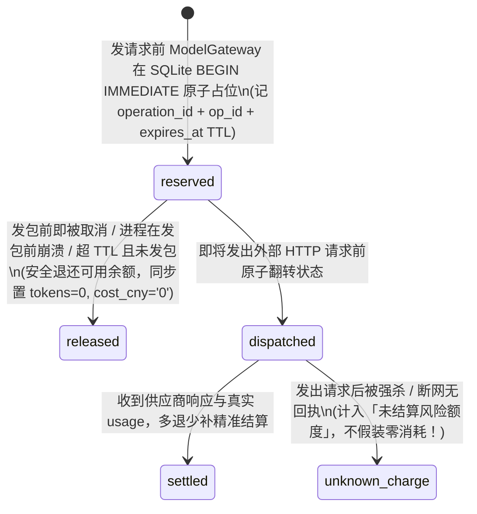

# 08 · 统一模型网关、五态费用控制与 Agent 审批权限设计（P0 核心治理）

- **优先级**：**P0**（基础统一 `ModelGateway`、隐私标签隔离与基础预算预留随 **2A `v0.8.2`** 上线；指令级预算护栏、`directive_budget_links`、五态预算状态机、三级路由与审批卡防重放随 **2B `v0.8.5`** 上线；全局多维资源中心与能力矩阵在三/四期完善）
- **核心目标**：用单一 `ModelGateway` 彻底堵死“模块绕过预算/重试/隐私检查私调模型”的口子；让免费池/弱模型稳健可靠；让付费模型每一分钱花得透明可控；让交互操作永远丝滑不被后台任务饿死；让 Agent 永远在人类审批边界内干活。

---

## 1. 统一模型网关（`ModelGateway`）、能力矩阵与隐私域隔离

### 1.0 全站唯一出口铁律：`ModelGateway`（基于既有 `provider_client.py` 演进，自 2A `v0.8.2` 起强制收口）
核对 [provider_client.py](../../../backend/integration/provider_client.py) 源码，现有 `ProviderClient` 已具备 `ofm_standalone` 端口自愈、`allowed_projects` 作品授权白名单、`token_saver_enabled` 提示词压缩拒绝、`free_pool` 0 价识别、`fallback_budget`（20 元回退预算封顶）、`provider_circuit` 熔断与 `EmptyModelStream` 保护。
新建的 `backend/integration/model_gateway.py` **绝不另起一套平行调用栈，而是作为 `provider_client.py` + `model_roles.py` 的统一门面与演进层**，完整继承 `v0.7.5` 全部免费池与隐私防压缩护栏，并强制全站 100% LLM 请求（主笔、精修、分诊 Triage、格式修复重试、主编路由/改令评估、审稿 D、记忆提取、全书扫描）一律经 `ModelGateway.invoke(...)` 发出：
1. **入站硬门禁**：校验 `op_id` 幂等上下文、供应商隐私分级标签、以及当前全局/单书暂停开关；
2. **发包前预算五态流转**：在 `BEGIN IMMEDIATE` 中先 `reserved` 占位，真正发起 HTTP 前翻转 `dispatched`，返回后精确 `settled`（断网/强杀记 `unknown_charge`）；
3. **统一限流退避、单步换模型与诊断采集**：支持 `override_binding` 单步临时换模型；429 冷却按供应商隔离并主动让出槽位；每次调用记录脱敏的执行诊断摘要（角色、模型、重试次数、耗时、估算 Token，**严禁在诊断字段留存原文或 API Key**）供任务卡折叠查看。

### 1.1 九维模型能力矩阵与隐私分级标签
突破现有仅按 A–E 角色绑定的静态配置，在 `providers` 元数据层引入可选的**9 维模型能力画像**与**强制隐私分级标签**（内置常见免费/主流模型默认画像，用户可微调）：

| 能力维度 | 典型调度用途 | 弱能力时的自动兜底策略 |
| --- | --- | --- |
| **1. 中文文学写作** | 主笔 B、精修 C | 优先分配高文笔模型；单模型下启用 Few-shot 示范范例补偿 |
| **2. 长上下文窗口** | 全书分析、长篇规划 A | 按窗口自动动态裁剪 `06` 五级记忆各层配额 |
| **3. 结构化输出稳定性** | 主编 E 编排 | 稳定性低的模型**自动锁定走 Level 1 确定性模板**，禁用开放自由 DAG |
| **4. 指令遵循精度** | 选区严格改写 C | 自动启用 XML 定界标签协议（`<replacement>`）+ 程序边界校验 |
| **5. 逻辑与因果推理** | 审稿 D、剧情影响分析 | 本地状态引擎先做硬核查，压缩问题清单再单次调用模型 |
| **6. 最大单次输出长度** | 整章初稿 B | 输出偏短的模型自动拆分为 2–3 场分段续写（复用 `scenes.py`） |
| **7. 流式输出支持** | 实时生成预览 | 支持流式则实时推片段；不支持时明确展示阶段与耗时（不伪造假百分比） |
| **8. 限速与并发度 (RPM/TPM)** | 并发槽位分配 | 触发 429 自动退避让出槽位，不卡死其他供应商任务 |
| **9. 单价与隐私域标签** | 成本控制与备用切换 | 严格遵循成本与隐私切换双红线（见下） |

### 1.2 安全降级与隐私隔离双红线
- **显式供应商隐私分级标签（防未发布原稿跨隐私域外泄）**：
  - `local_offline`（本机 Ollama / llama.cpp，零外发）；
  - `private_api`（作者自有付费/私有 API Key，无公共池共享）；
  - `free_pool_shared`（公共免费池通道）；
  - **硬红线**：任何自动备用切换/降级**只允许转向同等或更严格隐私级别**（`local_offline` 严禁静默切往 `private_api` / `free_pool_shared`；`private_api` 严禁静默切往 `free_pool_shared`），违者 `ModelGateway` 直接拒绝并提示用户手动授权。
- **4 种显式成本策略模式（绝不静默“免费切贵付费”）**：
  - **纯免费模式 (`free_only`)**：仅允许调度免费池/零成本本地模型，绝不触碰任何付费接口；
  - **免费优先模式 (`free_first`)**：优先免费池，免费池全线冷却/不可用时**默认暂停等待并提示用户，绝不未经授权自动切到昂贵付费模型**；
  - **质量优先模式 (`quality_first`)**：按角色与能力矩阵优选模型，备用切换须满足**隐私不降级、上下文容量达标且单价不超过原模型配置倍率**；
  - **自定义预算模式 (`budget_guarded`)**：按全局/作品/日/指令/模型五层预算硬控运行。

---

## 2. 任务优先级、交互保底槽位、三级暂停与执行诊断

彻底解决“定时自动日更 + 全书扫描/样本学习把 4 个并发槽位占满，导致作者划选一句话改稿干等几分钟”的体验痛点：

| 级别 | 任务类型 | 默认优先级 | 槽位规则 |
| --- | --- | --- | --- |
| **P0 交互快道** | 作者当前选区即时改稿 / A-B 双候选 | `100` | 可使用全部槽位（含交互专属保底槽） |
| **P0 交互快道** | 作者直接发送的主编对话 / `qa_lookup` | `90` | 可使用全部槽位 |
| **P1 主动创作** | 作者主动点击触发单章写作 / 规划 | `80` | 可使用全部槽位 |
| **P1 主动创作** | 当前交互所需审查 / 手改记忆同步 | `70` | 可使用全部槽位 |
| **后台配额池（P1 自动 + P2 批量）** | 定时自动日更（`60`）、后台记忆重建（`40`）、全书扫描（`30`）、示范样本学习（`20`） | `20–60` | **上述所有后台任务合计最多占用 `max_slots - 1` 槽（默认 ≤ 3 槽），始终为 P0 前台交互预留 ≥ 1 条专属快通道** |

- **防饿死老化机制**：处于 `queued` 状态的后台任务，每等待 `60 秒` 有效调度分 `+5`（上限 `75`，不超过 P0 实时交互，且**绝不突破交互保底槽红线**），确保后台任务在繁忙期仍稳步推进；
- **细粒度三级暂停控制**：支持**① 单任务暂停/取消**、**② 单作品自动任务暂停**（`POST /api/projects/{id}/automation/pause`，冻结该书日更与批量，不打断作者手写与其他书）、**③ 全局 AI 急停**（`POST /api/system/ai/pause`，一键冻结全站新派发）；
- **任务卡可折叠「执行诊断详情」**：每张任务卡默认保持极简视图，展开可查看当前角色、实际命中模型、重试次数、排队原因、耗时与脱敏错误（0 原稿、0 密钥），帮作者秒级判断是限流、弱模型重试还是预算触发。

---

## 3. 三级主编路由、实时生成预览与单步换模型重改

### 3.1 三级主编路由（省钱、降延迟、扛弱模型）
1. **Level 0 · 本地确定性路由（0 主编调用）**：
   - 明确的操作指令（“停掉第 2 章任务”“打开第 5 章”“保存草稿”“执行本章全部批注”“看看现在花了多少钱”）由本地规则解析器直接执行；
   - 明确的 `@精修`/`@审稿` 且目标与指令完整时，直接直达对应角色，不绕道主编多花一次调用；
   - 考据类只读提问（“第 3 章老地图最后落谁手里了？”）走 **`qa_lookup`**，直查 `06` 世界状态与本地 FTS5 索引回答，**不创建 `agent_directive` / DAG、不污染右侧任务看板**。
2. **Level 1 · 意图槽位 + 6 大确定性工作流模板**：覆盖开书建档+细纲+试写、规划续写、选区 A/B、单章批注、全书改设定、排期预览六大高频场景，弱模型/免费池也能稳定跑通。
3. **Level 2 · 受限自由 DAG 编排**：仅开放复合指令触发，受受控工具白名单、环检测、`MAX_DAG_NODES = 12`、递归深度 `≤ 2` 与 2 次纠偏降级保护。

### 3.2 生成过程实时预览与中途干预（不盲等 4000 字）
- 主笔写正文或精修大段改写时，通过瞬态 SSE 通道向创作室/任务卡推流实时片段（隔离渲染在「实时生成预览区」，绝不污染正式正文与草稿）；
- 展示**真实已生成字数、已消耗 Token 与当前执行阶段**（如「正在起草第 2 场 · 已写 1,920 字 / 目标约 3,000 字」），**绝不伪造不准确的百分比进度**；
- 预览区提供三个即时干预按钮：**[停止并丢弃]**、**[停止并保留已生成内容为草稿]**、**[停止并追加一句指令继续写]**。

### 3.3 单步临时换模型重改（不改全局设置）
- 精修候选卡、A/B 对比卡或失败任务卡均提供下拉按钮：**「换模型重改此步」**（列出用户已配置的可用付费/强模型或免费池其他模型）；
- 仅对本次单步任务覆写 `override_binding`（附带单次费用预估确认），不修改全局 A–E 路由配置，实现“平时免费池省钱铺量，关键高潮段一键唤强模型精修”。

---

## 4. 五态预算状态机与全局资源消耗中心

### 4.1 二期 2B 同步上线的最低限度指令护栏（可由作者调整）
| 护栏项 | 初始默认值 | 作用 |
| --- | --- | --- |
| 单条指令最大模型调用次数 | `20 次` | 防止未定价模型或重试循环无限消耗 |
| 单条指令最大自动连续生章数 | `3 章` | 防止一句话误触发一口气写几十章 |
| 单次格式纠偏重试次数 | `1–2 次` | 防止弱模型死循环纠偏 |
| 自动审查轮数封顶 | `2 次` | 坚守 `v0.7.5` 防卡死红线 |
| 单条指令最大 DAG 节点数 / 递归深度 | `12 节点` / `2 层` | 防止无限嵌套派活 |
| 单条指令 Token / 人民币上限 | 按用户配置 | 硬性资金封顶 |

### 4.2 五态预算状态机（与 `05` §1.2 严格统一 + `costs.py` 实装修补）

- **针对现有 [costs.py:195-235](../../../backend/integration/costs.py#L195-L235) 的两项必改修补**：
  1. 现有 `reserve_request()` 在用户未设全局/项目上限时直接 `return None` 跳过预留 → 改造为**只要传入指令级护栏（如 `max_calls=20`、`directive_budget_cap`）即强制进入原子预留**，避免默认配置绕过 2B 指令护栏；
  2. 现有 `costs.py:208` 统计未过滤 `state` → 新版查询强制过滤 `WHERE project=? AND state != 'released'`，且状态转为 `released` 时**同步将 `tokens=0, cost_cny='0'`**，确保回滚至 `v0.7.5` 时旧版 `costs.py` 也不会把已释放预留误计为已花费；继续沿用 `costs.record_gap()` 独立 `.gaps` 断记告警。
- **五层预算视图（全局模型资源与预算中心）**：在「4. 模型与系统」升级展示全局 / 单作品 / 今日 / 单条指令 / 单模型五层账本，明确拆分四项数字：**已结算金额**、**执行中预留**、**未结算风险额度（`unknown_charge`）**、**可用余额**；未配置单价的模型单列 Token 与请求次数并醒目标注**「含未定价模型（费用未知）」**，且强制支持通过 Token / 调用次数硬封顶管控。

---

## 5. 审批卡版本绑定、防重放与过期契约

所有落入 `agent_approvals` 的高风险审批（全书批量改稿、大纲重置、预算续跑、对外发布授权、中途改令范围确认）必须满足以下不可绕过契约：

```json
{
  "approval_id": "apr_81f2c9",
  "project_id": "p_01",
  "directive_id": "dir_9f2a1c",
  "directive_revision": 3,
  "kind": "book_scope_confirm | publish_authorize | budget_resume | amendment_confirm | outline_reset",
  "artifact_fingerprint": "sha256(相关章节 version_fingerprint 或大纲 revision 集合)",
  "approved_scope_hash": "sha256(受影响章节列表 + 目标模型 + 预算上限 + 操作参数)",
  "expires_at": "2026-11-26T22:00:00+08:00",
  "status": "pending | approved | rejected | expired | superseded",
  "resolved_by": "author"
}
```
- **执行前五重校验**：作者点击「批准」（客户端携带 `op_id` 经 `idempotency_keys` 幂等防双击）后，后端在执行实际副作用前二次核验：① 审批仍为 `pending` 且未过 `expires_at`；② `directive_revision` 未被新改令推进；③ 目标作品当前 `artifact_fingerprint` 与审批生成时一致（期间作者若手改了正文/大纲/换了模型或改了预算，立即拒绝执行旧审批卡并生成新审批卡）；④ `approved_scope_hash` 完整匹配本次待执行参数；⑤ 请求身份必须来自作者会话（严禁任何 Agent/Worker 伪造审批提交）；审批一旦消耗立即置为 `approved`（防重放双击二次触发）。
