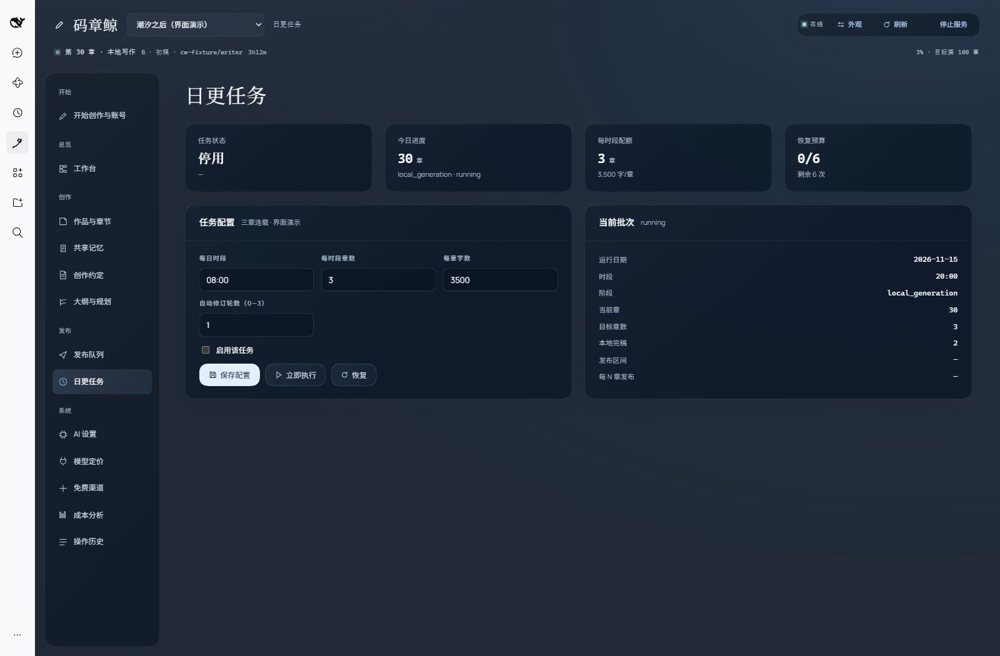

# 从首次安装到无人值守连载

这份指南按实际操作顺序，帮助你把码章鲸配置成一项能按计划自动写作和发布的任务。首次完成模型与账号授权之后，后续正常运行无需逐章点生成、逐章点发布。

[返回项目首页](../README.md) · [查看实机图](screenshots.md)

## 1. 安装并启动码章鲸

当前公开包（`0.7.1` 起）支持 **Windows 10/11 x64** 与 **macOS（Apple Silicon / Intel）**，要求 DSH ≥ 0.2.2-rc.1。

1. 打开 DSH 的插件管理，添加 npm 包名 `dsh-chapter-whale`。
2. 安装后重启 DSH。
3. 从侧栏打开「码章鲸」，点击「开始使用码章鲸」，等待本地环境准备完成。

使用 `dsh web` 的用户，也可以在终端执行：

```powershell
dsh plugin --profile web add dsh-chapter-whale
```

安装后重启 `dsh web`。自定义 profile 将 `web` 换成实际名称；桌面版请在应用内安装，避免装到另一个 profile。

- **Windows 首次启动**：npm 包自动从 GitHub Releases 下载并校验固定的 Python 与 Chromium 运行环境（完整包则直接随包解出）；已有同 `buildId` 运行时直接复用。
- **macOS（arm64 / Intel）首次启动**：自动检索本机 Python 3.11+（优先 `/opt/homebrew/bin/python3`、`/usr/local/bin/python3`、Python.org `/Library/Frameworks/Python.framework`、`pyenv`），在 `~/Library/Application Support/ChapterWhale/workspace/.venv` 创建隔离虚拟环境并安装 `deploy/macos/requirements-macos.txt` 中的后端依赖。若尚未安装 Python 3.11+，请先执行 `brew install python@3.13` 后重启 DSH。若在 Mac 上需要使用浏览器发布，在终端补装一次 Chromium 即可：
  ```sh
  "$HOME/Library/Application Support/ChapterWhale/workspace/.venv/bin/python3" -m playwright install chromium
  ```
- **macOS 能力边界提示**：免费额度独立服务（OFM）强依赖 Windows DPAPI，在 macOS 上不会启用；建议直接使用「自动接入 DSH 已登录模型」或自定义 API Key。

也可在 DSH 插件管理中添加从[最新 GitHub 发布页](https://github.com/thus-zhou/dsh-chapter-whale/releases/latest)下载的 `.tgz` 文件（Windows 提供轻量包与内含运行时的完整包；macOS 直接安装 `dsh-chapter-whale-<版本>.tgz`）。

首次启动时会准备运行环境，已有相同运行时的工作区可直接复用。

### 从 npm 下载文件与后续更新

只下载 npm 压缩包：

```powershell
npm pack dsh-chapter-whale@latest
```

把生成的 `.tgz` 文件添加到 DSH 插件管理即可，首次启动仍会准备运行环境。普通 `npm install` 只是把依赖放进当前 Node 项目，不会自动注册到 DSH。

桌面版在应用内检查更新；web profile 可执行：

```powershell
dsh plugin --profile web update dsh-chapter-whale
```

更新后重启对应的 DSH。旧版宿主升级未生效时，可在插件管理中显式添加 `dsh-chapter-whale@latest`。作品、登录信息和任务保存在 `%LOCALAPPDATA%\ChapterWhale\workspace`（Windows）或 `~/Library/Application Support/ChapterWhale/workspace`（macOS），建议更新前备份。

### 两个入口，使用同一份数据

| 入口 | 主要用途 |
| --- | --- |
| DSH 侧栏「码章鲸」 | 六大顶栏工作区（工作台 / 创作室 / 记忆与洞察 / 发布与排期 / 日更与运行 / 模型与系统），含书卷阅读预览、A–E 进度、风格预检、实体/检索洞察与外观控制台 |
| 本机完整管理页 | 同套 Liquid Glass 界面的本地独立控制台，补充免费额度渠道服务操作、设备配对与完整任务/排期编辑 |

**启动插件后**，在浏览器打开完整管理页：

```text
http://127.0.0.1:18765
```

这是你自己电脑上的工作台，与侧栏使用同一个后端。如果自定义过端口，请使用自己设置的地址。

## 2. 先准备作品和故事方向

在「开始创作与账号」中填写书名、题材和故事想法，创建作品。

随后完善「创作约定」：

- 故事题材和面向的读者。
- 核心前提、主角、主要人物关系。
- 想要的文风、叙事视角和节奏。
- 希望长期遵守的限制，以及已有大纲。

这些内容会为后续自动写作提供方向。清晰的设定和规划有助于连载保持连续性；后面也可以继续调整，并通过共享记忆查看设定、已发生事实和创作偏好。

## 3. 连接可用模型，并登录发布账号

### 直接使用 DSH 模型

DSH 已登录或已配置模型时，码章鲸会自动接入；首次使用会选择 DSH 当前模型，无需再次填写密钥。

打开「AI 设置 → 模型与角色」可更换通用模型。勾选「分别设置 A–E 模型」后，可单独选择规划、初稿、润色、审查和执行模型。更换宿主登录或当前模型后，点击「使用 DSH 当前模型」，再保存选择。保持 DSH 运行即可用于写作任务。

### 使用独立 API 服务

在本机完整管理页的「AI 设置」中配置接口地址、模型和密钥，保存后执行连接检查。侧栏可切换已保存的供应商和模型。

支持 OpenAI 兼容接口。先选自己已经可用的模型跑通流程，再按需要细分规划、写作、润色与审查阶段。

### 使用其他厂商账号或免费额度模型

1. 打开本机完整管理页。
2. 进入「AI 设置 → 免费额度接入」。
3. 点击「启动独立渠道服务」。
4. 在支持的渠道中完成账号授权。扫码、验证码和部分本机回调登录需要你本人操作。
5. 刷新状态与模型，确认这次登录实际提供了哪些模型和额度。
6. 如果使用「免费渠道池」，选择模型，确认额度类型，选择授权作品，再保存配置。
7. 在模型配置中选用对应的可用连接或已保存的免费池。

页面提供 CodeArts、WorkBuddy、Qoder、TRAE 等渠道入口；不同渠道的登录要求和模型权限分别生效。部分渠道需要额外配置自己的授权信息。页面列出渠道，并不意味着每个账号都自动获得可用额度。

免费池可以按配置尝试已选入的模型；是否使用付费备选，由你单独配置。模型服务商的计费与额度规则照常生效。

### 登录番茄账号

1. 在「开始创作与账号」填写一个便于识别的账号备注名。
2. 点击「打开番茄登录窗口」，在弹出的本机浏览器中自行扫码登录。
3. 进入作家后台后，回到码章鲸完成登录核验。
4. 在番茄作家后台先创建对应作品，确认实际平台书名。

码章鲸中的本地书名和番茄平台书名可以分别配置。创建日更任务时，要选对本地作品、发布账号与平台作品。

## 4. 创建自己的日更任务

在本机完整管理页进入「日更任务」，点击「创建日更任务」。

下面是一套便于理解的示例配置，书名和账号请换成自己的实际内容：

| 设置 | 示例 | 执行含义 |
| --- | --- | --- |
| 任务名称 | 每天两次更新 | 在任务列表中辨认计划 |
| 本地作品 | 自己已创建的小说 | 从这部作品的规划和正文继续推进 |
| 番茄书名 | 作家后台的对应书名 | 确定实际发布目标 |
| 账号 | 自己已登录的账号 | 确定提交发布的身份 |
| 每日更新时间 | `08:00, 20:00` | 每天两个独立执行时段 |
| 每次章节数 | `1` | 每个时段计划推进 1 章 |
| 每章目标字数 | `3500` | 写作时使用的篇幅目标 |
| 时区 | `Asia/Shanghai` | 按北京时间安排执行 |
| 修订轮数 | `2` | 审查后允许继续修改的轮数 |

时间、章数和字数是任务参数；实际章节内容与发布结果可在运行后查看。先从较小的更新量开始，便于确认自己的模型和账号能完整跑通。



### 两个开关都要打开

保存任务后，分别检查：

1. **任务已启用**：这部作品允许按该计划执行。
2. **自动调度已开启**：完整管理页「日更任务」顶部的全局开关已打开。

只保存任务，或者只打开其中一个开关，都不会构成完整的自动运行设置。全新安装默认关闭自动调度，账号和任务也不会从开发者电脑带入。

## 5. 先跑通一次，再交给自动计划

确认模型、账号和平台作品都已就绪后，可以在任务中点击「立即执行」。这会调用你配置的模型，并在满足条件时执行真实发布。

一次任务会按配置推进写作、审查与修订，检查章节资格和来源，随后入队、提交并核验发布状态。正常运行时，不需要再为每章分别点击生成或发布。

你可以这样查看结果：

| 页面 | 重点查看 |
| --- | --- |
| 工作台 | 当前章节、任务进度、批次状态、待发与已发情况 |
| 作品与章节 | 生成的正文、字数、审查状态，需要时手动调整 |
| 发布队列 | 已核验发布、未确认或需要继续核验的记录 |
| 日更任务 | 执行时段、运行状态、当前批次、暂停与恢复 |
| 操作历史 | 执行过程、失败原因和可继续处理的线索 |

平台发布核验与平台内容审核是两个不同环节，仍需遵守平台规则。

## 6. 让它无人值守运行

首次流程跑通后，保持任务和自动调度启用，电脑、DSH 与本机后端持续运行。码章鲸会在任务时间到来时继续执行计划。

你可以随时：

- 在侧栏看进度，而不用守着每次生成。
- 暂停某项任务或暂停全局自动调度。
- 修改后续更新计划、模型和修订设置。
- 阅读或调整已经保存的章节。
- 查看中断原因，再恢复允许继续的批次。

模型额度用完、网络不可用、账号授权失效或平台要求验证码时，需要先恢复相应条件。遇到发布结果未确认时，先查看平台与本地记录，再决定恢复操作。

## 常见排查

### 管理页打不开

先确认侧栏已经启动码章鲸。默认地址为 `http://127.0.0.1:18765`；如果自定义了插件端口，以实际配置为准。

### 任务到点没有启动

依次检查任务启用状态、全局自动调度、时区和时间，然后看操作历史中的模型、账号或运行状态提示。电脑休眠、关闭服务或关闭 DSH 后，不能继续按原计划保持运行。

### 厂商账号登录了，仍没有可用模型

确认该渠道返回的授权、模型权限与额度，刷新模型列表。部分渠道有额外授权信息要求。`0.7.0` 演示图在隔离环境中截取，展示的渠道数与未连接状态不代表你个人环境内的实际绑定。

### 章节已经生成，但没有发布

查看审查结果、发布资格、目标账号、平台书名和发布队列。正文落盘、任务退出和平台已核验发布分别有自己的状态。

### 更新插件前怎样备份

备份以下工作区，里面包含本机作品、账号和配置：

```text
# Windows
%LOCALAPPDATA%\ChapterWhale\workspace

# macOS
~/Library/Application Support/ChapterWhale/workspace
```

不要把这个目录中的账号登录态、密钥配置或私人作品提交到公开仓库。反馈问题时，请提供脱敏后的错误提示或截图。

---

[下载最新发行包](https://github.com/thus-zhou/dsh-chapter-whale/releases/latest) · [返回项目首页](../README.md)
