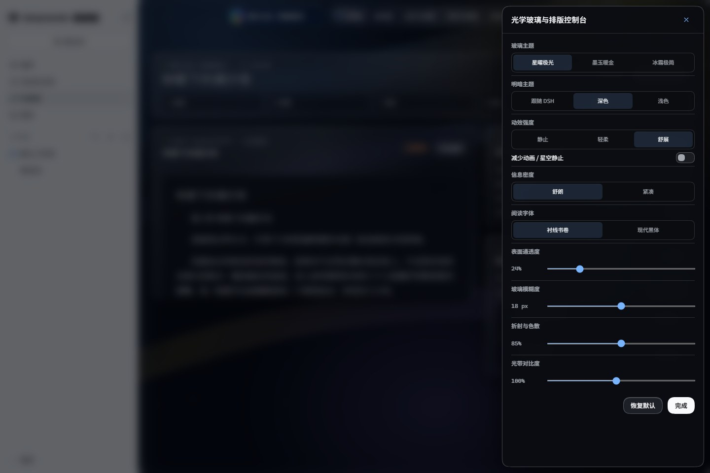
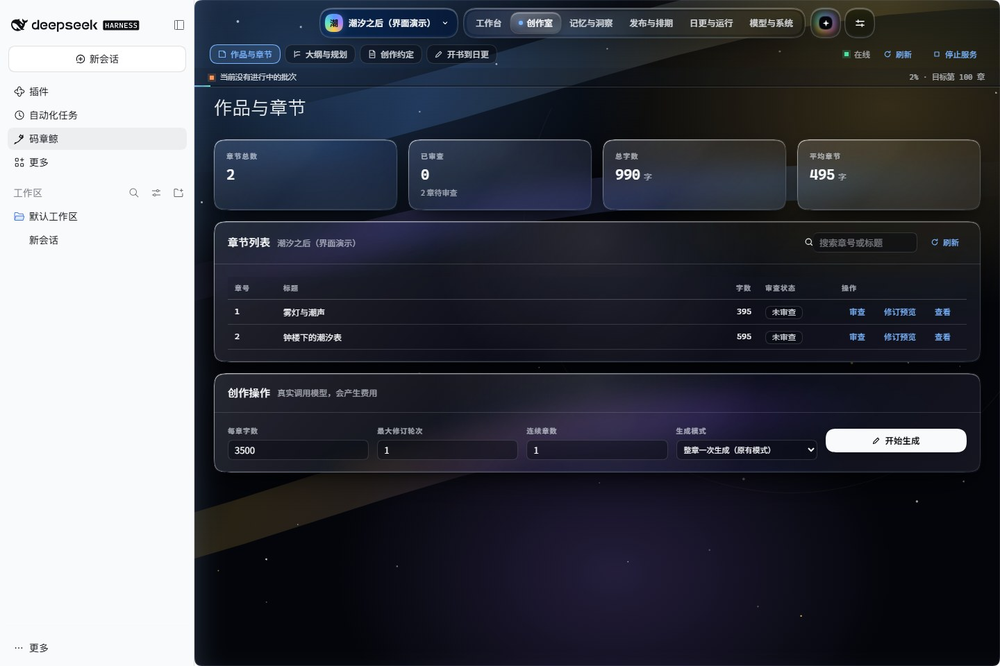
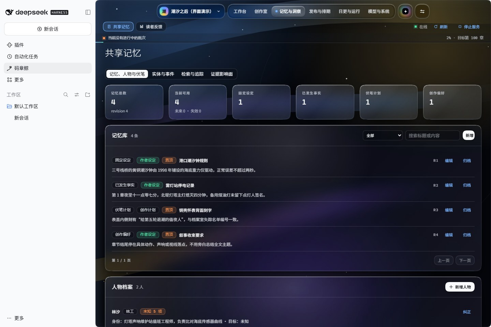
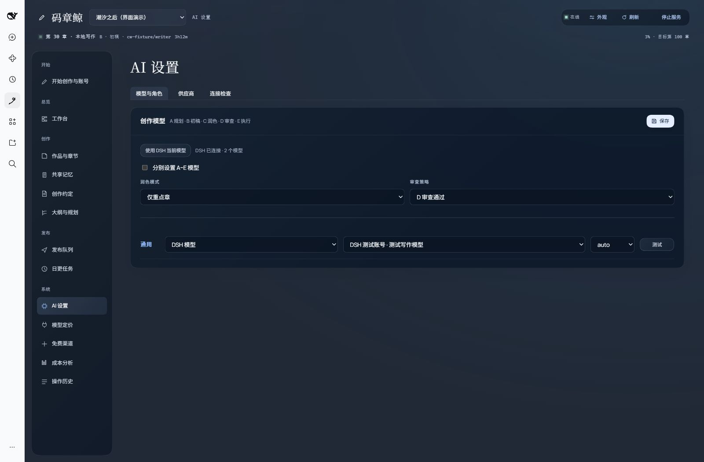

# 码章鲸 0.7.0 界面演示

以下图片均从 `0.7.0` 正式插件在 DeepSeek Harness `0.2.2-rc.3` 完全隔离环境中直接截取（`DSH_HOME` 与工作区均独立隔离，不含任何个人对话或登录态）。使用合成示例作品《潮汐之后（界面演示）》与停用演示任务；自动调度关闭，没有调用真实模型、登录发布账号或发布章节。

[返回首页](../README.md) · [上手指南](quickstart.md) · [0.7.0 验收记录](retest-0.7.0.md)

## 工作台 · 深色（星曜极光）

顶部 3 岛悬浮液态玻璃胶囊切换六大工作区；A–E 流程条、护眼磨砂稿纸正文直览、章节遥测虚线引线与队列/最近章节集中呈现。

## 工作台 · 浅色

浅色主题与 DSH 宿主左侧栏柔冷衔接，保证高亮墨色对比度与磨砂正文可读性；阅读区支持衬线书卷与现代黑体即时切换。

## 光学玻璃与排版控制台

右侧全高玻璃抽屉控制台支持「星曜极光 / 墨玉暖金 / 冰霜极简」三套主题、深浅切换（含跟随 DSH）、动效强度与星空静止开关、信息密度、阅读字体，以及表面通透度、玻璃模糊度、折射色散和光带对比度四项实时调节。

## 作品与章节

按章统计总章数、审查状态与字数，支持正文审校预览、修订触发与自定义字数/轮次生成参数。

## 日更任务与排期缓冲

集中展示任务状态、每日时段、每时段配额、恢复预算、投递模式与当前批次状态，并内嵌 `0.6.1` 排期缓冲与运行通知页签。

## 共享记忆与长篇连续性

集中管理固定设定、已发生事实、伏笔计划与创作偏好条目，新增「实体与事件」「检索与追踪」「证据影响面」页签与人物档案卡片。

## 创作约定

作者确认的题材基调、目标读者、核心前提、主要人物、文风与叙事视角，写入作品共享约束并在写作与审查阶段优先遵循。

## 模型与角色

自动桥接 DSH 已登录模型，保留通用模型配置与 A（规划）– E（交付）分角色独立模型及润色/审查策略。

## 免费渠道（隔离未登录示例）

展示支持渠道目录、网关状态与账户/可用模型计数。隔离环境中所有渠道均为未登录状态（`已连接 0`）；实际支持的登录与额度以各渠道当期返回为准。

