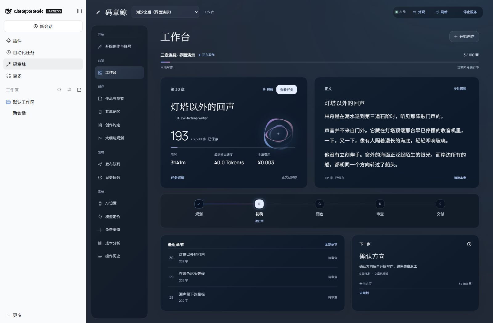
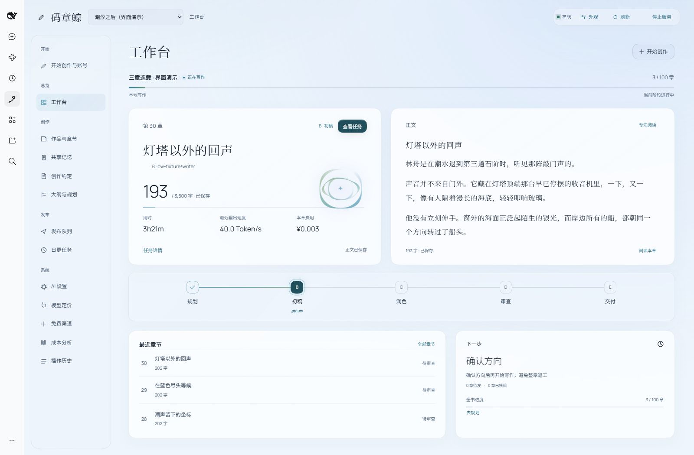
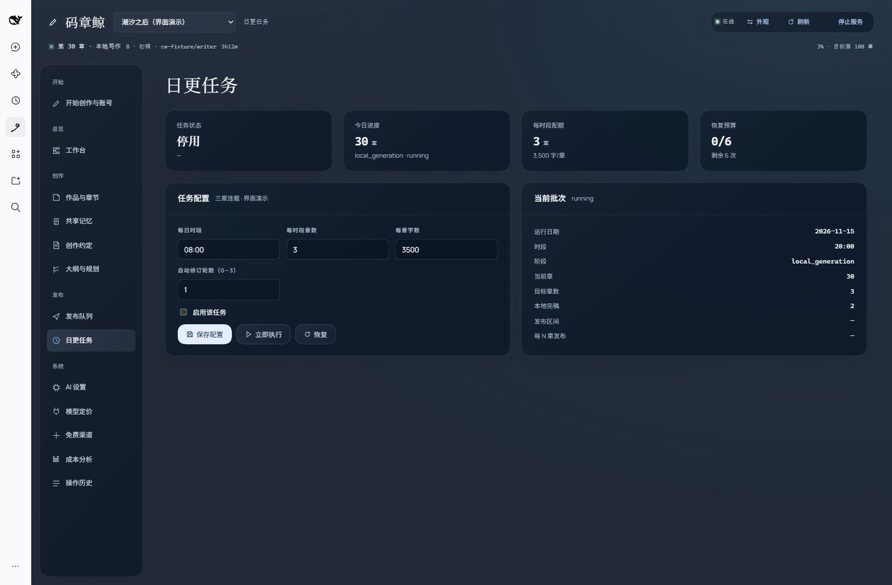
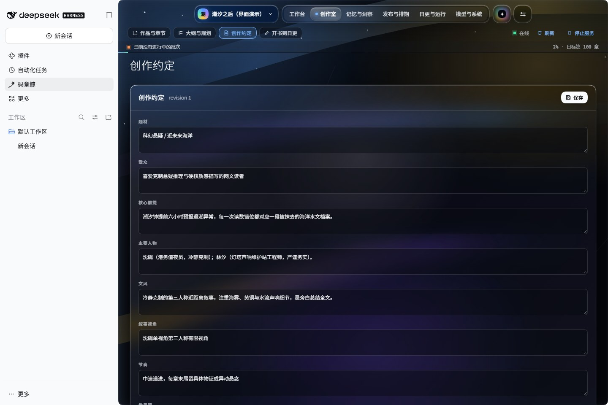
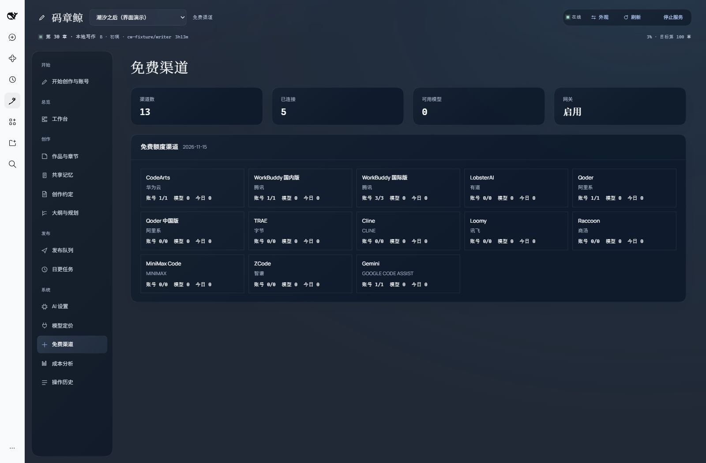

# 码章鲸 0.5.0 界面演示

以下图片均从正式插件在 DSH 0.2.2-rc.1 独立环境中直接截取。使用示例作品「潮汐之后（界面演示）」、测试模型和预置任务快照；自动调度关闭，没有调用真实模型、登录发布账号或发布章节。图中的任务进度与用量用于展示界面，不作为生成效果或发布结果证明。

[返回首页](../README.md) · [上手指南](quickstart.md)

## 工作台 · 深色

当前任务、已保存正文、五阶段进度线与最近章节集中呈现。缺少可靠依据时不显示预计剩余时间。

## 工作台 · 浅色

可跟随 DSH，或在插件中独立选择主题；正文可切换黑体和宋体。

## 外观与动效

蓝紫、海洋两套配色，三档炫彩与动效，信息密度、阅读字体、内容遮罩和减少动画设置自动记住。

## 模型与角色

直接选择 DSH 已配置模型，并保留通用模型与 A–E 独立分工。图中使用测试适配器。

## 作品与章节

按章查看字数、正文、审查、修订与版本。

## 日更任务

时间、章数、篇幅与恢复入口。演示任务已停用，运行快照仅用于界面展示。

## 共享记忆

示例固定设定与人物档案，支持编辑与检索。

## 创作约定

集中保存题材、故事前提、人物与文风。

## 免费渠道

展示渠道目录与未登录状态。登录方式、可用模型和额度以各渠道返回为准。

