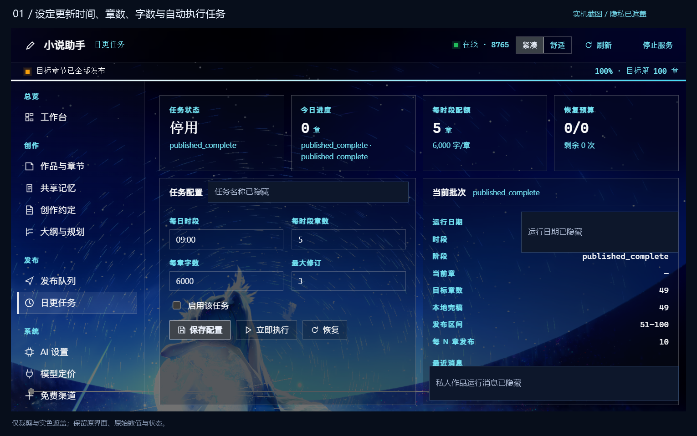
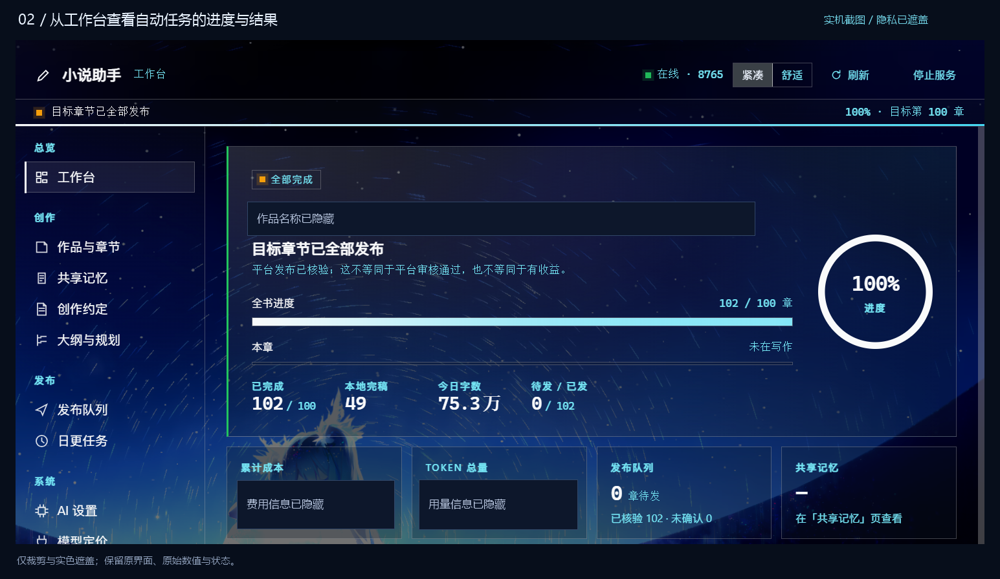
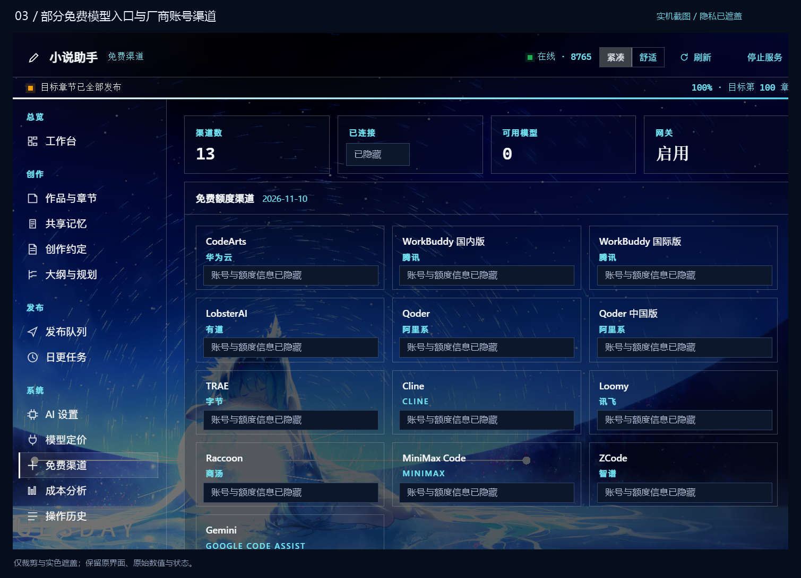
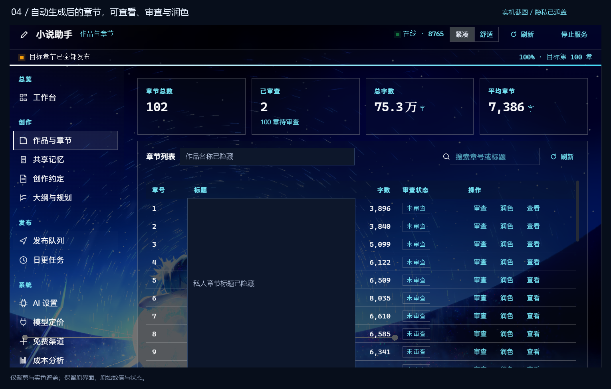
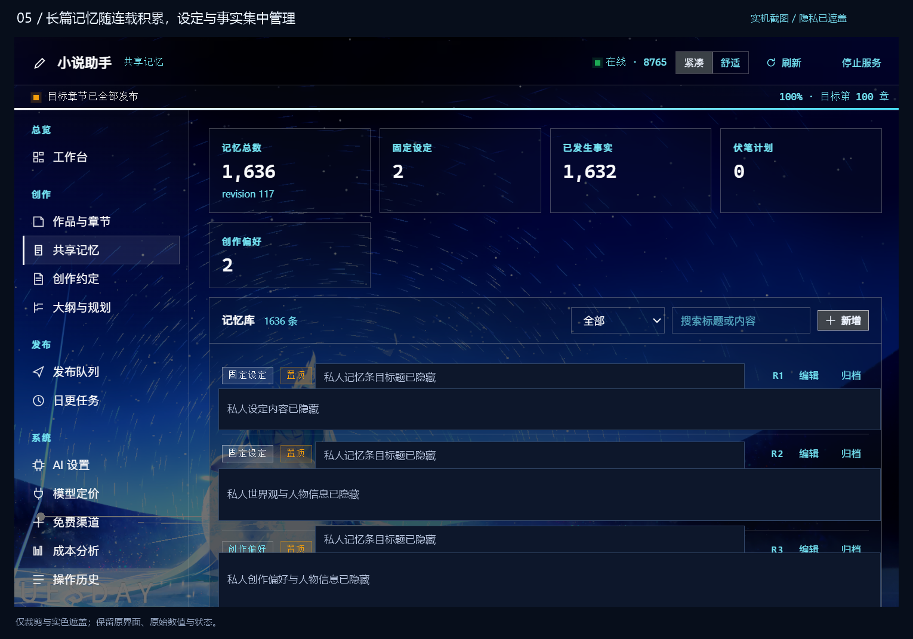
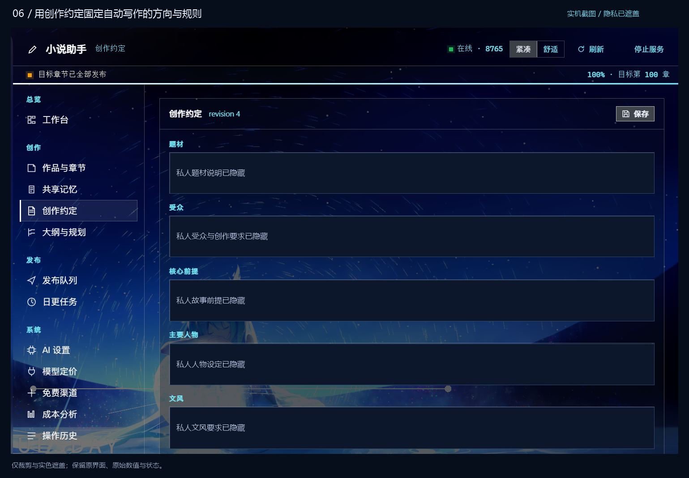
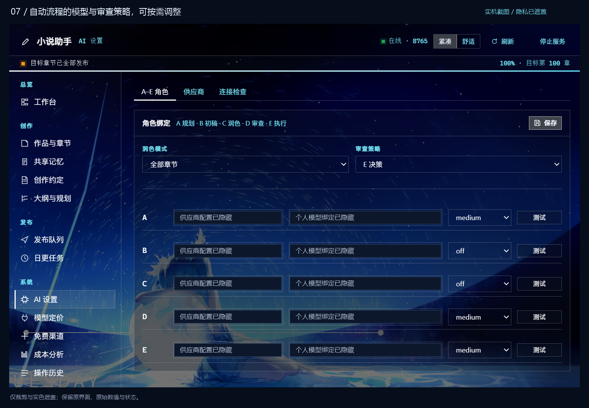

# 码章鲸实机使用图

这里的七张图片来自作者提供的实际使用截图。处理方式为本地裁剪和不透明区域遮盖，没有使用 AI 重绘界面，也没有把原始数值或任务状态改成宣传数据。

隐藏范围包括作品名、章节标题、故事内容、人物设定、私有记忆、本机路径、费用与用量、账号及额度情况、个人模型绑定和运行消息。截图中的旧名称「小说助手」、个性化背景和当时的任务状态予以保留；当前公开名称为「码章鲸」，默认界面随 DSH 主题显示。

[返回项目首页](../README.md) · [查看自动连载教程](quickstart.md)

## 01 · 自定义日更任务，让写作与发布按计划执行

任务页展示更新时间、每时段章数、每章目标字数、修订设置和执行控制，以及当前批次与发布区间。

这张图拍摄时，任务已结束并处于停用状态。它展示的是实际任务配置和完成后的记录。

## 02 · 工作台，集中查看自动任务的进度与结果

在一个页面看到作品进度、任务结束状态、发布队列和成本栏目。图中的费用与用量已隐藏；项目规模保留为当时的真实界面记录。

## 03 · 部分免费模型与厂商账号渠道

渠道页集中展示厂商入口、连接情况与模型状态。账号和额度信息已遮盖。完成支持渠道的授权之后，可按实际可用情况配置模型；完整管理页提供登录与免费池操作。

图片展示渠道入口，不代表每个渠道、每个账号都提供相同的登录方式或免费额度。

## 04 · 自动生成后，章节仍可查看、审查和润色

章节列表保留了章号、字数、审查状态和操作按钮，作品名及私人章节标题已隐藏。自动运行结束后，仍然可以打开正文，按需要进一步检查或调整。

## 05 · 持续连载需要持续积累的记忆

共享记忆将固定设定、已发生事实、伏笔和创作偏好分开管理，支持搜索、编辑、置顶和归档。截图保留了千条级记忆的界面记录，私人设定与人物内容已遮盖。

## 06 · 用创作约定固定方向

题材、受众、故事前提、主要人物和文风集中保存，作为自动写作时的创作要求。私人的故事与文字已遮盖，字段和界面结构保留。

## 07 · 按需要调整自动流程的模型与审查策略

模型配置是自动执行流程的辅助设置。可以逐步调整各阶段连接、润色模式和审查策略；截图中个人的供应商选择与模型绑定已隐藏。

---

图片反映个人使用环境中的界面与状态。公开版本的首次配置、厂商登录和任务创建步骤见[从首次安装到无人值守连载](quickstart.md)。
